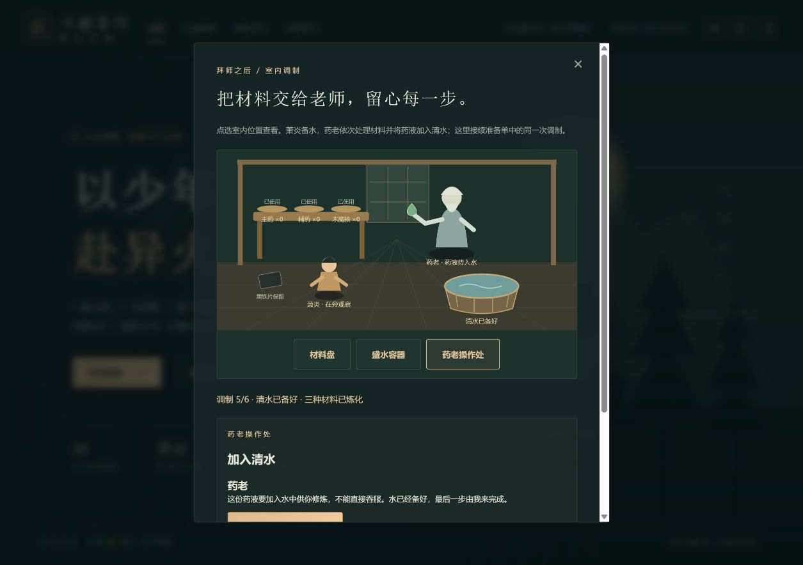
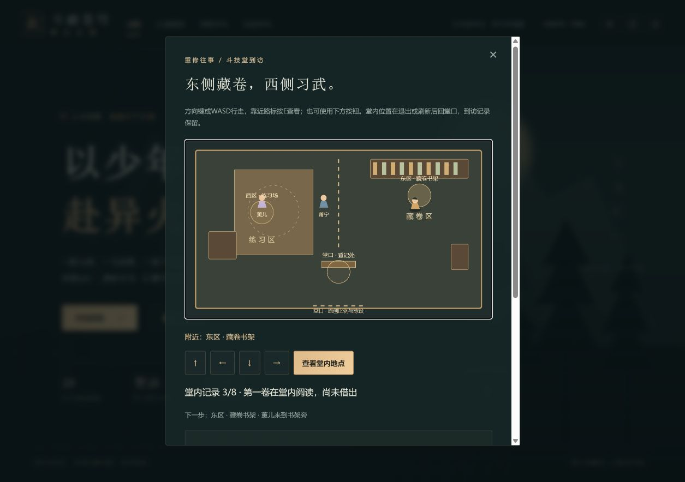
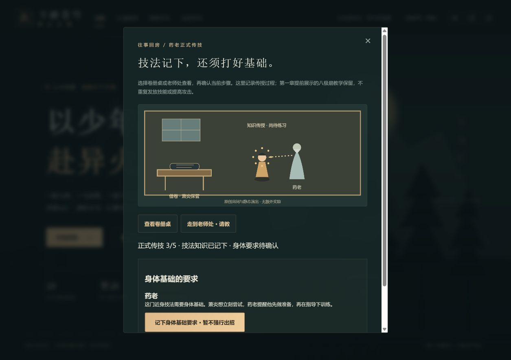

# 斗破苍穹 · 异火之路

浏览器单机剧情动作 RPG。以原创对白和程序绘制场景，改编从乌坦城到双帝之战的主要冒险线。当前版本为 **0.78.1：同行与实际离堂 Alpha**。28章压缩主线各有专属地图和机制，普通难度同一空白新旅途已通过28章真实网页首通；七线24页原创伙伴书简另有连续网页记录。拜师前接待厅入席与公开请求17步、补偿交涉15步、文书与三年赴约及双方离厅33步均可独立保存，离厅后切为旁观焦点；后山21步可实际行走、定位声音、核流失问答与同一古戒浮空返回，援助谈判、本人拜师、准备返戒、当晚来访/晨间交卡、同行药铺、入坊巡卫、分路寻核与放回手链均已独立交付；街角28步分别保存拦路、未交蓝金手链和普通绿链接取/戴上/致谢。早期重修从采购、传技、寄售到成人礼可独立保存，功法阁已实现入阁、门障、卷轴保管与同行援助。

支持沿路行走、手动战斗、三场景终战、自动与手动存档、JSON备份与导入、多标签冲突和较新档写保护、防剧透回顾、模块失败恢复、按需加载与发行包指纹。控气、控火和心念在减弱动态下使用键盘滑杆，动态模式可明确暂停与继续，暂停禁止锁定。详细功能和实际验证边界见[版本验收](docs/版本验收.md)。

完整原著人物事件、中文正版与当前动画逐集来源、真实设备及玩家Beta、历史存档回退根因、授权素材与公网发行仍继续推进。28章压缩主线完成不代表全剧情与全周期验收完成。

项目仓库：`git@github.com:remixjc/doupocangqiong-webgame.git`

## 文档

- [全周期开发计划](docs/全周期开发计划.md)：产品范围、全主线章节、阶段交付与发布维护。
- [开发进度](docs/开发进度.md)：阶段状态、验证记录、后续工作。
- [初始游戏方案](游戏方案与AI制作计划.md)：最初设计与技术分析。
- [AI 分批制作手册](docs/AI分批制作手册.md)：每批输入、实施步骤、验收及扩展任务。
- [运行与发布](docs/运行与发布.md)：操作、存档、静态部署、回滚和维护。
- [版本验收](docs/版本验收.md)：实际测试证据与尚未验证的项目。
- [成人礼来源与实施细单](docs/成人礼来源与实施细单.md)：已核训练/预测/仪式/两轮挑战事实与后续可玩依赖。
- [素材来源](docs/素材来源.md)：原创资源、故事来源及依赖记录。
- [剧情来源复核](docs/C0b来源复核任务卡.md)：正文/出版目录/动画证据与完整事件缺口。
- [传技与成人礼任务卡](docs/C1e传技与成人礼任务卡.md)：斗技堂、持续训练、首次寄售、预测与正式仪式的后续批次。
- [连续网页验收记录](docs/C1d连续网页验收记录.md)：全新旅程当前检查点与未完成项目。

## 当前可玩内容

28 章按顺序解锁；探索、采集、即时战斗、四类敌人、四种首领模式、三阶段危险预警、营地与重试、炼药、坊市、装备强化、四种主线异火、药老支援、终局尾声。

支持键鼠、手机横屏摇杆、本地自动存档、三个手动存档、JSON 备份和动画防剧透设置。运行时不需要服务器账号或 AI 服务。

前三章采用独立后山、萧家院落与坊市地图，加入药老木桩教学、三处立约路线和议价供货。第二、三章以事件作为主要目标，普通战和采集用于补充资源。第四章独立洞穴中，与小医仙接取探索、读石刻、按叶 / 月 / 火解开实体封门、领取一次性材料宝匣并返程，再完成归途试炼。第五章独立山谷保护采药同伴，双方到达两处药圃再返营；随后在紫色警戒区躲避落焰24秒，从西侧安全撤离，不击杀狮王。第六章独立公会提供练习材料，读取35% / 60% / 50%火候、通过三步控火认证并登记审核；免费重试，认证奖励与普通丹药生产分别结算。第七章石漠城读取青鳞线索，清除囚栏守卫解救两位团员、打开巷门并回报萧鼎；已解救节点刷新保留。第13–28章的专属机制继续逐批深化。小说全部支线、后续专属地图及逐集动画演出列入扩展计划。动画最新集数未核实，剧透上限由玩家自行设置。

第三章供货完成后到测试石锁定三道斗气，合计 180 分通过，失败免费重试。采购商的竞争委托提供稳妥供货和精品考察两条不同成本 / 收益的路线，是可选支线。关闭与刷新保留事件进度。

第八章独立地底火域与蛇人巡逻投影：守卫沿路线走动、掩体阻挡视线，持续暴露积累警戒，警戒满后追击，营地可脱离。药老委托中确认入口退路，在控火坛启动追踪落焰 / 交替火脉 / 大范围回涌三段挑战，每段12秒；火域增温、青色冷却点降温，100热量失控后可休整重试当前阶段。返回药老确认、收服台交互和营地首通结算后才获得青莲地心火，不需重复采草杀怪。旧档检查旧目标后迁移，不补发奖励。C3机制已交付，完整伙伴支线仍留C10，自动接续C4。

第九章以岩枭之名向法犸报名，读赛程牌，依序到三座赛炉完成初赛 / 复赛 / 决赛。各轮三步210分通过，独立目标火候和1 / 1.3 / 1.6倍指针速度；失败只重试当前轮，刷新保留已通过成绩和已锁定火候。赛材免费，不额外产丹；登记一次60金币 / 80积累，领奖台审核后营地首通解锁第十章。第13–28章专属机制继续逐批深化。


第十章确认山门约碑和演武台入口后开启纳兰决斗。生命低于67% / 34%进入第二 / 三阶段；踏风突进锁定路线、三叠风刃封锁三处区域、旋风围绕对手蓄力。决斗场封闭，招式收束后反击伤害提高15%；休整清空对手运行态、保留赴约足迹，获胜首通440金币。招式和数值为原创改编，追逃接续C4c。


第十一章依次从前哨撤离，到岩间与竹林两个青色掩体各累计坚持6秒，躲避紫色追击预警。区外暂停计时、通过节点保留，倒下 / 休整 / 刷新回最近完成的安全点，当前计时重建；两点通过后才能出口撤离。不击杀高阶追兵，不消耗材料；首通470金币解锁黑角域。C4机制完成，C5接续。


第十二章公告和竞拍台支持40 / 60 / 80金币托管。对手超价后全额退款，可加价80竞得恢复丹2 / 回气丹2，或免费旁观取得退路情报；零金币可完成主线，补给只发一次。刷新保留出价与结果，回执事登记30积累，再通过出发拦截挑战，首通500金币解锁学院。原著具体拍品与完整支线留后续校订。


第十三章若琳安排原创双阵资格试炼：双方到集合点确认，再带同伴到西阵按E守阵。玩家到东阵连续共鸣3秒，同伴须存活并留在西阵；离阵或同伴倒下会清空当前共鸣计时。投影守卫能攻击守阵同伴，休整从最近完成节点免费重试。返回若琳登记一次40积累后提交入院审核，首通才解锁下一章。完整人物伙伴支线仍留C10。

第十四章由胡嘉安排双路火能猎捕：队友集合后共同清理西路、东路守卫，每路双方到达才领取一次2火能，失败保留已完成节点。返回登记消耗2火能并获得30积累。强榜投影在蓄势时减伤65%，收招后承伤提高25%，半血后由三点预警变为交叉五点；首胜再得一次3火能。首通后开放复练，每局真实胜利得1火能、无额外金币；人物面板可多次以2火能换30积累。通关前锁定普通火能修炼，保证登记余额。

第十五章向苏千接取三层镇炎，确认塔门退路后在三处阵眼分别累计8 / 10 / 12秒。各层有追踪落焰、交替双焰或心炎回涌；受击增加热量，镇心石降热但暂停计时，满100热量失控后从最近完成台阶免费重试。回报后挑战韩枫投影，营地第一次正式结算才取得陨落心炎。三层数量和风险为原创压缩玩法，原著具体层数与时序留来源校订。

第二章首通后可从修炼手札进入“重修往事”：独立借资采购、坊市交涉和黑铁片附物、药老调制与稀释，再做三次调息和初期斗技尝试。失误免费重试，步骤自动保存；初期练习不授予战斗技能，不回退已有主线。准备单上可进入独立往事路线，键盘或方向按钮到四处地点接取、借资、购买药草/魔核并核对黑铁片。地图与准备单共用同一份订单和收据；带回材料后可在药老容器处继续调制、加水、调息和初期斗技尝试。走开关闭当前操作，已完成步骤保留。坊市还可独立回顾手链插曲：赠核手链不接取，普通绿链交薰儿后才记归属；旧归档不自动完成此新事件。完整人物细节和成长过程继续补全。

## 开发运行

要求 Node.js 24 与 pnpm 11。

```bash
pnpm install --frozen-lockfile
pnpm dev
pnpm run check
pnpm build
pnpm preview
```

开发地址以终端输出为准。生产文件在 `dist/`，通过静态 HTTP 服务运行；直接双击 `index.html` 不支持模块加载。

CI 在推送和 PR 时执行类型检查、测试和构建。Pages 工作流已提供，首次发布需在仓库 Settings → Pages 选择 GitHub Actions 后手动运行。配置存在不代表线上站点已发布。

## 操作

WASD / 方向键移动；按住 J 连续普攻；空格闪避；1 / 2 / 3 斗技；E 人物 / 路标 / 采集 / 试炼 / 营地；Q 恢复丹；F 回气丹；R 药老支援；Esc 营地 / 关闭菜单。

完成任务后到地图上的试炼碑挑战首领，通过后在营地菜单结算。药草会再生，失败保留已结算的资源；休整从营地恢复。菜单和后台暂停战斗。

0.1.0 存档自动迁移到 schema 2：保留材料、金币、设置和已完成章节；尚未通过首领的前三章需要补做新事件，已经通过的事件视为完成且不追加奖励。旧版本无法读取新格式，请在升级前保留备份。

0.3.0 使用 schema 3，事件按稳定 ID 分开保存。schema 1 / 2 自动迁移，0.2.0 进行中的供货记录保留；旧档已通过首领的新事件视为完成，不增发竞争货款。未过关第三章新增测试石目标，竞争委托仍可选。

故事文字为游戏改编创作，不复制原著正文和动画字幕。战斗数值、采集、试炼及普通敌人属于游戏化设计。人物、地名和世界设定属于原作品的相应权利人；第三方素材的来源须单独记录。

存档管理按需加载，自动保存状态和重试同步可用，加载超过20秒有独立恢复提示。当前546项Vitest与3项Node检查通过；室内三位置可核对材料、备水和观察药老调制，离开/刷新保留步骤。归档后可翻阅日夜成长过渡，再从舆图接续第3章或原旅程，翻阅不授予境界和考核成绩。初期归档后可在准备路线药老处接续斗技堂，在东区读卷、西区观察薰儿切磋，再回书架交涉、归回第一卷并选另一卷，堂口登记后才借出；步骤和保管独立保存，离堂后可独立回房请药老传技，卷册核对、请教、知识传授、身体要求与归档分别保存；监督训练和恢复继续下一批。全新旅程连续网页验收仍开放。







采用同版官方引擎子集，总JS减少约110KB并保持按需加载，原包体预算不变。后续继续后山监督训练与回室恢复。

后山监督训练：在往事准备路线走近药老，完成正式传技后接续督练；四次承接、负荷提醒、免费停练与重试独立保存，刷新可继续。本轮完成后可接续回房恢复：同一药液渐淡至耗尽、晨光离开容器、持续时段回顾与五段故事结果分别保存，不重复发放主线能力。

首次寄售准备：恢复完成后独立筹款与采购，老师在隐蔽巷调制，装瓶后由萧炎保管；收据、专用余额、制品归属保存。鉴定、入场及寄售结算接续开发。

0.26.0新增一月前预测：同行入场、名簿点名与本人近碑触出七段，三人成绩各自存档；从两瓶完成页或准备路线药老处接续。后续萧克挑战另行继续。

0.27.0新增预测后萧克六段应战：实际左侧避与低阶击肩可失败免费重试，倒地与父亲宣布分开，离场后记录薰儿次日邀请。保留所有主线和独立钱账；正式礼及八段训练下一批。

0.27.1剧情事件按需载入释放初始23360字节；移动点按跨零步帧保留至真实物理步。新档药老教学接取与旧档摘要已核，完整新旅程验收继续。

0.28.0 / C1e-4c-1a：36同行与实际代表性训练/夜间故事八段15阶段已交付，旧档只补未参与；623项+3Node/类型/三难度早期全链及28章回放/生产构建通过，网页清晨1/2刷新与15/15归档/回焦/摘要实测。早期钱账药液和主线不变。4c-1b接37–38宾客/萧玉收剑未战斗，再39–45正式礼两轮裁定。来源、真机、新档全链及真正后台缺口不假签，详见版本验收。

0.29.0 / C1e-4c-1b：正式木台宾客与萧玉收剑中止12阶段已交付，没有战斗或佩剑奖励；627项+3Node/类型/断点保存迁移/三难度全早期链及28章回放/生产构建通过，网页5/12拔剑刷新恢复、6提醒仍drawn/7收剑、12归档回焦与摘要已核。下一批4c-2二长老仪式/正式八段验碑，继以41–45萧宁两轮最终裁定。来源与设备/新档全链/后台缺口不冒签。

0.30.0 / C1e-4c-2：正式仪式与八段复测13步交付；叫名后阶梯开放、主持/半小时回顾/验碑/本人触碑各自记录，631项+3Node与最终类型构建/4项专项通过，网页验碑8刷新且台下拒触/13归档回焦及摘要已核。旧钱账奖励不改；接41–42萧宁首轮pending，43再攻，44–45最终裁定，不能单轮结算。


0.31.0：正式仪式完成后可接萧宁首轮，场边药物宁持未服，推拉推错序免费重开并保存动作断点，倒地/台边10步仍待裁判。后续违规再攻与最终宣布继续开发。


0.32.0：首轮之后记录违规用药与叫停无效，八极崩迎击和追加拳击分别完成，出场仍待裁判最终宣布。迎击断点保存，错招/停练免费重开且违规事实保留。


0.33.0：双请求均被裁判阻止，萧宁三个月处分与正式胜负分开，继续其他仪式到午后礼终，再离场婉拒斗技/功法支持。16步断点保存，全部已结算奖励保留；完整新档与设备验收继续。

0.42.0新增25步援助与本人拜师：许可承诺/一年目标/本人愿学/青石前行礼/其后听药老名字各自保存，古戒仍浮空，功法与准备继续接续。旧档只补空记录，不重发奖励；详细验证见 docs/C1g援助与本人拜师验收.md。

0.43.0新增28步功法说明：斗者和火属性前置、可进化说法/老师与他人未试/文字依据、本人查看请求与暂缓传授分开保存，本段未授卷，准备与返戒继续。验收见 docs/C1g功法说明验收.md。

0.44.0新增20步温和方案与正式返戒：三类准备要求、老师入戒/同戒返手、借资打算和紫衣来人分别保存；终页衔接已有准备路线，旧采购账本与药液保持。详 docs/C1g准备说明与返戒验收.md。

0.45.0新增26步当晚薰儿来访与借资问答：紫金卡仅展示收回，本人实际离山后切旁观；当晚不到账、不清旧采购账，次晨普通黑卡待续。详 docs/C1g当晚来访与借资问答验收.md。

0.46.0新增14步次晨普通黑卡：本人接卡与唯一160采购账同步，旧已领/已付/耗尽只补历史；真实两个网页分支已验。详 docs/C1g晨间交卡与唯一账本验收.md。

0.47.0新增15步实际同行入城与药铺：两药数量年份和原30/20唯一订单同存，旧已付/已用只补历史，木核与附物待后段。详 docs/C1g同行入城与药铺验收.md。

0.48.0新增24步入坊巡卫：门卫、队长与三人跟随逐步保存，明确旁观和返回本人；不派税、境界或物资。详 docs/C1g入坊巡卫验收.md。

0.49.0新增20步分路寻核与放回普通手链：两人视角独立操作，旧已赠记录保留，来人姓名待下一段交谈。详 docs/C1g分路寻核与放回手链验收.md。

0.49.1共用前期存档严格校验，初始JS减少2796字节，旧档与剧情保持。754项测试及原包体门槛通过，详 docs/C1g存档校验包体优化验收.md。

0.50.0新增28步让路与两条手链，唯一赠礼联动旧记录且原奖励保持；760项测试与31真实下载核验通过，详 docs/C1g让路与两条手链验收.md。

0.51.0新增34步围堵与非战斗离场，人物与旁观焦点分别选择，拒绝单挑且无战利品；766项测试及26真下载核验通过，详 docs/C1g围堵与非战斗离场验收.md。

0.52.0新增10步发现绿核、黑铁片与心中建议，物品仍属摊主且没有提前成交或授技；772项测试及19真下载核验通过，详 docs/C1g摊位发现与心中建议验收.md。

0.52.1共用21处方向键映射、总JS减少860字节，772项测试与24真文件兼容核验通过，固定预算保持。详 docs/C1g共用方向键包体验收.md。

0.53.0新增17步询价、卖家同意、唯一60折算成交与实际离摊，旧已购/耗尽不重扣或补货；779项测试和23真下载全state核验通过。详 docs/C1g询价与唯一成交验收.md。

0.53.1共用19页键盘派发及六模块133行剧情字段，全部文案和次序保持，总JS减少7538字节；已购尚存原生备份完整17步实玩补齐。详 docs/C1g输入与剧情表包体优化验收.md。

0.54.0新增九步实际出坊回族、分路、本人回房锁门和当时材料上桌；785项测试与25真下载核验通过，旧耗材不恢复，铁片解释接续。详 docs/C1g回族与房中准备验收.md。
