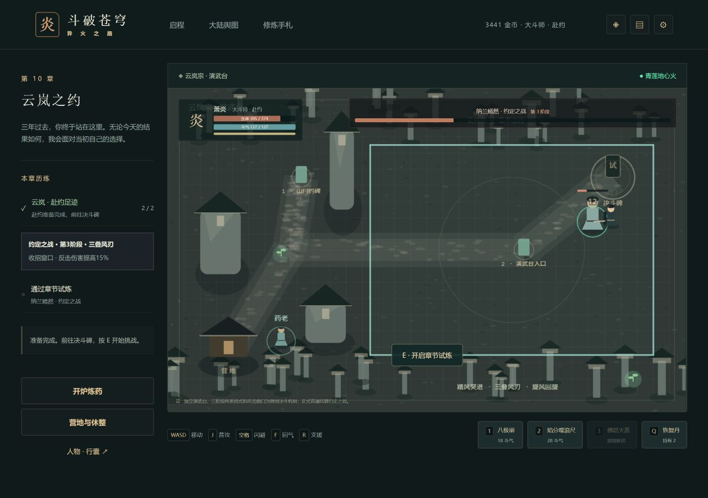
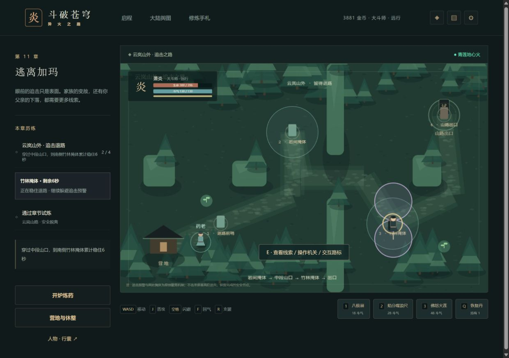
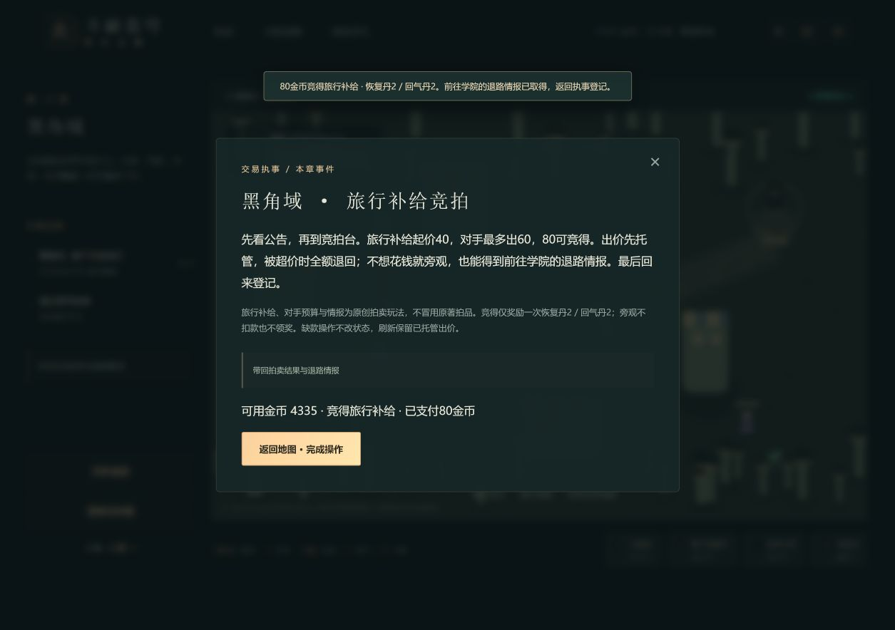

# 斗破苍穹 · 异火之路

浏览器单机剧情动作 RPG。以原创对白和程序绘制场景，改编从乌坦城到双帝之战的主要冒险线。当前版本为 **0.10.0：天墓、菩提与妖火场景基础 Alpha**，前二十五章采用专属地图，前二十二章有专属机制，保留28章压缩主线。丹会、星域和救师撤离已实现；第23–25章独立场景已接入，专属计时、幻境与净化继续开发。C5b之后浏览器完整流程与一次存档回退原因仍待补验，详见版本验收。

项目仓库：`git@github.com:remixjc/doupocangqiong-webgame.git`

## 文档

- [全周期开发计划](docs/全周期开发计划.md)：产品范围、全主线章节、阶段交付与发布维护。
- [开发进度](docs/开发进度.md)：阶段状态、验证记录、后续工作。
- [初始游戏方案](游戏方案与AI制作计划.md)：最初设计与技术分析。
- [AI 分批制作手册](docs/AI分批制作手册.md)：每批输入、实施步骤、验收及扩展任务。
- [运行与发布](docs/运行与发布.md)：操作、存档、静态部署、回滚和维护。
- [版本验收](docs/版本验收.md)：实际测试证据与尚未验证的项目。
- [素材来源](docs/素材来源.md)：原创资源、故事来源及依赖记录。

## 当前可玩内容

28 章按顺序解锁；探索、采集、即时战斗、四类敌人、四种首领模式、三阶段危险预警、营地与重试、炼药、坊市、装备强化、四种主线异火、药老支援、终局尾声。

支持键鼠、手机横屏摇杆、本地自动存档、三个手动存档、JSON 备份和动画防剧透设置。运行时不需要服务器账号或 AI 服务。

前三章采用独立后山、萧家院落与坊市地图，加入药老木桩教学、三处立约路线和议价供货。第二、三章以事件作为主要目标，普通战和采集用于补充资源。第四章独立洞穴中，与小医仙接取探索、读石刻、按叶 / 月 / 火解开实体封门、领取一次性材料宝匣并返程，再完成归途试炼。第五章独立山谷保护采药同伴，双方到达两处药圃再返营；随后在紫色警戒区躲避落焰24秒，从西侧安全撤离，不击杀狮王。第六章独立公会提供练习材料，读取35% / 60% / 50%火候、通过三步控火认证并登记审核；免费重试，认证奖励与普通丹药生产分别结算。第七章石漠城读取青鳞线索，清除囚栏守卫解救两位团员、打开巷门并回报萧鼎；已解救节点刷新保留。第13–28章的专属机制继续逐批深化。小说全部支线、后续专属地图及逐集动画演出列入扩展计划。动画最新集数未核实，剧透上限由玩家自行设置。

第三章供货完成后到测试石锁定三道斗气，合计 180 分通过，失败免费重试。采购商的竞争委托提供稳妥供货和精品考察两条不同成本 / 收益的路线，是可选支线。关闭与刷新保留事件进度。

第八章独立地底火域与蛇人巡逻投影：守卫沿路线走动、掩体阻挡视线，持续暴露积累警戒，警戒满后追击，营地可脱离。药老委托中确认入口退路，在控火坛启动追踪落焰 / 交替火脉 / 大范围回涌三段挑战，每段12秒；火域增温、青色冷却点降温，100热量失控后可休整重试当前阶段。返回药老确认、收服台交互和营地首通结算后才获得青莲地心火，不需重复采草杀怪。旧档检查旧目标后迁移，不补发奖励。C3机制已交付，完整伙伴支线仍留C10，自动接续C4。

第九章以岩枭之名向法犸报名，读赛程牌，依序到三座赛炉完成初赛 / 复赛 / 决赛。各轮三步210分通过，独立目标火候和1 / 1.3 / 1.6倍指针速度；失败只重试当前轮，刷新保留已通过成绩和已锁定火候。赛材免费，不额外产丹；登记一次60金币 / 80积累，领奖台审核后营地首通解锁第十章。第13–28章专属机制继续逐批深化。


第十章确认山门约碑和演武台入口后开启纳兰决斗。生命低于67% / 34%进入第二 / 三阶段；踏风突进锁定路线、三叠风刃封锁三处区域、旋风围绕对手蓄力。决斗场封闭，招式收束后反击伤害提高15%；休整清空对手运行态、保留赴约足迹，获胜首通440金币。招式和数值为原创改编，追逃接续C4c。



第十一章依次从前哨撤离，到岩间与竹林两个青色掩体各累计坚持6秒，躲避紫色追击预警。区外暂停计时、通过节点保留，倒下 / 休整 / 刷新回最近完成的安全点，当前计时重建；两点通过后才能出口撤离。不击杀高阶追兵，不消耗材料；首通470金币解锁黑角域。C4机制完成，C5接续。



第十二章公告和竞拍台支持40 / 60 / 80金币托管。对手超价后全额退款，可加价80竞得恢复丹2 / 回气丹2，或免费旁观取得退路情报；零金币可完成主线，补给只发一次。刷新保留出价与结果，回执事登记30积累，再通过出发拦截挑战，首通500金币解锁学院。原著具体拍品与完整支线留后续校订。



第十三章若琳安排原创双阵资格试炼：双方到集合点确认，再带同伴到西阵按E守阵。玩家到东阵连续共鸣3秒，同伴须存活并留在西阵；离阵或同伴倒下会清空当前共鸣计时。投影守卫能攻击守阵同伴，休整从最近完成节点免费重试。返回若琳登记一次40积累后提交入院审核，首通才解锁下一章。完整人物伙伴支线仍留C10。

第十四章由胡嘉安排双路火能猎捕：队友集合后共同清理西路、东路守卫，每路双方到达才领取一次2火能，失败保留已完成节点。返回登记消耗2火能并获得30积累。强榜投影在蓄势时减伤65%，收招后承伤提高25%，半血后由三点预警变为交叉五点；首胜再得一次3火能。首通后开放复练，每局真实胜利得1火能、无额外金币；人物面板可多次以2火能换30积累。通关前锁定普通火能修炼，保证登记余额。

第十五章向苏千接取三层镇炎，确认塔门退路后在三处阵眼分别累计8 / 10 / 12秒。各层有追踪落焰、交替双焰或心炎回涌；受击增加热量，镇心石降热但暂停计时，满100热量失控后从最近完成台阶免费重试。回报后挑战韩枫投影，营地第一次正式结算才取得陨落心炎。三层数量和风险为原创压缩玩法，原著具体层数与时序留来源校订。

## 开发运行

要求 Node.js 24 与 pnpm 11。

```bash
pnpm install --frozen-lockfile
pnpm dev
pnpm run check
pnpm build
pnpm preview
```

开发地址以终端输出为准。生产文件在 `dist/`，通过静态 HTTP 服务运行；直接双击 `index.html` 不支持模块加载。

CI 在推送和 PR 时执行类型检查、测试和构建。Pages 工作流已提供，首次发布需在仓库 Settings → Pages 选择 GitHub Actions 后手动运行。配置存在不代表线上站点已发布。

## 操作

WASD / 方向键移动；按住 J 连续普攻；空格闪避；1 / 2 / 3 斗技；E 人物 / 路标 / 采集 / 试炼 / 营地；Q 恢复丹；F 回气丹；R 药老支援；Esc 营地 / 关闭菜单。

完成任务后到地图上的试炼碑挑战首领，通过后在营地菜单结算。药草会再生，失败保留已结算的资源；休整从营地恢复。菜单和后台暂停战斗。

0.1.0 存档自动迁移到 schema 2：保留材料、金币、设置和已完成章节；尚未通过首领的前三章需要补做新事件，已经通过的事件视为完成且不追加奖励。旧版本无法读取新格式，请在升级前保留备份。

0.3.0 使用 schema 3，事件按稳定 ID 分开保存。schema 1 / 2 自动迁移，0.2.0 进行中的供货记录保留；旧档已通过首领的新事件视为完成，不增发竞争货款。未过关第三章新增测试石目标，竞争委托仍可选。

故事文字为游戏改编创作，不复制原著正文和动画字幕。战斗数值、采集、试炼及普通敌人属于游戏化设计。人物、地名和世界设定属于原作品的相应权利人；第三方素材的来源须单独记录。
