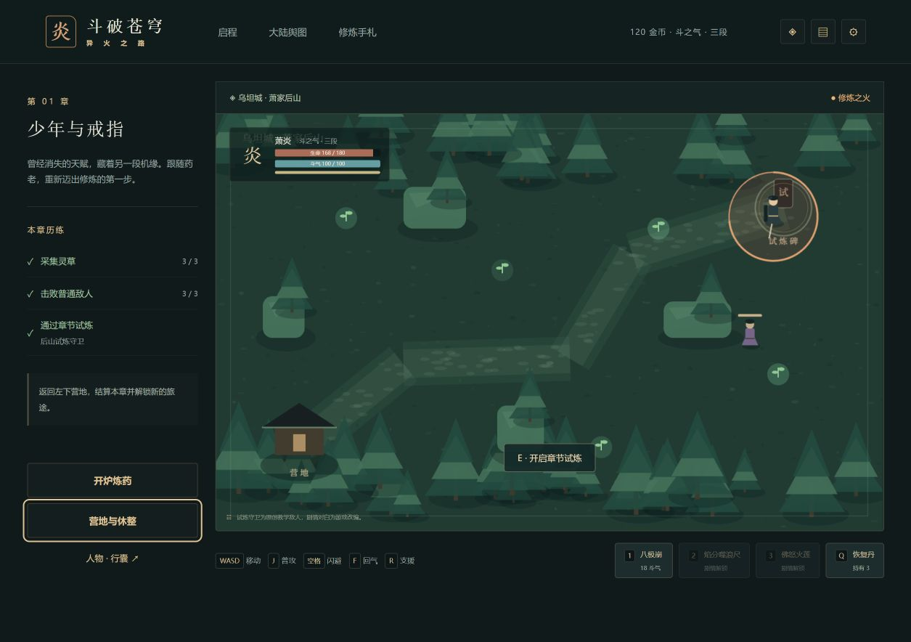

# 斗破苍穹 · 异火之路

浏览器单机剧情动作 RPG。以原创对白和程序绘制场景，改编从乌坦城到双帝之战的主要冒险线。当前版本为 **0.1.0：28 章压缩主线 Alpha**。

项目仓库：`git@github.com:remixjc/doupocangqiong-webgame.git`

## 文档

- [全周期开发计划](docs/全周期开发计划.md)：产品范围、全主线章节、阶段交付与发布维护。
- [开发进度](docs/开发进度.md)：阶段状态、验证记录、后续工作。
- [初始游戏方案](游戏方案与AI制作计划.md)：最初设计与技术分析。
- [AI 分批制作手册](docs/AI分批制作手册.md)：每批输入、实施步骤、验收及扩展任务。
- [运行与发布](docs/运行与发布.md)：操作、存档、静态部署、回滚和维护。
- [版本验收](docs/版本验收.md)：实际测试证据与尚未验证的项目。
- [素材来源](docs/素材来源.md)：原创资源、故事来源及依赖记录。

## 当前可玩内容

28 章按顺序解锁；探索、采集、即时战斗、四类敌人、四种首领模式、三阶段危险预警、营地与重试、炼药、坊市、装备强化、四种主线异火、药老支援、终局尾声。

支持键鼠、手机横屏摇杆、本地自动存档、三个手动存档、JSON 备份和动画防剧透设置。运行时不需要服务器账号或 AI 服务。

现阶段各章共享关卡结构，配有六种地域主题和原创短对白；小说全部支线、章节专属地图及逐集动画演出列入扩展计划。动画最新集数未核实，剧透上限由玩家自行设置。



## 开发运行

要求 Node.js 24 与 pnpm 11。

```bash
pnpm install --frozen-lockfile
pnpm dev
pnpm run check
pnpm build
pnpm preview
```

开发地址以终端输出为准。生产文件在 `dist/`，通过静态 HTTP 服务运行；直接双击 `index.html` 不支持模块加载。

CI 在推送和 PR 时执行类型检查、测试和构建。Pages 工作流已提供，首次发布需在仓库 Settings → Pages 选择 GitHub Actions 后手动运行。配置存在不代表线上站点已发布。

## 操作

WASD / 方向键移动；按住 J 连续普攻；空格闪避；1 / 2 / 3 斗技；E 采集 / 试炼 / 营地；Q 恢复丹；F 回气丹；R 药老支援；Esc 营地 / 关闭菜单。

完成任务后到右上试炼碑挑战首领，通过后在营地菜单结算。药草会再生，失败保留已结算的资源；休整从营地恢复。菜单和后台暂停战斗。

故事文字为游戏改编创作，不复制原著正文和动画字幕。战斗数值、采集、试炼及普通敌人属于游戏化设计。人物、地名和世界设定属于原作品的相应权利人；第三方素材的来源须单独记录。
