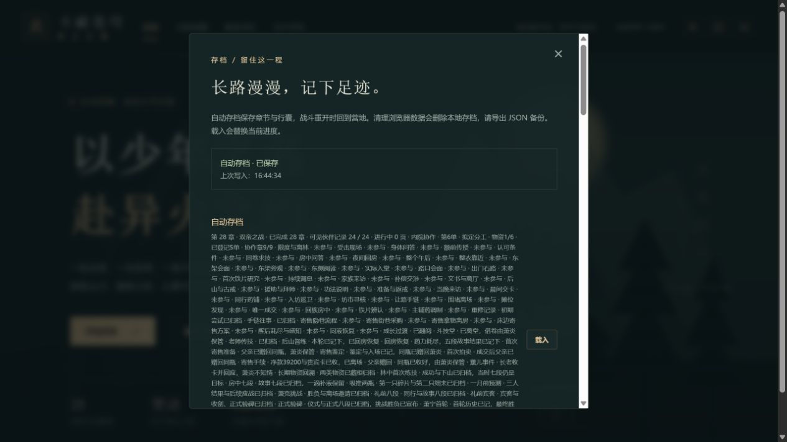
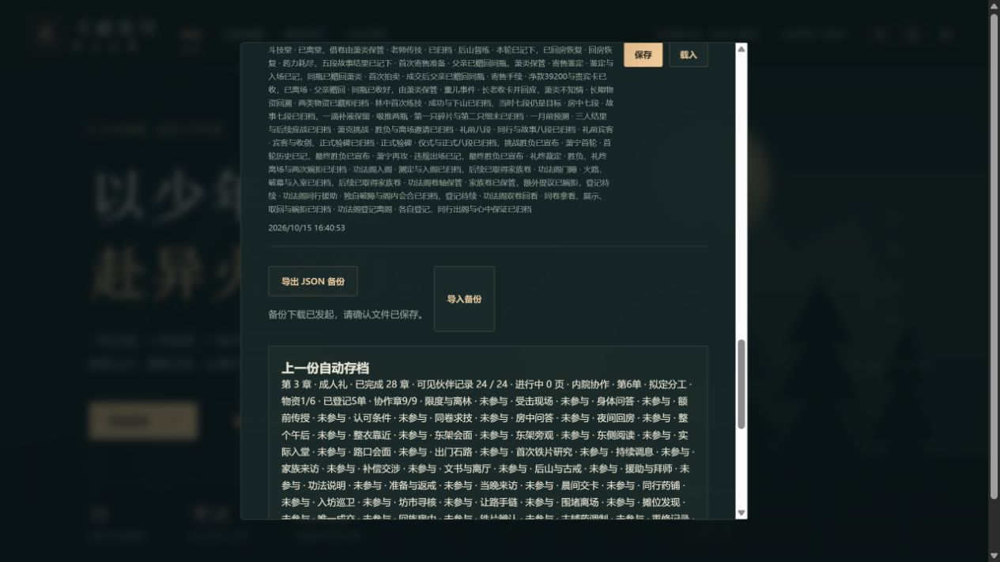

# C10n 协作存档摘要与同批容量验收

2026-10-15 / 0.95.1。自动、三个手动槽、上一自动档和导入校验使用同一协作摘要，显示本单、阶段、物资、已登记数、协作章。草案、现场第1–3步、失败整队和待登记分别显示；已经完成5单时下一单为第6单，荣誉仍为9/9。

没有账本、未首通14章或查看者动画上限不足14章时不显示协作内容。备份自己的小说模式不能越过查看者上限；收窄范围不擦除账本，恢复14章重新可见。摘要读取没有写入、重置或结算操作；原作建门和人物职责仍未核齐，P08不因此关闭，固定25个工作包继续。

## 容量与规则检查

先前总JS1849976，仅余24字节。本批将自有`content/bonds.ts`文字字面量加入既有AST文字池，保留源文件、模板、结构、逻辑及所有奖励值。完整7线24页导出逐字段与未压缩源相等；4种查看范围、4种阶段、3种回应下的手札、回访队列和摘要结果相等；协作各阶段及封存边界的生产文字转换也逐项相等。未更改第三方依赖、原作来源或授权范围。

新增摘要专项从实际规则产生合法账本，核失败/恢复、第五单前置四单历史、JSON、四槽及上一自动档；查看者13/14边界、无账本/未首通、读取不写状态分别检查。3文件14专项通过。完整`pnpm check`通过180文件1097项Vitest、39项Node、类型、既有三难度早期/28章回放、存档及生产完整性。

实际生产157文件2585635字节；初始JS429245、gzip160095、总JS1838650。固定500000/165000/1850000门槛不变，总余11350；和0.95.0相比总JS净少11326字节，此数来自真实构建，不用源码估算代替。5个完整自有文字模块及65个场景模块/68载荷/902行生产核验通过。NOTICE复核差异只有版本标题行。

## 旧档与真实网页

实际前正式`c52c4bd5bed4b362d05954f61a55f56fb81008e1`的376份src/package源码完整提取，873份冻结原生备份用实际旧/新解析器逐份核对：整个state仅contentVersion到0.95.1；其中12份已有协作账本完全保持，其余不补账本、完成或奖励。原件指纹和873元数据未改；新迁移writer成功后冻结。公开摘要见`qa/c10n-coop-preview-0951-migration.json`。

独立4203生产网页通过正常文件选择导入未修改0.95.0四单原件：

- 导入预览和自动/手动1–3槽都显示第5单、草案、物资1/6、已登记4单、荣誉9/9。
- 正常补给出发，查看现场摘要；两次误选耗尽，手动槽2保存失败阶段，刷新后整个state相等。
- 查看上一自动档摘要并实际恢复到一次失误/物资2的现场；再次失败后免费整队，按核账→复核→勘路完成，待登记摘要仍为已登记4单；报告第五单+0。
- 第五单报告后刷新整个state相等。设置动画范围13时，四槽、上一自动档和小说原件的导入预览都没有协作内容；上限14后恢复可见。
- 沿既有设置行为，第一次切动画时使用原存储上限3，当前章28→3、高阶火焰回初始；已完成28章及协作账本保持。提高上限不会自动恢复当前章/火焰；本批如实核对这些变化，随后正常重导自己刚导出的第五单备份回28章。

12份真正下载原件逐份与实际规则API、设置动作及恢复/导入顺序的**整个state**相等，官方解析结果也与整个原生state相等。除协作操作和上述明确设置行为外，原有资源、主线、奖励及历史保持。元数据append-only从873→885；证明见`qa/c10n-coop-preview-0951-native.json`。不是手机或真人Beta证据，未新增小说/动画来源。

两图已实际查看。既有完整早期历史摘要较长，当前采用原有可滚动存档面板；本批没有声称已实现历史折叠。控制台warn/error为空。

## 实际失败与接续

新原生核对脚本首轮误以为flames来自`content/flames.ts`，在读取模块时ERR_LOAD_URL退出，尚未写证明或元数据；按真实UI导入改为`core/rules.ts`后12份全部相等。失败记录保留，不修改任何下载原件。旧writer未重跑。

本批独立提交推送后继续核对完整远端SHA、匹配Game checks和正式清单；提交后刷新/原生另行追加，不重跑已冻结885集合证明。Pages跳过仍不表示公网发行。随后继续合法来源支持的完整人物流程及E02/E03原缺口，不重复已验普通死亡/增援回收或将原创协作代签原作组织。
