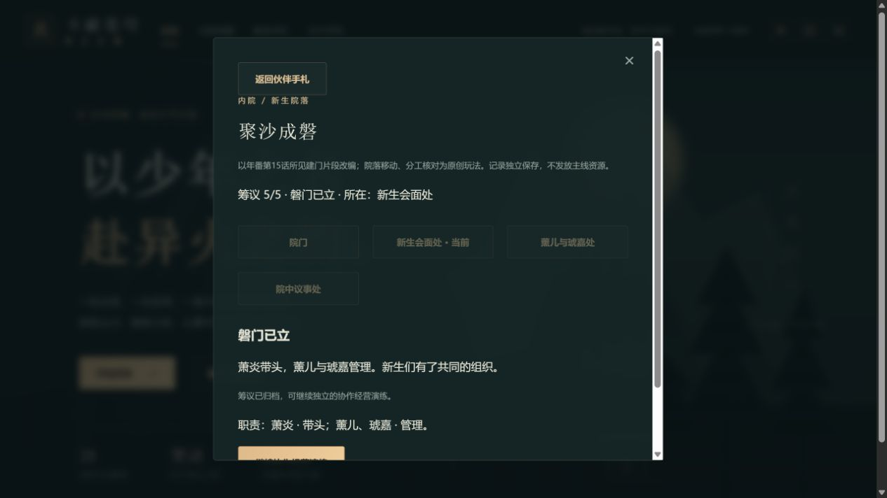

# C10n 磐门筹议验收

2026-10-15，0.96.0。将新生请求、同伴商议、分工、定名及共同确认作为一个完整现场交付；来源与实现边界见《C10n磐门筹议任务卡.md》。

## 实际交付

伙伴手札新增独立筹议入口，首通游戏第14章且查看者允许14章才显示。玩家在四处原创院落位置之间移动，听取互助与管理提议，安排萧炎带头、薰儿与琥嘉管理，选择磐门定名，回新生处共同确认。错误回应、错误分工及名称可以免费修正，离开重开与刷新保留断点。

可选`panmenFounding`从0.96.0开始，仅正常参与才出现。完成记录只读，原28章首通、24页手札和原有匿名协作不会代签。所有操作核修订号；解析检查字段集合、整数、阶段、位置、职责以及阶段至少需要的修订次数。没有主线奖励、材料、火能、塔内特权或角色能力变化。

归档按钮直接衔接原经营演练。原5单、9荣誉、1物资及跨职分配完整保留；网页接续第六单三节点，报告后6单、9荣誉、1物资，追加奖励为0。原有三委托、失败整队、荣誉上限沿已验规则，归档不能重置旧奖。

## 来源范围

本批正常打开腾讯第15话《磐门》，可播放范围内实际读取若干建门与管理对白。没有观看完整20:05，也没有宣称所有14至16分钟帧均连续读完。15:31附近管理提议与15:55至16:20附近命名有实际可见定位；不是精确字幕区间。24份过程截图仅在私有`.git`留核验SHA，公开JSON不含动画图像、评论和播放器临时令牌，不作为游戏素材。

本批完成建门当场和所见管理提议。原作后续具名成员任务与经营来源仍待，匿名原创委托不能代签这些事实，P08记部分完成，25个工作包仍开放。中文433及英译461的完整正文仍未读；动画不能用于推算中文/英译固定章号差，也不补签实际发布日期或其他集数。

## 核验区分

- 规则测试：完整13动作最短路线；错误位置/选择/职责、过期输入、重复完成、错误版本/结构/阶段；原有完整主线和协作账保持。全部断点经JSON与fake-indexeddb四槽/上一自动档往返，查看者13章隐藏、14章恢复。
- 实际旧档：真正0.95.1提交`4dfc265c6db454c0e13f25d7aa968022ac218c60`的376份源文件，对887份不可改写原生档使用新旧解析器比较。整个state仅版本变化，26份原有协作记录保持，所有旧档不补筹议；原件与旧元数据指纹未变。详`qa/c10n-panmen-0960-migration.json`。
- 实际网页：由原4203存档自然升级，完整完成筹议；误选请求/分工/名称后免费修正，中途与完成各一次刷新。接续第六单零奖、13/14章范围切换及本人原生备份导入恢复。13份原生JSON与实际API逐步推导的整个state相等，两组刷新和导入前后整个state相等；原28首通、金币、积累、火能与其他历史保持。详`qa/c10n-panmen-0960-native.json`。
- 包体：500000初始、165000初始gzip、1850000总JS上限保持，实际429245 / 160089 / 1845993，159发行文件2593725字节。没有为本批提高上限或删除已有剧情。

网页测试没有覆盖用户原三个手动槽的新筹议读写；该项的全断点证据来自规则数据库测试，未覆盖其现有内容。没有实体设备、真人Beta或公网部署结论。旧成功证据写入器保持冻结，本批新迁移和13原件证明完成后也冻结，元数据仅追加887→900。

首次候选被实际许可声明中的0.95.1标题拦截，重新核对许可输入后只更新版本标题；生产固定预算通过。浏览器一次用AX显示的checkbox去找DOM角色而无匹配，改用最新AX目标；一次导入确认自动关闭窗口后导出助手超时，重新打开存档管理正常导出，完整状态相等。保留失败经过，不将工具超时当游戏错误。游戏控制台警告/错误为空。

完整pnpm check通过：181文件1102项Vitest、39项Node、类型、三难度28章、四槽/上一档与生产发行检查。整份日志保留私有任务证据；提交后另核远端SHA、匹配CI和正式发行绑定。本候选清单仍绑定前一提交，不能当正式新SHA发行绑定。

