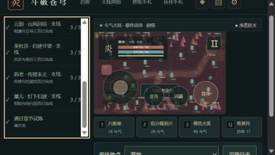
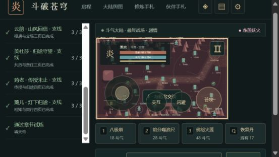

# C11e-6 任务阅读与原生输入焦点

2026-10-12，0.37.5。独立4183、此前正常通关的完整旅途，568×320浏览器覆盖。新增可聚焦任务栏被全局键盘分类当作场景：修复前ArrowRight实际将角色从210/625推到214/625，继续点按后222/625。未以代码推断冒称实际复现。

现在任务栏带`data-game-input="reading"`，包含子控件时也识别为阅读区。全局游戏键盘不接管阅读区任何键：方向、Home/End/空格等由浏览器原生处理，移动/战斗/丹药快捷键不穿透。原生按钮激活与正常场景快捷键规则保持。

焦点转入阅读区或表单时清理已按住键、尚未消耗的移动点按、瞄准/移动和排队动作；不通过暂停整个实例解决输入冲突。新增focusin监听在场景shutdown/destroy时移除，重复释放幂等。持续自动行走规则与持久状态保持。

实际流程：

1. 新候选正常读取原终局档，任务栏依次Home、ArrowRight/Down、1/j/q/f/r、空格、End。角色保持210/625、斗气184/184、体力100；End滚动动画结束后scrollTop283/clientHeight244/scrollHeight527，末项可见。初次读取222只是滚动动画中段，不代签最终值。
2. 原生地点框ArrowDown选到“终战启程碑”，再按1，不移动或出招，210/625与184斗气保持。
3. 回到场景聚焦后ArrowRight及1，实际214/625、166斗气与3.1s冷却。说明恢复正常移动/战斗，不是冻结当前世界。截图拍摄时冷却可能已结束，出招结果由当时可见DOM记录。
4. 正常打开存档、实际下载完整JSON，0.37.5与原0.37.4整个state仅contentVersion变化。28章/24页、19506金币15582积累、草5晶89恢复17回气16、净莲/归队、双卷8援助10及原设置保持；原manual未写入。error=[]。完成后reset尺寸覆盖。

三图实际查看，微小位移以可见`data-player-x/y`读证，截图不是位置/冷却唯一依据。证据[键盘边界实际记录](qa/c11-reading-keyboard.json)，完整state SHA256为`ad0a29f18c763e5fe94f4fba3ac7b6cb054105f78934ccfb51a75894737249f4`。

最终110文件685Vitest+11Node、类型/迁移/三难度早期和28章回放/生产构建/包体/完整性通过。新增回归覆盖阅读全快捷键、阅读/表单切入的持有键与物理步缓冲/动作清理、场景恢复、重复注销；不是为了映射CSS写无意义断言。日志`.git/task-reading-keyboard-check.log`。入口489229/gzip158980，总JS1625218，引擎gzip173297按需，71文件1735100字节，预算保持。

验收产物基于bef6d566f1a698ab164e5b40dc29f02c442df7fb并含未提交修改，未称冻结发行。该前批远端Game checks38184628706 success、Pages38184628725 skipped。本次转焦点的残留持有键由EventTarget/BufferedMovement回归验证，未用浏览器内部注入模拟真实按住键；真实长按/实体设备/后台/阅读器/Beta与公网发布继续开放。
