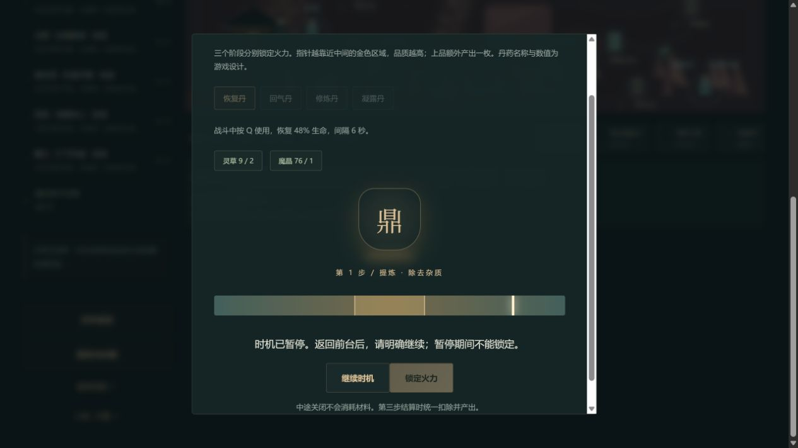

# C11e-7：通用动态时机明确暂停与继续

2026-10-12 / 0.37.6。减弱动态的键盘滑杆已由0.33.2交付，本批补动态模式的暂停体验；不重复记为新滑杆功能。

## 行为

控气、认证、大会、成丹、心念与普通炼药共用的HeatControl增加“暂停时机 / 继续时机”。暂停冻结当前未提交指针，并禁用锁定；锁定处理同时检查控制器状态，防止失焦与React状态更新之间误提交。明确继续保留本步相位，排除暂停期间时间，不重新抽取输入，也不改变评分公式。

窗口失焦或页面隐藏触发同一暂停，重新可见不会自动继续；初始隐藏页不启动计时。回收注销监听和计时器，已取消那一轮的迟到回调不能在继续后更新。正常锁定进入下一步仍按既有规则重建输入；减弱动态保留1%原生range，不显示动态暂停按钮。无存档字段、故事前置或奖励变化。

## 实际网页

独立4185生产预览正常导入4184同一普通旅途的真实28章备份，未修改备份、导入fixture、覆盖原站或任何手动槽。第一次真实下载验证0.37.5→0.37.6迁移。正常关闭减弱动态、开炉恢复丹，第一步暂停后的指针跨调用保持；初版观测0.846不动、锁定disabled，继续后0.942→0.998，再暂停。明确继续后正常锁定进入第二步，仍可独立暂停、锁定disabled。没有完成第三步或消耗材料。

恢复减弱动态后，重新开炉可见一个“炼药火力位置”range，零个动态暂停按钮；关闭未结算。下载/真实刷新/再下载保持整个state。最后构建加入计时器世代防迟到回调后再次真实刷新，重新开炉暂停，最终实际指针0.852跨调用保持、锁定禁用，继续后正常锁定进入“第2步 / 融合 · 协调药性”，新步骤暂停可用。再次关闭并恢复原减弱动态偏好，真实备份与此前整state相同。

图已实际查看，显示暂停提示、继续入口和禁用锁定，以及9草/76晶；截图不能证明真实后台、精确时间或屏幕阅读器达标。

原文件与四份本批真实下载副本由官方parseSave在浏览器外校验，五份解析结果全同，原JSON仅contentVersion变化。28章/18718金币/14470积累/总杀75/总炼药0/原行囊、七线未参与和三空手动槽保持；新页面error=[]。指纹与观察边界见[机器可核记录](qa/c11-heat-pause.json)。

## 检查与剩余门槛

完整110文件686Vitest+11Node、类型、迁移、三难度早期与28章回放、生产预算与完整清单通过。增加迟到回调世代隔离后再跑控火/存档/回放3文件15项和最终类型/生产构建：71文件1736021字节、初始489229/gzip158978、全部JS1626138、引擎gzip173297且按需。日志`.git/task-heat-pause-check.log`、`task-heat-pause-final-tests.log`、`task-heat-pause-final-build.log`。

失焦/隐藏/不可后台继续/相位保留/回收/迟到回调由注入时钟与EventTarget回调规则测试证明，未在本次桌面工具下声称真正窗口后台或实体手机实测。其他后期面板沿共享UI和完整规则回放，不等同逐面板新增网页验收。正文与当前动画逐集来源、完整人物、历史回退、零币/缺款、死亡末帧、真人设备/Beta/公网仍各按独立门槛推进。

前批4583a27b6c2e46842e9ae715d3950af69eb2e4f7远端完整SHA匹配，Game checks38199328895 success、Pages38199328928 skipped。自动续办继续。
