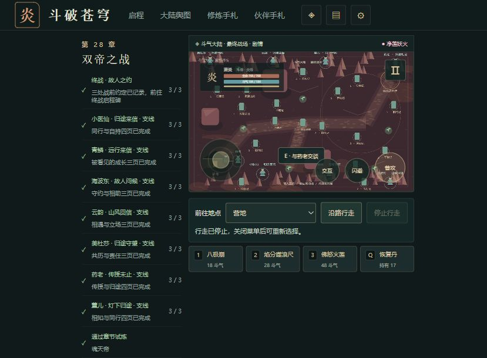
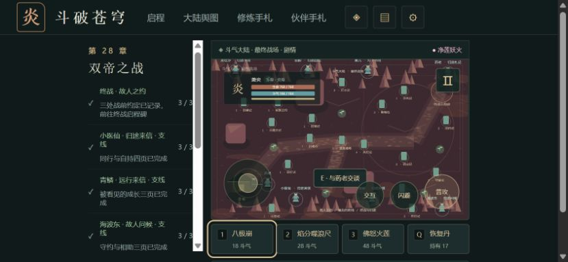
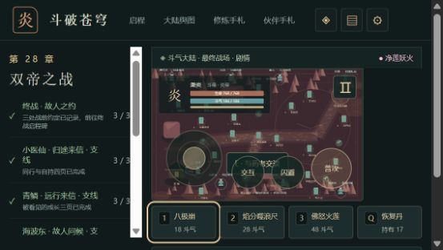
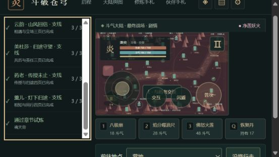
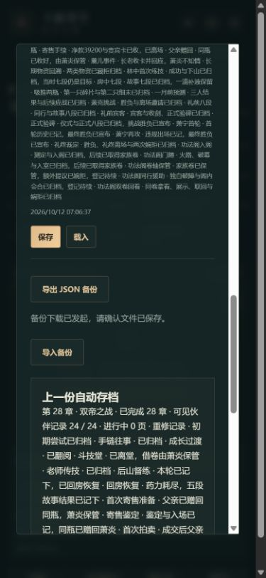
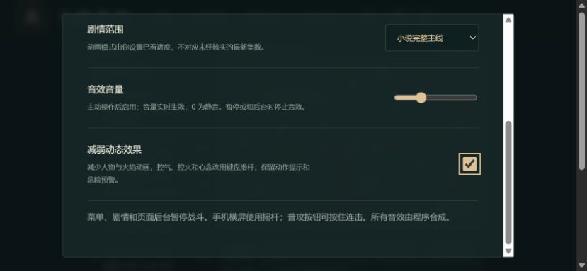

# C11e-5 短横屏战斗与任务滚动

2026-10-12，0.37.4。独立4183，沿用此前正常旅途的28章/24页完整档，没有修改数据库、内部坐标或store。viewport能力本轮实际生效，宽高由可见DOM读取核实；以前0.14.5覆盖未生效的记录仍保留为当时事实。

发现并修复两个问题：

- 844×390：导航面板在战斗栏前方，四个斗技/丹药按钮落到首屏外。工具点击斗技后页面滚动，画布顶端落到-131.5，无法同时观察完整场景。
- 568×320：720px以下继承竖排布局，长任务先占满页面，横屏场景仍排在任务之后。

现在战斗栏在DOM顺序与视觉顺序均先于沿路面板；短横屏保持双栏，窄横屏主区使用剩余宽度。任务栏限制屏内高度并独立滚动，加明确名称、键盘焦点和边框。场景、导航、战斗与奖励规则没有变更。

| 范围 | 实际结果 |
|---|---|
| 844×390页首 | 画布top88.5/bottom326.5；四按钮333.5–378，在390屏高内 |
| 568×320页首 | 画布88.5–256.5；四按钮263.5–305.5，宽83，各边界均在client宽553内 |
| 任务键盘末项 | End后scrollTop283、client244、scroll527；末项228.5–274在容器38–282内 |
| 390×844竖屏 | 旋转提示、暂停/路线禁用；点击八极崩仍184斗气，不出招 |
| 320×568竖屏 | header八按钮与任务计数在client宽305内，没有水平溢出 |
| 横屏战斗 | 原生Enter实际释放八极崩，166/184斗气与3.2s冷却 |
| 短屏对话框 | 竖屏存档末端Shift+Tab聚焦新旅程但未激活，滚动到2008.5；真实下载成功。横屏设置Shift+Tab到末端复选框，滚动266.5，控件在窗口内 |

工具会为聚焦控件滚动页面，本批不签“所有点击完全不滚动”。两次ControlHome等待报工具超时，后续DOM确认实际已回页首；不把它们当游戏console错误，也不把初始End滚动动画的26当最终值。最终末项为稳定283。浏览器尺寸覆盖已reset，不改变用户默认尺寸。

七图均已实际查看。机器记录见[尺寸与流程证据](qa/c11-responsive-layout.json)。部分初期尺寸/弹窗图为0.37.3，修复图/键盘末项/最终竖屏拒招与完整下载为0.37.4；不把初期图冒称最终构建。

初期0.37.3竖屏实际导出与原完整state相同。最终0.37.4实际下载与此前完整0.37.3仅contentVersion变化，其余字段全部相同：28章/24页、19506金币15582积累、草5晶89恢复17回气16、净莲/归队、双卷8援助10及原设置。原manual1–3没有写入。最终error=[]。

最终`pnpm run check`通过110文件683Vitest+11Node、类型、旧档迁移、三难度早期及28章回放、生产构建/包体/完整性；日志`.git/task-responsive-final-check.log`。入口489201/gzip158960、总JS1624777、引擎gzip173296按需，71文件1734659字节；验收产物含未提交修改，基础SHA011a44e，未称已冻结发行。

另已从干净011a44e5eda0e7a3919e5f2cd189b96b3d368a2d构建并独立保存0.37.3完整包，核预期SHA/71文件1734261字节成功；远端Game checks38183488407 success、Pages38183488423 skipped。证据[干净候选指纹](qa/c11f-release-integrity-011a44e.json)。该本机目录不随克隆分发，也不代表0.37.4、公网部署或正式发行。

本批签浏览器尺寸与上述键盘/下载流程；实体Android/iOS、真实触摸拖杆与长按、后台连按、阅读器、帧率/内存、玩家Beta、公开发布与完整来源继续开放。
