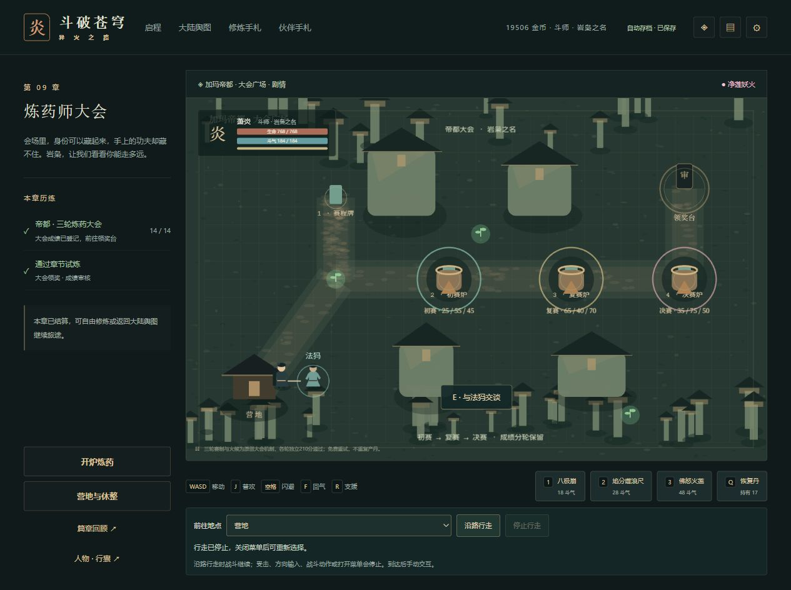

# C11 大会场地去重验收

2026-10-15，0.96.1。对应[任务卡](C11大会场地去重任务卡.md)，修复第9章静态场地的实际重复分配与叠画。

## 根因与结果

原`AdventureScene.drawEnvironment`将三个赛台放在`map.paths`循环内。实际大会地图有两条道路，因此每次入场创建6个说明文字对象，并绘制6次赛台圆环、6次底色。其他道路数量还会改变赛台数量，零道路时完全漏绘。

现在道路循环只绘道路与原随机纹理，三个赛台在循环之后绘制一次。位置、目标火候、赛程、交互点与旧成绩均保持。实际两路地图文字对象6→3，圆环与底色各6→3；不是将画面截图当内存计数，也不宣称减少了确定数量的GPU纹理或提高固定帧率。

## 自动核验

新增测试执行真正的场地绘制与容器接线，只有Phaser显示接口是计数替身。原实现5项中4项失败/1项通过，修复后5项通过：

- 0/1/2/4条道路，各赛台始终只有一个圆环、一个底色和一个说明文字。
- 28张实际地图再回大会，切图销毁上一场地及文字；同地图重复同步不分配；其他地图不出现大会标签。

完整`pnpm check`通过：182文件1107项Vitest、39项Node、类型、三难度28章、四槽/上一档、生产完整性。针对绘制/接线/28章回放的3文件11项另已通过。变更后的素材指纹与NOTICE标题已正常复核，未更改依赖或第三方许可正文。

固定初始/初始gzip/总JS上限500000/165000/1850000保持；实际429245/160091/1845994，余70755/4909/4006。候选159文件2593726字节，正式提交后另核SHA绑定及文件一致性。

## 旧档与实际网页

冻结901份不可改写原件，对真正0.96.0的378个源码/版本文件分别运行实际旧、新解析器；整个state只有`contentVersion`变化，其中40份含协作、13份含筹议，均完整保持。见[迁移证据](qa/c11-tournament-0961-migration.json)。未重跑任何旧版成功写入器。

正常同域网页先在0.96.0导出28章，再通过舆图重返9章导出旧原件。升级0.96.1后：

- 三座炉台均实际沿路到达并手动交互，仍显示三轮300/300/300、尝试4次及已登记结果，没有重奖。
- 新入场、三炉交互、正常刷新、实际退出舆图再重入的四份第9章原生整state，与旧9章只差版本。
- 实际场景→舆图→场景画布1→0→1；此前另记录正常刷新后的无画布页面与重入，二者分别标明。
- 正常选择28章，原生整state恢复到原28章只差版本：28首通、19506金币、15582积累、既有筹议与6单/9荣誉/1物资协作账保持。
- 控制台警告/错误为空。7份新原件经官方解析器逐份核验，元数据仅追加901→908，见[网页证据](qa/c11-tournament-0961-native.json)。

两图已实际查看。修复后赛台圆环/底色的叠加减弱是消除重复绘制的结果；单张图不能证明对象数量，计数由实际绘制代码回归单独证明。

E03仍为部分完成，最大群战、精确堆/GPU保留和其他设备验收继续；25个工作包未缩减。本轮动画资料仅选帧，未核到完整成员经营闭环，未据此新增剧情或关闭来源门槛。提交推送、匹配CI和正式产物的最终核对保存在本次交付记录。
