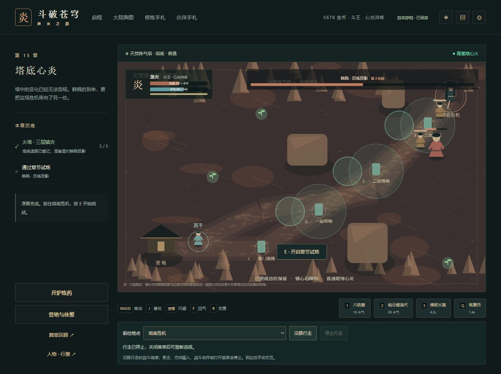
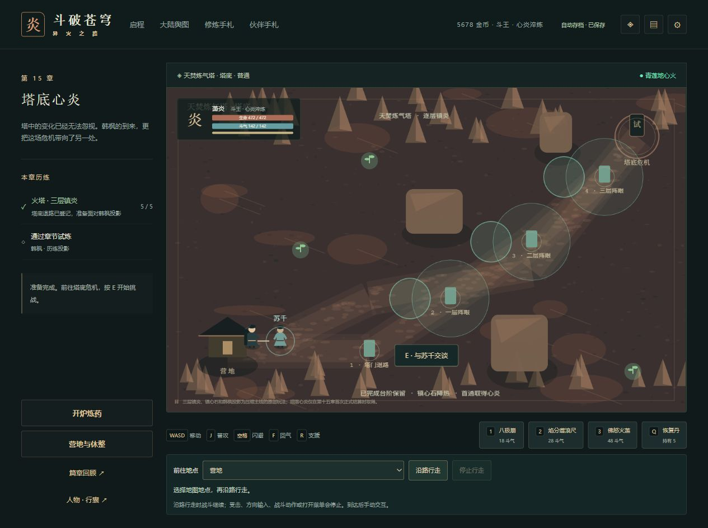

# C11持续增援对象回收验收

2026-10-15，0.94.2；正式前置613bb8c / 0.94.1，远端SHA一致，Game checks38691685346成功、Pages38691685434跳过。本批提交后完整SHA/CI另记正式交接。

## 已复现边界与修复

CombatWorld的死亡结算将hp置零，绘制、瞄准和敌人循环均跳过死敌，但数组持续保留对象。storm首领以存活人数限制增援，反复击杀后死去猎手不占存活名额，仍不断留在数组里。问题是该数组的强引用持续增加，不能直接称为浏览器堆泄漏或GPU泄漏。

spawn在追加新敌人前回收已死亡匿名普通敌人；活敌、具名关卡记录和首领对象保持原顺序，ID继续递增。首领保留维持战后bossMaxHp等原HUD行为，具名记录保持驻点波次的既有验证。已结算奖励与视觉浮字/特效不从敌人对象回滚。

初始旧实现压力回归失败；首轮候选回收全部普通敌人导致既有驻点三个验收失败，记录保留。已将修复收窄至匿名普通敌人，最终增援、死亡帧灼烧、三驻点和三难度28章回放共4文件24项通过，没有修改旧驻点断言来迁就候选。

## 核验范围

规则fixture明确控制首领末帧、援兵一击生命和位置；200轮并不表示网页自然战斗200轮或固定时间性能提升。新证明提取真实前置全部373份src/package源码，三难度各200轮，逐轮比较整个Runtime、活敌、回调、浮字和特效，全等；原数组末轮201，新数组最多2。不可改写855份旧原件分别对新旧官方解析器核对，整state仅contentVersion升0.94.2。

调查中先用第22章直接spawn的隔离样本比较规则；进一步检查发现22章正常入口是撤离审核，因此它单独不能证明普通玩家可达。该原始样本和失败过程保留。正式独立证明改用已归档真实第15章报告前原生档，先执行官方报告规则，再通过普通试炼碑interact开启首领，三难度逐轮对照仍全等。最终测试也改为通过15章正常入口，不把直接spawn当网页入口。

具体机器结果见[qa/c11-enemy-retention-0942.json](qa/c11-enemy-retention-0942.json)。完整检查178文件1088项Vitest、39项Node、类型、三难度早期及28章、四槽/上一自动档与生产完整性通过；最终入口fixture修订后另跑3文件21项及类型通过。固定500000/165000/1850000不变，实际440925/gzip160154/总1842169，155文件2587975字节。许可清单变化仅版本标题。

## 真实网页与原生档

独立4200页面正常导入前正式28章原件，迁移及正常刷新两份原生整state等于官方解析原件。独立4201页面导入历史15章真实归档原件，正常报告、沿路到试炼碑、手动开战，没有灌入生命、计时或敌人对象。

第一次站立观察未及时暂停，自然倒下；失败窗口不能导出，未声称存在死亡时原生JSON。免费重建恢复472生命，已报告5/5保持；再正常走回开战。第二次8.5秒观察后暂停时287生命；后续按正常按钮使用两枚恢复丹、支援与群体斗技，实际击杀4名增援，首领仍存活。5526→5678金币、4565→4605积累、晶石32→36、恢复丹7→5。整个state恰等于官方GameStore报告、四次普通击杀及两枚恢复丹消耗后的状态，其余字段全部保持；再增援和刷新两份原生整state也完全相同。刷新重入472生命，画布进入1/退出0，控制台error为空。

本批六份新下载逐件由官方parseSave核对整个原生state，元数据855→861；没有扩大并重跑此前任何旧证明。[qa/c11-enemy-retention-0942-native.json](qa/c11-enemy-retention-0942-native.json)保存指纹、状态对照和真实工具失败：导入关闭窗口后的导出超时、报告后按钮改名及行走观察期限提前。均通过重新读DOM继续，超时不计下载或完成。

截图存在角色重叠和截图到暂停之间少量生命变化；实际四次击杀由原生state证明，不能从重叠图像反推精确敌人总数。未签全游戏最大群战、浏览器堆或GPU回收。E03及25工作包仍开放，真实设备与其他来源门槛也不据本批关闭。

