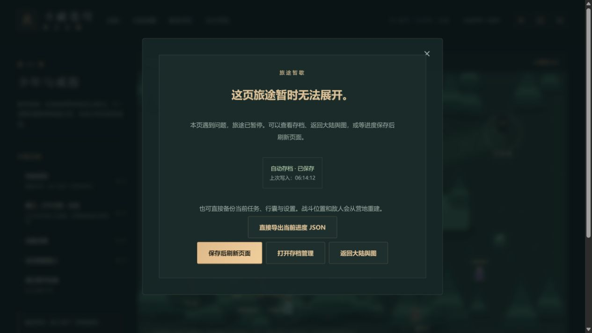
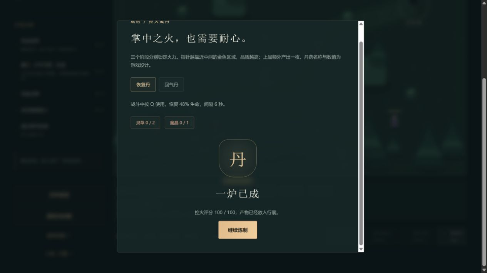

# C11b-6 按需操作面板

2026-10-12；0.37.1。0.37.0首页静态JS496347距500000预算仅3653。设置、坊市与炼药现在通过一个按需模块打开，现有控件与规则不改；每页共用20秒期限和故障边界，失败有暂停、直接JSON备份、打开存档及保存刷新。

生产清单额外检查Panels、GameView、SavesPanel分别存在独立JS模块且不在首页静态依赖图，即使总字节未超预算也不能误改为同步引入。新增Node规则验证动态成功、缺失、非JS、静态回流。

108文件674Vitest+4Node、类型/旧档迁移/三难度早期完整链及28章正常规则回放/构建通过。入口488439字节/gzip158750，较0.37.0少7908字节/gzip少2407；全部JS1623906、引擎gzip173297且按需。固定预算不提高，初始余11561，Phaser大块提醒保留。这里不声称手机首载或FPS改善比例。

## 实际网页验收

独立本地4181生产服务仅对`Panels-*`返回HTTP404，其他文件正常，控制与请求日志在本地`.git/task-toolkit-control.json`/`task-toolkit-http.log`。通过computer-use正常网页动作，无存储/React/网络Promise注入。

首页正常打开、新旅程80金币、第一章三页开场后实际画布1。直到按“游戏设置”才出现`Panels-Bh3hNVuT.js`真实404；恢复卡标题/状态/备份/刷新/存档/返回均可见，焦点在“直接导出当前进度JSON”，实际下载文件已检查：第一章、intro=true、零完成、80金币，未新增物品。网络错误如实留在控制台。

恢复服务资源，按保存后刷新，设置正常打开。勾选减弱动态，进入原第一章/营地/坊市，实际购两草一晶共44金币，余额36。炼药首步100分后关闭，再开仍草2/晶1，无消耗；重新开炉三次原生按钮100分，第三步才草2→0/晶1→0、恢复3→5、积累0→12、炼制数1。三个手动槽保持空白，存档正常实际导出。刷新人物36金币12积累/恢复5保持，设置减弱动态仍勾选。本次未做任何章节首通。

两图实际查看。炼制截图的顶部略被滚动截断，结算100/100与草0/晶0完整显示，人物余额和丹药由DOM及真实下载JSON核对；不把画布数称性能验证。

真实4177旧终局档0.37.0→0.37.1刷新/正常导出，整state仅contentVersion变化。28章、伙伴24页、19506金币15582积累/草5晶89恢复17回气16/火能4、双卷8/8与援助10/10/两次重试，以及空手动槽保持。旧4174手动档本批未操作。

## 接续

0.37.0已推送dd743553e64fc52ea33b9cd71b3630fb20c6306e且远端同SHA，Game checks38179422495 success、Pages38179422503 skipped。

本批提交推送后接真实资源等待超过20秒及迟到响应专项。请求404已有证据，真实后台/真人手机/阅读器、Beta、完整来源和公开切换/回滚不能由本批代签。
