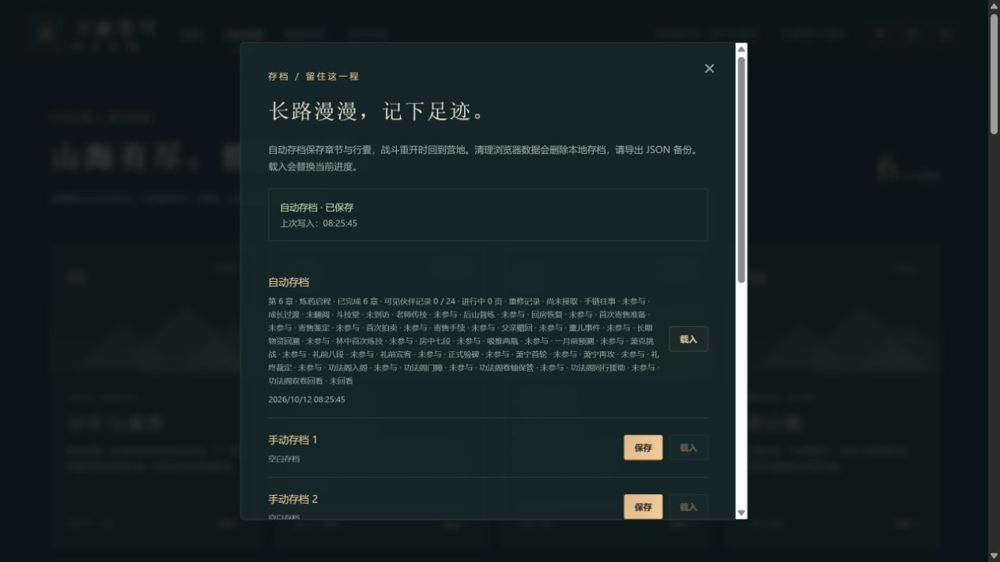
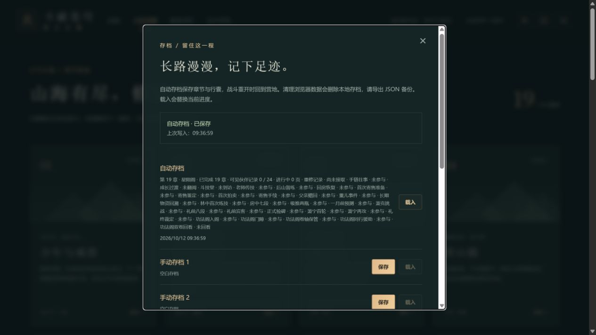
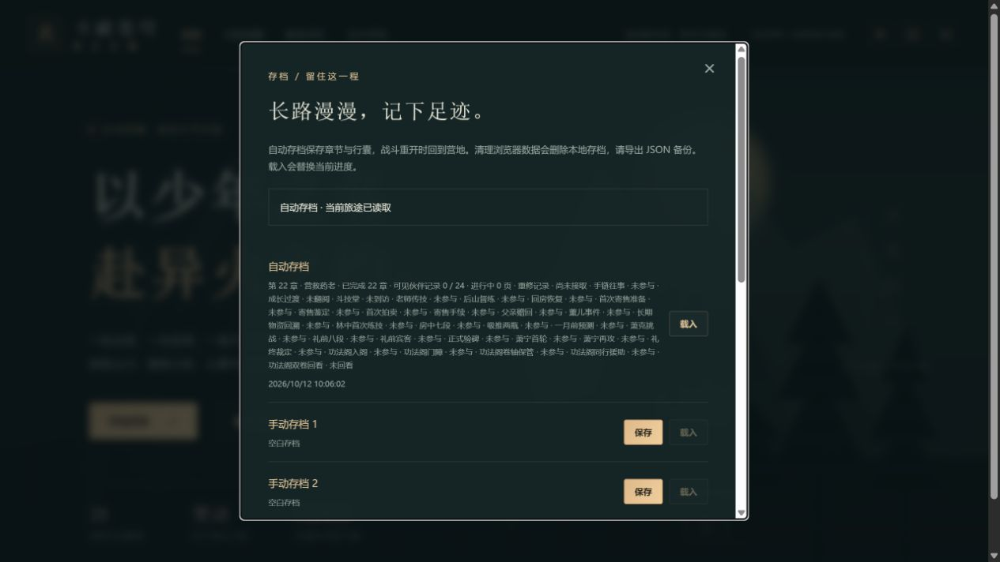

# C11c-3 普通难度独立旅途

2026-10-12。运行0.37.5正式源码提交`28b1d98029836105bb57b17762983b75ba7690b5`的独立完整生产归档，地址4184。以空白站点正常新旅程、普通难度和减弱动态开始；未导入已通关档，未写浏览器内部状态、坐标或事件。此前完整28章/24页旅途在其他站点保持。

## C11c-3a：前三章

本批签普通难度桌面实际主流程及中途备份，为之后C5b离阵中断、C6b免费巡防留下合法未结算旅途。它不是完整早期扩展剧情的新验收，也不是实际玩家平衡或真人Beta。

| 节点 | 正常操作与可见结果 | 导出金币 / 积累 | 行囊：草 / 晶 / 恢复 / 回气 |
|---|---|---|---|
| 第1章首通 | 教学2/2，三草、三敌、守卫326→118→击败，首通140 | 250 / 155 | 3 / 3 / 2 / 2 |
| 第2章首通 | 立约祖训碑/演武台/出门路手动E依次1/2/3，教习真实两轮交战，首通200 | 498 / 345 | 3 / 7 / 0 / 2 |
| 第3章首通 | 报价60、交付草2晶1，三道原生控气滑杆各50%得300/300，支援/斗技/普攻击败418生命投影，首通230 | 830 / 550 | 1 / 9 / 0 / 2 |

第一章教学完成后曾将角色留在安全营地范围外读源码，角色闲置受击到0并出现正常失败窗口。点击“回到营地，重新挑战”后教学2/2保留，继续采集和战斗。本批保留这次失败，不能据代理闲置推断游戏缺陷或实际玩家难度失衡。

沿路行走在受击时实际停止，必须手动应战再续行。战斗使用页面按钮并等待实际普攻冷却，没有一瞬间多次点击充当连续伤害。第1章消耗恢复丹1，第2章消耗2并正常营地休整一次，第3章使用药老支援；没有购买、强化、炼药或切换难度。首领击败时分别105/180、77/198、99/220生命，然后各自正常首通恢复。可选竞争委托、伙伴页和早期重修全链未参与。

每章首通后通过正常存档窗口真实下载JSON，独立本地保留：

- `.git/task-normal-ch01-export.json`
- `.git/task-normal-ch02-export.json`
- `.git/task-normal-ch03-export.json`
- `.git/task-normal-ch03-refreshed-export.json`

文件用当前官方`parseSave`在浏览器外验证，解析结果逐字段与真实下载state相同，未合成或重签进度。第3章正常刷新后再导出的整个state完全相同：completed=[1,2,3]、总击杀10、总炼药0、强化均0、修炼之火、normal/reducedMotion及未参与事件保持。三个手动槽始终空白，上一份自动摘要仍完成2章，刷新未多发首通资源。新站点控制台error=[]。

本批六张截图均实际查看；第1/2/3下载时截图滚动位置主要呈现空手动槽及上一份备份，不把备份的较少完成数量当作当前自动档数量。实际文件指纹、任务和资源详[机器可核记录](qa/c11-normal-early-journey.json)。

规则沿同一0.37.5完整110文件685Vitest+11Node、迁移与三难度早期/28章回放证据；本批存档/版本保护/预览3文件18项通过，含既有旧格式迁移；类型/生产构建/包体/完整性再次通过，71文件1735100字节、入口489229/gzip158980、引擎gzip173297且按需、总JS1625218。日志.git/task-normal-save-tests.log与task-normal-build.log。只增加验收证据，不提高玩法版本。正式构建提交28b1d98远端一致，Game checks38185449706 success、Pages38185449737 skipped。

下一批C11c-3b继续同一4184普通旅途第4青山镇、第5山脉邂逅、第6炼药启程，正常保留中途备份；后续达到第13章时先补离东阵中断，再第17免费巡防。完整原作事件/中文与动画精确来源、实体设备、后台、阅读器、真人Beta及公网发布保持各自待验。

## C11c-3b：青山镇、山脉、认证

同一普通旅途继续完成4–6章。上一证据批ff27cf8639a5de0bbeac1da596a6aeab91be54e2已推送且远端匹配，Game checks38186774330 success、Pages38186774363 skipped。首次SSH推送临时断开，正常重试成功，没有改远端地址或强推。

| 节点 | 实际操作 | 导出金币 / 积累 | 草 / 晶 / 恢复 / 回气 |
|---|---|---|---|
| 第4章 | 小医仙接取、石刻读叶→月→火、机关三符、实体穿门领宝、正常休整后洞口确认、464→179→击败归途投影、独立260首通 | 1154 / 790 | 4 / 15 / 1 / 2 |
| 第5章 | 两处药圃双方E、回接被甩开的同伴、洞口120生命完成护送；重新警戒24秒、窗口打开真实备份、西侧E撤离和290首通 | 1372 / 1075 | 6 / 21 / 2 / 2 |
| 第6章 | 丹方台实际读35/60/50、药炉原生滑杆300/300、未登记真实备份、执事40/50登记、实际E审核、独立320首通 | 1732 / 1375 | 6 / 21 / 2 / 2 |

第五章如实记录两次失败：第一次到南坡后错误等待另一种交互提示，长工具等待使同伴遭攻击倒下；正常营地休整免费恢复120/120，随后使用当时实际“E · 与采药同伴交谈”推进药圃。返回洞口时同伴被甩开，前置未完成导致云韵接取按钮禁用；正常导航“采药同伴”接回、等双方到达后E，才完成3/3。没有把禁用接取或工具超时当作游戏错误。

第一次警戒尝试用闪避、方向键和区内路线走位，但仍在剩余2秒时受击死亡。正常失败恢复保留护送3/3与警戒1/3，当前计时恢复24，已采草不重发。接着从普通坊市以每枚45金币真实购买4枚恢复丹，1226→1046、恢复0→4；不强化或切换难度。第二次在区内灵草4/5之间正常沿路往返，受击会停止路线，使用恢复丹2次，警戒计时实际21→17→12→5→窗口开启，115生命仍存活；西侧正常E撤离才签挑战。菜单在工具调用间暂停世界和计时，不把这套代理操作冒称无暂停真人24秒难度结论。

失败及菜单截图保留：[同伴倒下后的休整窗口](qa/c11-normal-ch05-companion-failed.png)只显示营地菜单，0生命由当时可见DOM确认；[警戒失败窗口](qa/c11-normal-ch05-survival-failed.png)实际显示失败；[撤离后的290首通入口](qa/c11-normal-ch05-ready.png)显示正式结算仍独立。

第5窗口打开的真实JSON仍completed=[1,2,3,4]、警戒stage2、boss=false，不提前签撤离或发首通。第6未登记JSON实际stage5、300分/尝试1、1372金币1075积累；登记和首通后合计恰好+360金币/+300积累，行囊全同，认证没有生产丹药。两份中途文件与4/5/6首通、6刷新文件均由当前官方parseSave逐字段验证。

第6首通刷新后的整个state完全相同，completed=[1..6]、1732/1375、草6晶21恢复2回气2、普通/减弱动态、总炼药0、强化0；前3章progress与上一批逐字段相同。三个手动槽仍空白，上一份自动摘要完成5章，error=[]。可选人物卷页、重修扩展和第3竞争支线没有被补签。

本批六张图实际查看。所有实际下载的本地副本是`.git/task-normal-ch04-export.json`、`task-normal-ch05-window-export.json`、`task-normal-ch05-export.json`、`task-normal-ch06-pending-export.json`、`task-normal-ch06-export.json`及`task-normal-ch06-refreshed-export.json`，文件指纹和真实节点详[机器可核记录](qa/c11-normal-mountain-certification.json)。这些是UI真实下载，不是为验收构造的存档。

版本保持0.37.5，山脉/认证/旧档/三难度全早期与28章回放4文件24项通过；类型/生产构建/包体/完整性通过，71文件1735100字节，入口489229/gzip158980、引擎gzip173297按需、总JS1625218，原预算保持。日志.git/task-normal-mountain-tests.log与task-normal-mountain-build.log，当前复核构建清单绑定ff27cf8；实际网页仍运行独立28b1d98归档。本批仅补普通路线证据。接C11c-3c同一旅途7–9章，然后10–13与离阵专项、17免费巡防；完整来源、设备/Beta及公网门槛继续开放。

## C11c-3c：沙城、青莲与大会

上一批5562045ca06ce02b140a722f1605db8ed0571fd1已远端一致，Game checks38188195519 success、Pages38188195511 skipped。同一4184普通难度真实旅途已完成7–9章，仍0.37.5、零强化、总炼药0；菜单在工具调用间暂停，不签真人Beta或无暂停难度平衡。

| 节点 | 真实主流程 | 金币 / 积累 | 草 / 晶 / 恢复 / 回气 |
|---|---|---|---|
| 第7章 | 青鳞线索、实际后巷/水井守卫，第二囚栏剩1守卫拒救，清除后两次各恢复1、报告50；602→121→击败投影、350首通 | 2198 / 1680 | 6 / 24 / 4 / 2 |
| 第8章 | 药老/入口/控火坛，三段各12秒，正常沿路到灵草4附近冷却点，热量持续0但实际受伤；用恢复2，59生命完成第三段；回报/收服台E/380独立首通才得青莲 | 2650 / 2010 | 6 / 27 / 2 / 2 |
| 第9章 | 报名/赛程牌/三座赛炉，原生火候25/55/45、65/40/70、35/75/50；三轮300/300/300、尝试3；登记60/80、领奖台E审核、410首通 | 3120 / 2415 | 6 / 27 / 2 / 2 |

每章真实下载首通JSON，并另保第7两人已救待报告、第8三段完成待报告、第9三轮完成待登记三个节点。第8待报告文件仍基础火、boss=false且未完成第8章，不提前签异火。第9待登记→首通合计恰好+470金币/+405积累、行囊全同，比赛没有生产丹药。本批没有购买、强化、切换难度或修改存档推进。

第9真实刷新后再次导出，整个state相同：completed=[1..9]、3120/2415、青莲、零强化/炼药、普通和减弱动态保持，前6章progress逐字段与C11c-3b相同。三个手动槽仍空白，控制台error=[]。三张自动摘要截图均实际查看。

真实文件副本为.git/task-normal-ch07-rescue-export.json、ch07-export.json、ch08-pending-export.json、ch08-export.json、ch09-pending-export.json、ch09-export.json及ch09-refreshed-export.json（后六项同task-normal-前缀）。当前官方parseSave在浏览器外逐字段验证；指纹、任务与资源详[机器可核记录](qa/c11-normal-desert-tournament.json)。规则和类型生产检查结果记录在本段后续验收；实际网页仍是28b1d98独立归档。

下一批C11c-3d同一普通旅途10–13章，保留第13东阵尚未完成的实际文件并补离阵清计时专项；后续第17免费巡防。已有剧情难度完整档保持，完整人物/来源/设备/Beta/公网门槛继续开放。

C11c-3c最终：救援/控火/大会/旧档与三难度早期和28章回放5文件35项通过，类型/生产构建/包体与指纹通过，71文件1735100字节；入口489229/gzip158980、引擎gzip173297按需、总JS1625218、原预算保持。日志.git/task-normal-desert-tests.log和task-normal-desert-build.log；复核清单绑定5562045，网页仍28b1d98。仅证据批不抬玩法版本。

## C11c-3d：赴约、追逃、拍卖退场与东阵离阵

f251037bbffb5fae0dcf63f857e4a43a6fddcd12已远端一致，Game checks38189413924 success、Pages38189413898 skipped。同一4184真实普通旅途完成10–13；0.37.5、零强化/总炼药0保持，三手动槽仍空白。此前独立完整剧情难度旅途保持。

| 节点 | 实际正常操作 | 金币 / 积累 | 草 / 晶 / 恢复 / 回气 |
|---|---|---|---|
| 10 | 山门约碑/入口2/2、决斗碑E、技能/支援/普攻，第一轮可见第2阶段/436生命，第二轮击败，276/374生命、独立440结算 | 3560 / 2765 | 6 / 27 / 2 / 2 |
| 11 | 前哨E、岩间实际6秒后246生命/2/4真实下载，竹林实际6秒/用1恢复后296生命、北侧出口E、独立470 | 4030 / 3140 | 6 / 27 / 1 / 2 |
| 12 | 公告/竞拍台、40托管4030→3990、对手60回应全额回4030、选择免费退场；4/5下载、独立30积累登记、拦截实战、500首通 | 4530 / 3570 | 6 / 27 / 1 / 2 |
| 13 | 集合/西阵守位、正常清2守卫、实际东阵部分离阵重置专项、40登记、入院E审核、独立530 | 5128 / 4055 | 6 / 29 / 1 / 2 |

第13先正常下载接取0/4、守位2/4；都没有第13首通或boss完成。正常沿路到东阵1000/400，真实计时“持续共鸣 · 剩余2秒”时开营地暂停。正常选择西阵沿路行走700ms，再暂停时公开DOM位置773/400，任务仍2/4/同伴140/140，提示回到“同伴守住西阵 · 保护同伴，到东阵共鸣”。正常返东阵1000/400后实时提示重新“持续共鸣 · 剩余3秒”；再实际完整3秒才3/4。没有改JSON、注入坐标/计时/同伴生命或导入fixture，补齐当前版C5b独立离阵中断证据。

三张离阵[部分计时暂停图](qa/c5b-east-partial-normal.png)、[离阵暂停图](qa/c5b-east-left-normal.png)、[返阵暂停图](qa/c5b-east-reset-normal.png)实际查看，只显示营地菜单和模糊背景；不能用图冒称可读倒计时。上述计时、位置与2/4来自当时工具实时只读DOM输出，并写入[机器可核记录](qa/c11-normal-duel-academy.json)。运行态共鸣计时不进入JSON；保存文件证明持久节点和未提前奖励，不能单独证明部分秒数。历史0.7.1回退原因没有证据，本次离阵/新版刷新不替它关闭。

3/4待报告实际下载→若琳40积累→入院资格审核E→530首通恰好+530金币/+465积累，行囊全同。第13实际刷新再次导出，整个state完全相同、completed=[1..13]，前9章progress与C11c-3c逐字段相同。拍卖4/5待报告文件与11终点金币/行囊全同，未领取竞得物资；12终点仅+500金币/+430积累，行囊不变。

10/11/12/13另有[10槽位](qa/c11-normal-ch10-summary.png)、[11槽位](qa/c11-normal-ch11-summary.png)、[12槽位](qa/c11-normal-ch12-summary.png)、[13槽位](qa/c11-normal-ch13-summary.png)真实下载后的窗口图；截图滚动在下部，显示三空手动槽与上一份自动记录，**不是当前完成数量截图**。全八图实际查看，13-top另显示当前自动完成13。控制台error=[]。

十份真实下载副本为.git/task-normal-ch10、ch11-safe、ch11、ch12-pending、ch12、ch13-start、ch13-guard、ch13-pending、ch13、ch13-refreshed-export.json（各项均task-normal-前缀）。当前官方parseSave在浏览器外逐字段验证，JSON记录其SHA256/字节数/持久节点/资源。决斗/追逃/拍卖/协作/旧档/三难度早期与28章回放6文件46项通过，类型/生产构建/包体/全部指纹通过，71文件1735100字节；入口489229/gzip158980、引擎gzip173297按需、总JS1625218保持。日志.git/task-normal-duel-academy-tests.log与task-normal-duel-academy-build.log，复核清单绑定f251037，实际网页仍28b1d98归档。

工具长分析之间菜单暂停，不代称真人无暂停难度平衡或Beta。一次十章结算已成功但结语遮挡导致后续“存档管理”超时、REPL重置，重新观察读完两页再下载成功；已击败首领的meter查询无匹配是验收脚本过度查询，不是游戏报错。接14–17和C6b免费巡防；完整来源/人物、真实设备/Beta/公网继续各自待验。

## C11c-3e：内院、塔底、宗门与免费巡防

上一批4c970352f37cbbd0b281b2f266d486d81e379235已推送；SSH读远端两次临时断开，以GitHub ref API实际核main相同，Game checks38190600269 success、Pages38190600266 skipped。同一普通真实旅途完成14–17，0.37.5保持。

| 节点 | 实际操作 | 金币 / 积累 | 草 / 晶 / 恢复 / 回气 / 火能 |
|---|---|---|---|
| 14 | 集合/西单卫/东双卫、队友受伤72/180，正常休整180但掉队，返集合点接回再胡嘉登记；火能0→2→4→2，强榜329→183→52→胜利得5，560独立首通 | 5796 / 4565 | 7 / 32 / 1 / 2 / 5 |
| 15 | 第一8秒后384生命；第二热61→镇心0→完成164生命；正常休整保2层，实际买6恢复−270而未用；第三12秒分段镇心58→0/62→0/60、末段支援，韩枫487→265→胜利227生命，590首通才心炎 | 6306 / 5090 | 7 / 37 / 7 / 2 / 5 |
| 16 | 三阵守卫与3/4/5秒、第三剩1秒→完成4/5待报告，正常药老报告/实体山门/云山432→21→胜利、620独立首通，之后支援disabled | 7086 / 5630 | 7 / 41 / 7 / 2 / 5 |
| 17 | 免费巡防选择不扣7086金币/行囊，西台守卫清理3/5后实际保存刷新；东台2守卫实际拒绝，战后4/5下载；报告独立恢复1/40积累、真实边境战38→胜利、650独立首通 | 7904 / 6235 | 7 / 45 / 8 / 2 / 5 |

第17已补C6b免费巡防正常正金币路线，选择文件7086/5630和16终点金币/行囊全同；西驻点实际3/5刷新仍保持，路线不变。巡防待报告7254/5670/恢复7→已报告7254/5710/恢复8/回气2，恰好金币0、积累40、恢复1，无回气发放，报告按钮消失；首通恰好+650/+525，行囊不变。四次普通击杀如实记录：西段前战斗已经清到部分东卫，未登记东段刷新按规则重建，不能把本次称三次唯一守卫。零金币巡防与出资缺款没有本次真实网页证据，继续规则待验。

12份真实下载副本.git/task-normal-ch14-pending、ch14、ch15-pending、ch15、ch16-pending、ch16、ch17-choice、ch17-west、ch17-pending、ch17-report、ch17、ch17-refreshed-export.json（均task-normal-前缀），当前官方parseSave在浏览器外逐字段验证；[机器可核记录](qa/c11-normal-academy-alliance.json)含实际指纹。15待报告仍青莲、boss=false/未完成，首通才fallen；17真实刷新后整state完全相同、completed=[1..17]，前13章progress逐字段保持、普通/减弱动态/零强化炼药/三空manual，error=[]。14采草一次是相邻通用E实际触发，资源如实计入，不抹掉。

[14槽位](qa/c11-normal-ch14-summary.png)、[15槽位](qa/c11-normal-ch15-summary.png)、[16槽位](qa/c11-normal-ch16-summary.png)、[17槽位](qa/c11-normal-ch17-summary.png)显示三空手动槽/上一自动摘要，滚动仍在下部，不能叫当前完成数截图；17-top实际键盘聚焦/ControlHome后显示当前自动17完成。五图均实际查看。一次17待报告下载等待超时导致REPL重置，原UI实际存档窗口仍暂停；重新观察正常下载成功，没有改存储或状态。

猎捕/塔/宗门/炎盟/支援/旧档/三难度早期与28章回放7文件67项通过，类型/生产构建/包体/全部指纹通过。71文件1735100字节，入口489229/gzip158980、引擎gzip173297按需、总JS1625218保持；复核清单绑定4c97035，实际网页仍28b1d98独立归档。日志.git/task-normal-academy-alliance-tests.log与task-normal-academy-alliance-build.log。菜单暂停分段不签真人Beta/无暂停平衡；接18–22普通旅途及尚未验路线，完整来源/人物/设备/公网继续开放。

## C11c-3f：雷云与西→东师门联络

db3cd93659d0ac15336b978841fd0ed2127909e6已远端一致、Game checks38192082929 success、Pages38192082935 skipped。同一普通旅途完成18–19，0.37.5保持。

十八西段实际8秒后385/526生命、stage2/4真实备份；东段途中受击停步338，再正常重选到避雷石，用恢复丹1、剩4秒时385生命，再实际4.3秒完成3/4，北侧事件山口E撤离、680独立首通。8584/6785、草7晶45恢复7回气2火能5；总击杀与17完全同，没有普通战或首领奖。药老仍离队。

十九补此前只有规则证据的西→东顺序：正常西林E实际拒绝1守卫，清理后score1单份下载；真实刷新/重返仍西已取得、东待寻找。正常清东2守卫、到东簿E取齐score3，真实中庭首次正确选丹塔、attempt1、stage3未报告下载；风尊者唯一50登记，审核台第一次通用E实际采相邻草1、出现明确“提交师门联络审核”后再E才正式通过，710独立结算。不跳章、不改变JSON、没有导入fixture。

十九待报告→首通恰好+710金币/+625积累，行囊仅草+1，独立50登记与575首通保持。真实刷新下载整state完全相同：completed=[1..19]、9432/7440、草8晶48恢复7回气2火能5、陨落心炎/普通/减弱动态/零强化炼药/三空manual，前17章progress与前批逐字段相同，控制台error=[]。

[十八章首通摘要](qa/c11-normal-ch18-summary.png)与十九摘要两图均实际查看，正常焦点/ControlHome显示当前完成18/19。六真实文件副本为.git/task-normal-ch18-safe、ch18、ch19-west、ch19-pending、ch19、ch19-refreshed-export.json（各项task-normal-前缀）；当前官方parseSave浏览器外逐字段验证，[机器可核记录](qa/c11-normal-thunder-lineage.json)包含真实指纹/奖励差值。

追逃/联络/支援/旧档/三难度早期与28章回放5文件42项通过，类型/生产构建/包体/全部指纹通过：71文件1735100字节，入口489229/gzip158980、引擎gzip173297按需、总JS1625218保持；复核清单绑定db3cd93，实际网页仍28b1d98。日志.git/task-normal-thunder-lineage-tests.log与task-normal-thunder-lineage-build.log。此为菜单分段暂停的AI桌面证据，真人Beta/无暂停难度、完整来源/人物/设备/公网继续待；接20–22，优先丹界同一45秒真实世界窗口取三份专项。

## C11c-3g / C7a：普通丹界单窗口与丹雷

上一批7c60848fe61b96df9b05ebae3e3b1b36a1d07407已用GitHub ref API核main一致，Game checks38192766009 success、Pages38192766022 skipped。PowerShell API读取曾临时EOF，curl正常读取并核到实际结果；不写成CI失败。

同一4184普通旅途完成第20章，首次补上丹界**仅启动1次、同一45秒游戏计时窗口取得三份**的桌面证据。任务牌真实45秒，西路受击停止后再正常续行，西侧火莲/八极/普攻清守，北侧浪尺/八极/普攻，东侧两次普攻；西→北→东取得位，暂停时实时剩余42→40→37→35→32秒，最后E第三份显示“时限结束”。没有休整、刷新、重建或重试45秒窗口。菜单在工具间暂停世界，这不是无暂停真人速通或玩家平衡结论。真实待报告下载stage2/score7/attempts1/boss=false，四守卫普通收益192金币/40积累/晶4；指定药材没有增加普通草。回执事仅登记，不发资源。

成丹第一次错误把原生滑杆当作跨步骤保留值，实际每步重置；结果140分未过、尝试1。按正常免费重试，第二次独立三步PageUp至可见0.3/0.7/0.5，300分通过、尝试2，没有扣赛材或生成行囊丹药。保留失败，不把操作误解归因产品缺陷。

丹雷台E正式开始18秒。真实剩15/12/7秒时生命374/274/444；普通恢复丹1枚合法使用，最终244/562生命存活、stage6待报告。计时受浏览器调度影响，每次工具等待时长不直接等于世界已运行时间，按页面剩余和真实完成节点判断。没有丹雷普通击杀收益。玄空子唯一80积累登记、实际大会审核E、独立营地740首通，药老继续离队；终点10364金币8160积累、草8晶52恢复6回气2火能5、陨落心炎。仍普通/减弱动态、零强化/总炼药0、三手动空槽。

四份真实下载副本：.git/task-normal-ch20-herbs-export.json、ch20-thunder-export.json、ch20-export.json、ch20-refreshed-export.json（后3同task-normal前缀）。当前官方parseSave在浏览器外逐字段等于原始JSON.state；20刷新整个state全同、前19章progress逐字段保持。待丹雷报告→首通恰好+740金币/+680积累（80登记+600首通），行囊全同。文件指纹和持久节点见[机器可核记录](qa/c11-normal-dan-realm.json)。控制台error=[]，实际旧完整档保持。

图已实际查看，当前摘要为20章已完成20，不能用上一份自动摘要代签。首通后记未读完时曾错误等待下载，工具超时后核正常对白、读完两页再下载；不是存档失败。版本0.37.5保持，丹界/丹雷/旧档/三难度早期和28章回放4文件33项通过、类型/生产构建/包体完整性通过，71文件1735100字节、entry489229/gzip158980、总JS1625218、引擎gzip173297按需。日志.git/task-normal-dan-tests.log与task-normal-dan-build.log；本轮复核构建绑定7c60848，实际网页仍28b1d98独立归档。接21星域与22营救普通旅途，完整原作/来源、死亡末帧人工、真机/Beta/公网各门槛仍开放。

## C11c-3h / C7b-c：普通星火与师徒撤离

8fe67c28d275ff711afa92b76e8b32373997ba22已正常推送并用GitHub ref API核main完全一致，Game checks38193590239 success、Pages38193590262 skipped。首次SSH推送临时断开，正常重试成功，不强推或改变远端。

同一普通旅途21–22首通，不参与可选伙伴页、强化或生产炼药。第21核心必须E打开正式事件再点击“开始星火稳固”，不是E后等待便能启动。开场导航途中通用E正常采到草1，真实下载草8→9，不将此草归因稳固奖励。

第一段发生两次100压力失控：首次启动后误等待已关闭弹窗，随后真实剩7秒/454生命/压力100；正常免费休整重试后一次回镇心途中受击停止，错误沿用未到达假设，实际剩3秒/370生命/压力100。两次均正常免费休整从当前10秒重新开始，不删失败或补造状态。之后逐段短操作、暂停读当前压力并核西侧镇心石860/420实际抵达；10/12/14秒三段通过。第一段镇心7秒保持而43→14下降、第二段压力归零且计时暂停、第三段跨段53压力与14秒均真实显示。第三段核心/镇心配对58→11、30→9、29→0，剩余14→13→12→11→9→8→6→5→3→完成；恢复丹1枚合法使用，最终186/580生命完成5/6。两个安全节点与待报告均下载真实文件。

引路人报告/收服台E均不发资源和异火。首通前真实JSON仍fallen、10364/8160、草9晶52恢复5回气2、51总击杀；770正式首通才11134/8785和star。第21刷新整个state相同，没有普通击杀收益，药老仍离队。

第22确认退路、外廊/内封/囚牢四守卫实战、按E依序破禁，囚牢生成200生命药老与两追击者。正常清两追击者，有6普通击杀收益312金币/60积累/晶6，不能称营救全无战斗收益。护送中真实超过180等待、受击中断路线；反复正常重选动态“药老 · 撤离同伴”接回，经700/446→534/517→369/587可见位置，200生命安全会合。没有本章用丹或休整重建；星火正常恢复在长回程提升生命，不制造无伤证明。

待报告实际下载stage4；风尊者报告stage5后再下载，金币/积累/行囊完全相同、支援仍离队。出口E确认仍R disabled，独立800首通才12246/9495、三千焱炎火/药老归队。第22真实刷新下载整个state相同，前20章progress与20终点逐字段相同、21记录保持；普通/减弱动态、零强化/总炼药0、草9晶58恢复5回气2火能5、三手动槽空白。实际重返第22页面R按钮enabled=true，未重复护送或奖励，error=[]。

十份真实下载副本为.git/task-normal-ch21-stage3-export.json、21-stage4、21-pending、21-gate、21、21-refreshed、22-pending、22-reported、22、22-refreshed（均同task-normal-ch前缀及-export.json后缀）。官方parseSave逐字段相同、teacherSupport核首通前后离队/归队；文件指纹与节点见[机器可核记录](qa/c11-normal-star-rescue.json)。菜单暂停不代签玩家Beta或实体设备，两次失控是实际代理操作结果，不直接归因难度失衡。

两图已实际查看。版本保持0.37.5，星火/营救/旧档与三难度早期和28章回放4文件27项通过，类型/生产构建/包体与完整性通过，71文件1735100字节、entry489229/gzip158980、总JS1625218、引擎gzip173297按需。日志.git/task-normal-star-rescue-tests.log与task-normal-star-rescue-build.log；复核清单绑定8fe67c2，实际网页仍28b1d98独立归档。接23–24普通天墓与菩提，完整原作/来源、死亡末帧人工、真机/Beta/公网门槛保持。
