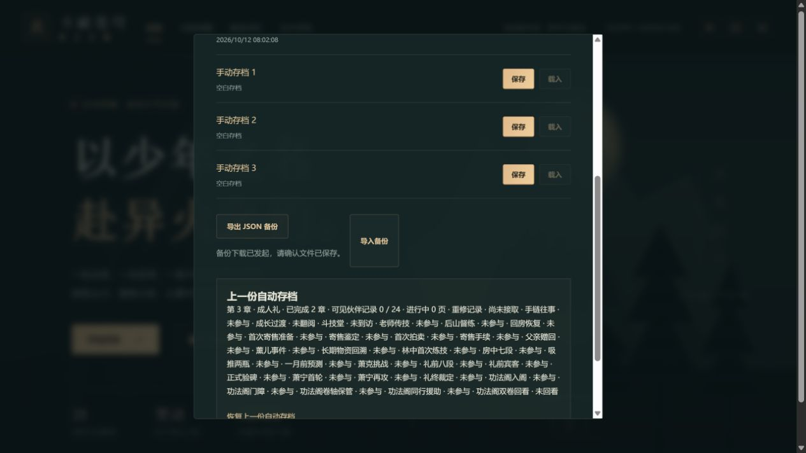
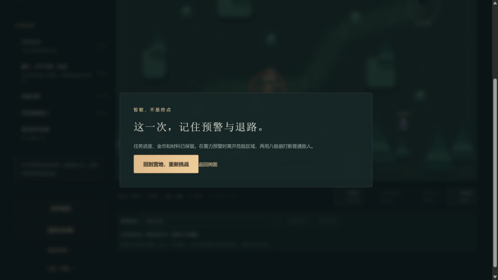

# C11c-3 普通难度独立旅途

2026-10-12。运行0.37.5正式源码提交`28b1d98029836105bb57b17762983b75ba7690b5`的独立完整生产归档，地址4184。以空白站点正常新旅程、普通难度和减弱动态开始；未导入已通关档，未写浏览器内部状态、坐标或事件。此前完整28章/24页旅途在其他站点保持。

## C11c-3a：前三章

本批签普通难度桌面实际主流程及中途备份，为之后C5b离阵中断、C6b免费巡防留下合法未结算旅途。它不是完整早期扩展剧情的新验收，也不是实际玩家平衡或真人Beta。

| 节点 | 正常操作与可见结果 | 导出金币 / 积累 | 行囊：草 / 晶 / 恢复 / 回气 |
|---|---|---|---|
| 第1章首通 | 教学2/2，三草、三敌、守卫326→118→击败，首通140 | 250 / 155 | 3 / 3 / 2 / 2 |
| 第2章首通 | 立约祖训碑/演武台/出门路手动E依次1/2/3，教习真实两轮交战，首通200 | 498 / 345 | 3 / 7 / 0 / 2 |
| 第3章首通 | 报价60、交付草2晶1，三道原生控气滑杆各50%得300/300，支援/斗技/普攻击败418生命投影，首通230 | 830 / 550 | 1 / 9 / 0 / 2 |

第一章教学完成后曾将角色留在安全营地范围外读源码，角色闲置受击到0并出现正常失败窗口。点击“回到营地，重新挑战”后教学2/2保留，继续采集和战斗。本批保留这次失败，不能据代理闲置推断游戏缺陷或实际玩家难度失衡。

沿路行走在受击时实际停止，必须手动应战再续行。战斗使用页面按钮并等待实际普攻冷却，没有一瞬间多次点击充当连续伤害。第1章消耗恢复丹1，第2章消耗2并正常营地休整一次，第3章使用药老支援；没有购买、强化、炼药或切换难度。首领击败时分别105/180、77/198、99/220生命，然后各自正常首通恢复。可选竞争委托、伙伴页和早期重修全链未参与。

每章首通后通过正常存档窗口真实下载JSON，独立本地保留：

- `.git/task-normal-ch01-export.json`
- `.git/task-normal-ch02-export.json`
- `.git/task-normal-ch03-export.json`
- `.git/task-normal-ch03-refreshed-export.json`

文件用当前官方`parseSave`在浏览器外验证，解析结果逐字段与真实下载state相同，未合成或重签进度。第3章正常刷新后再导出的整个state完全相同：completed=[1,2,3]、总击杀10、总炼药0、强化均0、修炼之火、normal/reducedMotion及未参与事件保持。三个手动槽始终空白，上一份自动摘要仍完成2章，刷新未多发首通资源。新站点控制台error=[]。

本批六张截图均实际查看；第1/2/3下载时截图滚动位置主要呈现空手动槽及上一份备份，不把备份的较少完成数量当作当前自动档数量。实际文件指纹、任务和资源详[机器可核记录](qa/c11-normal-early-journey.json)。

规则沿同一0.37.5完整110文件685Vitest+11Node、迁移与三难度早期/28章回放证据；本批存档/版本保护/预览3文件18项通过，含既有旧格式迁移；类型/生产构建/包体/完整性再次通过，71文件1735100字节、入口489229/gzip158980、引擎gzip173297且按需、总JS1625218。日志.git/task-normal-save-tests.log与task-normal-build.log。只增加验收证据，不提高玩法版本。正式构建提交28b1d98远端一致，Game checks38185449706 success、Pages38185449737 skipped。

下一批C11c-3b继续同一4184普通旅途第4青山镇、第5山脉邂逅、第6炼药启程，正常保留中途备份；后续达到第13章时先补离东阵中断，再第17免费巡防。完整原作事件/中文与动画精确来源、实体设备、后台、阅读器、真人Beta及公网发布保持各自待验。
