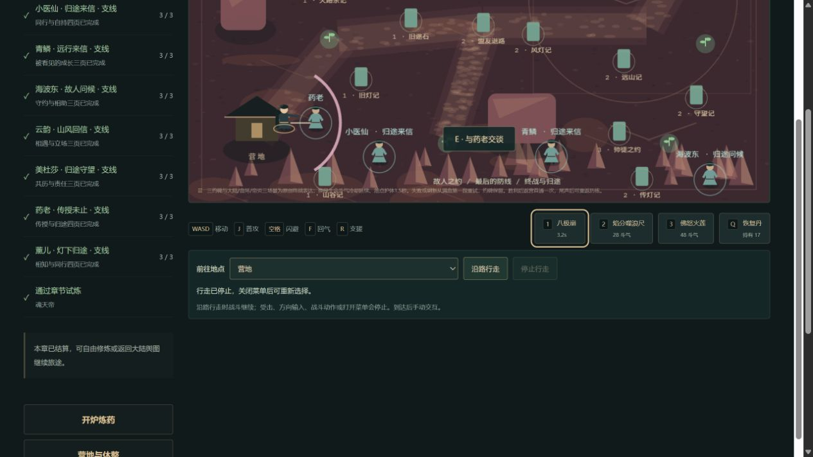
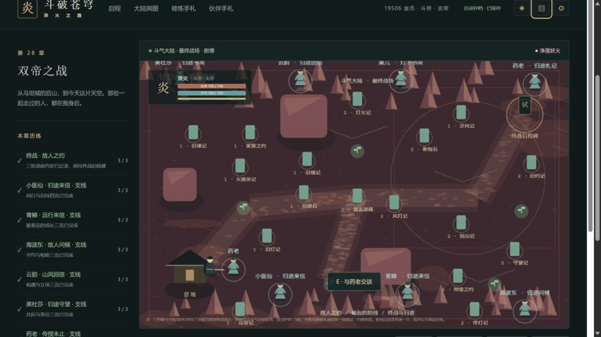

# C11 / E03 未用特效初始化验收

2026-10-15，接正式`8c4eef2b367f028a8c30ccf2cec45e4b287aa4ea`，运行版0.94.1。只修改GameView中的两个Phaser配置，关闭当前游戏从未使用的PreFX/PostFX初始化。原AUTO渲染器、Graphics/Text/Container、普通攻击、斗技及其他程序绘制保持。

任务范围见《C11未用特效初始化任务卡.md》。[机器核验](qa/c11-unused-fx-0941.json)与[未修改的原生采样](qa/c11-unused-fx-0941-native.json)保留固定候选身份、工具指纹、原始间隔、脚本入口和验证边界。

## 实际变化

上批真实长动画帧将两次进入的255.9/295.9毫秒定位至TextureManager.addBase64的图片onload同步入口。阅读实际安装的Phaser3.90.0源码确认，onload发出LOAD，updatePending清零发出READY，随后WebGLRenderer.boot启动PipelineManager；这条同步链还包含其他初始化，不能把全部时间当成图片解码。

PipelineManager读取顶层disablePreFX/disablePostFX，原来均默认false。当前1280×800与默认32分档时，源码中PreFX分支创建24×3+3=75个渲染目标，还会注册FX管线。75是源码分支计数，**不是实测GPU对象数**，也没有删除基础绘制需要的其他目标。当前src没有preFX/postFX或自定义pipeline使用，因此显式关闭两项；Phaser生产文件完整指纹不变，没有修改引擎或构建剥离规则。

除GameView增加三行说明/配置外，全部src与前正式逐字节相同。实际生产GameView块也核见两个true配置。没有为了通过容量验收提高500000/165000/1850000门槛；本批440925初始、160152 gzip、1842095总JS，155发行文件。相较前批总JS增加33字节，初始gzip增加4字节；不是新的下载体积优化。

## 网页与性能

独立4199域正常导入上一正式0.94.0完整原件，实际进入终章、人物菜单、方向移动、普攻、八极崩、退出大陆舆图、再次进入终章及设置菜单。画布实际1→0→1；原减弱动态效果仍勾选，没有改变设置。八极崩的程序绘制弧线与冷却可见，页面实际截图已经查看。这个营地动作样本不代签最大群战的危险帧或GPU释放。

真实58446.8毫秒、60快照，采样期间没有并行构建/测试或注入存档/时间/假负载。记录4个长动画帧、5个脚本入口；两次相同Phaser onload入口为163.7/98.4毫秒，rAF入口35.8/22.9毫秒，另有React click5.6毫秒，一帧脚本数组为空并原样保留。每个有效生产字符位置均按本次候选文件指纹核验。

与上批255.9/295.9毫秒相比，本次两条入口观察值较低；两个独立样本不是独占环境的因果实验，**不承诺固定加速比或卡顿已消失**。本次仍有3条Long Tasks共317毫秒，包含父页56毫秒与游戏163/98毫秒；长动画帧原始blockingDuration共244毫秒，不能把它和Long Tasks相加。场景回调p99=23、最大207.2毫秒，超50毫秒2次；它不是GPU呈现帧率。没有捕获到的脚本不记成零耗时。

## 存档和检查

852份冻结原生旧档逐份与真实旧正式全部373份src/package文件的解析器比较，完整state只改变contentVersion0.94.0→0.94.1；原件和原metadata字节不变。旧证明写入器没有重跑。候选之后两个正常下载，含独立页正常刷新，官方parseSave与其原生state及旧正式迁移后的完整state全相等，金币19506、积累15582、物资、28结算和登记离阁13保持；新增2件独立追加至854。

完整`pnpm check`通过：177文件1084 Vitest、39 Node、类型、三难度28章及早期回放、四槽/上一自动档、生产/许可/容量/场景/完整发行检查。首次check因版本变化使覆盖快照过期而失败；第二次被旧0.94.0第三方声明标题拦下。分别重生覆盖快照及从真实安装源码重生许可清单，许可差异只有标题版号，第三次完整检查成功；保留原失败记录，没有放松检查。

本轮iframe头部click定位失败，重新读取DOM后Enter成功。iframe备份在父页等待download事件时超时并使工具会话重置；页面显示发起但下载目录没有新原件。随后同域独立游戏页正常下载与刷新后第二份均成功。这个失败保留，不能把父页工具超时当成已完成原生下载。实际样本errors和本批两页所查error日志均为空，不延伸为所有历史页从无错误。

## 后续

E03仍partial，固定剩余25工作包；本批是实际初始化配置修正，不关闭最大群战、精确保留对象/GPU和完整调用栈门槛。下一优先完成这些有限缺口或合法来源支持的完整人物包，避免继续发布重复采样器小批。E01历史原事故、E02其他专属末帧、正文/动画、实体设备、真人Beta、权利和发行门槛分别保留。独立提交后再核远端SHA、匹配CI及正式原生刷新；Pages跳过不作已部署。
