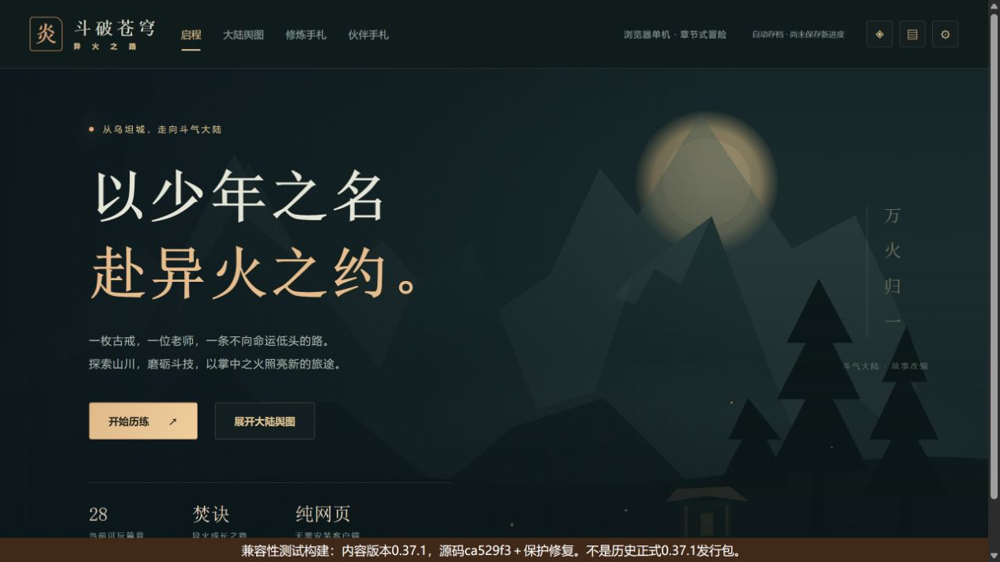
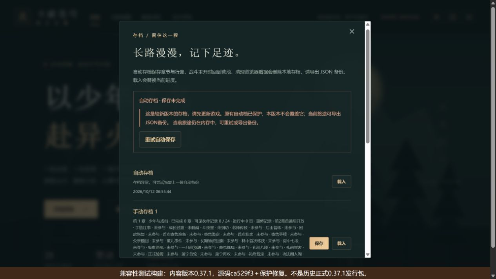
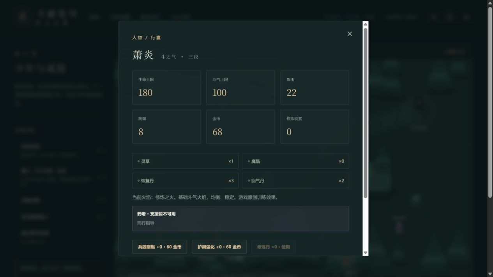

# C11f-3b 本地版本切换与原档恢复

2026-10-12。独立地址4183，实际新版为已推送ca529f3c1df6e25665f76c2c67c71741a158c7dc构建的0.37.2。较低内容版本来自同一提交的隔离源码副本，仅改package版本为0.37.1、HTML标题与醒目的兼容性测试标识；保护代码保留，**不是历史正式0.37.1二进制**。

两个目录均已构建/包体/发行清单/文件指纹核验。控制HTTP服务器只切换静态资源目录，未读写浏览器数据库、内部store或位置；页面正常点击、设置、购买、手动保存及真实下载形成测试旅途。未切换已有4174、4177等其他验收地址。

流程与实际结果：

1. 兼容性构建正常开始第1章、阅读三页开场，开启减弱动态；80金币、草0，保存手动槽1和下载旧JSON。槽1时间06:55:02。
2. 同源切回真实0.37.2，刷新从旧旅途继续。实际购一草，支付12后68金币/草1，保存新版手动槽2并下载JSON。自动档时间06:55:44、槽2时间06:56:01；旧槽1仍原时间。
3. 同源切到兼容性构建，刷新显示较新自动档保护提示，没有载入旧备份。新版槽2载入被拒；兼容槽1可读成80金币/草0，但自动写入失败并持续提示原有较新自动档受保护。点击重试仍被拒，正常改变减弱动态设置也不能写入。当前兼容内存旅途可实际下载，整state与旧文件一致。
4. 恢复真实0.37.2并刷新，原自动摘要/时间、槽1与槽2摘要/时间均与切换前可见DOM完全相同；下载整state与新版原文件完全一致，68金币/草1/减弱动态开启保持。三个比较均为实际字符串相等，不依赖截图猜测。
5. 正常取消/恢复减弱动态得到“已保存”，刷新继续场景，画布1、人物显示68金币/草1；再下载整state仍与原新版文件完全相同，当前console error=[]。

完整机器记录与比较指纹见[版本切换证据](qa/c11-version-transition.json)。新版state规范JSON SHA256为`5d69f712ee2f18c2dcc3de4241bbfba3ca940a41599a245960b9283706949130`；比较忽略外层导出时间，比较的是完整state，不只金币。

首页图没有捕获短时提示，保护初始化结果由当时实际DOM读证；下面持续保存失败图显示真实保护错误及测试标识，均已实际查看。

本批4文件25项保存/冲突/恢复专项通过，当前源码类型与生产构建/包体/清单/完整性通过；入口489148/gzip158940，总JS1624615、引擎gzip173298按需、71文件1734144字节，0.37.2不变。日志`.git/task-version-switch-tests.log`与`.git/task-version-switch-build.log`。ca529f3远端Game checks38181904032 success、Pages38181904080 skipped。

实测发现尚待修复的提示：存档列表把较新自动档/手动档/备份统一写成“存档异常，可尝试恢复上一份自动备份”。实际保护有效，但摘要建议不准确，接C11f-3c区分版本不兼容与损坏，再验证同源切换显示。

本批签本地受保护兼容性构建切换与原档恢复，不签旧历史二进制回滚、真实公网缓存/部署、完整终局跨版本切换或移动设备。历史0.37.1本身没有此修复，不能从该测试推出它安全；完整发行与来源/人物/Beta/设备仍开放。
