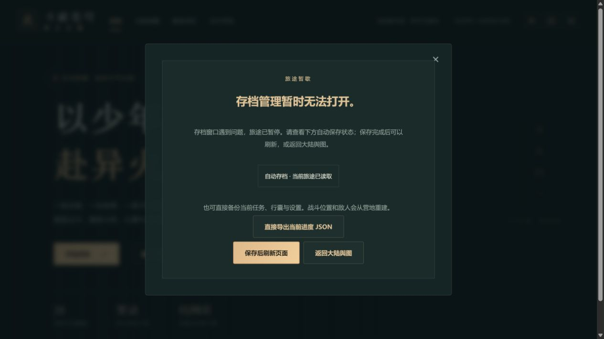
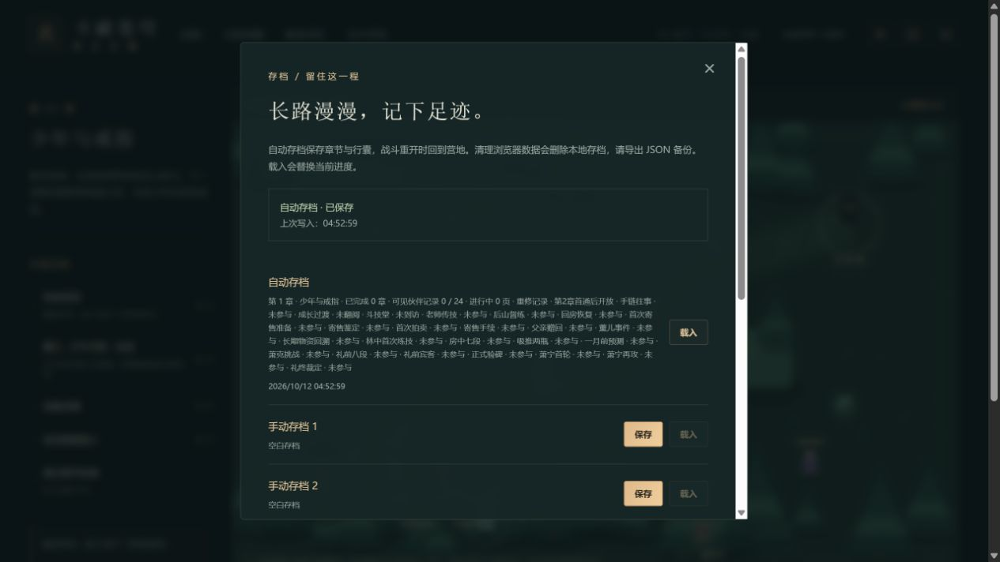

# C11b-5：模块故障时保留备份出口

2026-10-12；运行0.33.11。旧构建切换后，场景或存档窗口可能无法取得原来的资源。恢复卡现在直接导出当前内存中的完整持久状态，并显示真实自动保存状态；存档窗口自身未加载时仍有备份入口。正常存档管理共用下载组件。只提示下载已发起，实际文件是否保存另行核对。

下载不读取或写入IndexedDB，不等待失败的保存队列，不改自动档、上一份备份或手动槽。URL在点击后延迟释放，异常也回收链接和URL；战斗位置、敌人和运行态不包含在JSON中。导入仍使用原校验与确认流程。存档格式与旧档迁移规则不变。

## 实际浏览器流程

独立本地4180验证地址使用生产文件副本。测试服务人为对`GameView-*`、`SavesPanel-*`返回HTTP404，日志保存在本地`.git/task-recovery-http.log`。这是真实浏览器请求故障演练，未改浏览器存储、导入角色fixture或操作内部游戏状态；也不是公开部署故障。

1. 空白地址正常开始第一章，读完三页开场。场景请求404进入恢复卡，自动保存完成；80金币、180生命/100斗气，未做任务、未结算。
2. 点击打开存档管理，该模块同样404。恢复卡直接下载JSON，文件中的第一章`intro=true`，未新增任务、材料或奖励；画布0。
3. 首次截图发现恢复卡绝对定位导致父弹窗高度坍缩，只有按钮可见。修复面板上下文为正常布局，重新构建和真实404验收；标题、保存状态、备份与刷新/返回按钮都完整可见。前图只保留本地失败记录。
4. 修正后再次真实下载：`异火之路-第1章-1791751963229.json`，SHA256为`5F7B685332EDC11A496FB8C05747E9FA0FDEEB41F5E8D5C26F51E8724560189B`。文件未编辑或公开提交。
5. 服务恢复资源，点击“保存后刷新页面”，正常开始历练，无需重读开场。实际画布1，存档窗口正常展开，80金币及未结算任务保留，三个手动槽为空。

两图均已实际查看。第二图只显示窗口上半部，第三个空手动槽由可见DOM核验。预期模块404和React报告确实出现在日志中，不能称本次控制台零错误；刷新恢复后未新增故障。

4175真实终局档正常刷新读取0.33.11，28章/24页/19506金币15582积累保留，三个手动槽仍为空。共用组件再次实际下载终局文件，和前版0.33.10原样备份逐字段比较，整个state对象仅`contentVersion`变化；没有覆盖旧手动档。4174旧档本批未操作。

## 检查与边界

最终完整check：103文件656项Vitest、3项Node、类型、旧档迁移、三难度完整早期链与28章回放、生产构建通过。新增规则覆盖保存失败后最新内存备份、不写档/不带运行态、下载准备/点击/清理异常与后续重试、三种恢复上下文的直接出口。初次类型检查遇到新DOM类型的`hidden`允许字符串，修正接口后重跑通过，失败日志保留本地。

最终入口485273字节/gzip158143、总JS1567810、引擎gzip173298按需，原门槛不变。实际已补模块HTTP404的网页故障及恢复路径；20秒网络悬挂仍为既有规则测试，磁盘额度/多会话冲突备份由规则验证，未称真人设备或完整线上切换/回滚通过。正式发行、来源、人物完整事件、真实后台/设备/Beta门槛继续开放。
