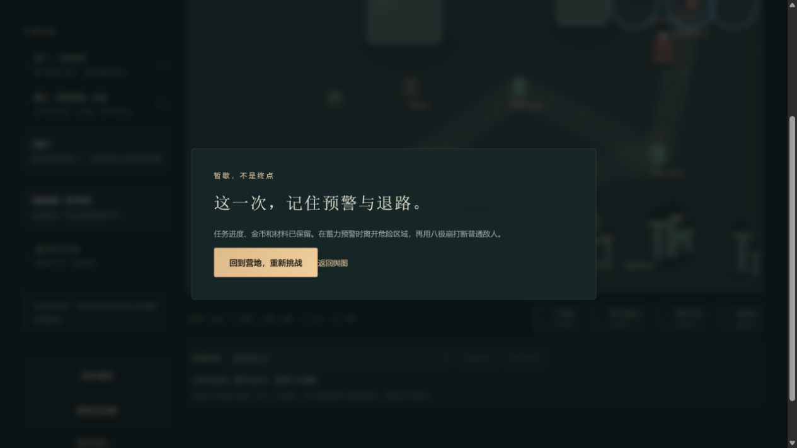
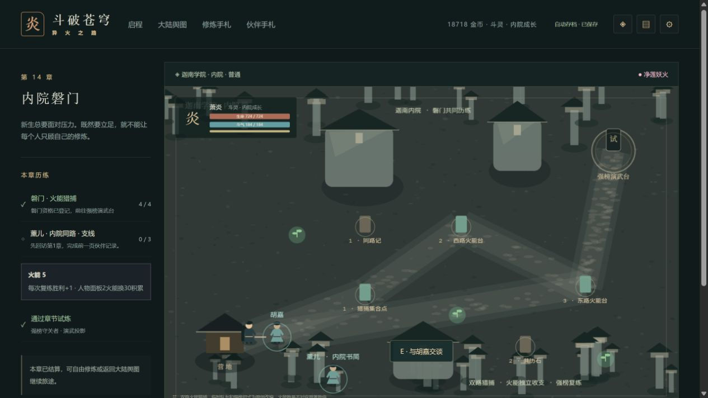

# C11死亡帧灼烧结算验收

2026-10-15，0.93.2，固定收尾项E02的一项已复现缺陷。精确帧序使用明确的规则fixture；网页自然死亡与重试单独取证，不声称在浏览器注入了1生命或烧伤计时。

## 问题与修复

0.93.1的`CombatWorld.step`进入敌人循环前检查玩家存活，却没有在处理下一名敌人前重新检查。前一个敌人的预警落点可以把玩家生命打到0；后一个敌人若正好达到灼烧结算时刻，仍会调用`hurtEnemy`及击杀回调。因此可在倒下后的同一帧发出普通击杀或挑战胜利通知。问题来自循环中的状态变化，不是存档版本或首通奖励幂等失效。

新规则在每名敌人开始处理前检查生命，倒下即停止本轮剩余敌人处理。倒下前按原遍历顺序已经发生的击杀继续保留；后续帧、动作和免费重建遵循已有规则。本批不回滚玩家已得奖励，不新增schema或剧情字段。

## 可复现证据

`tests/death-frame.test.ts`构造经官方`validateState`验证的合法章节进度fixture：已取得青莲后回访第一章。精确生命、预警和燃烧计时只在规则测试中安排，不作为浏览器通关或真实发生频率证据。

- 敌人A在本帧先造成致命伤，敌人B本帧后续灼烧足以击杀。原实现三难度均失败，回调捕获玩家生命为0；修复后无击杀回调，B生命及烧伤进度保持，后续120帧和攻击不补结算。
- 同帧先处理B，再由A造成致命伤，三难度均保留恰好一次击杀，发生时玩家生命为1。后续120帧不重复。
- 保存官方序列化往返、免费重建的正式进度保持，重建恢复生命。
- 既有丹雷、青莲、星火、妖火、三阵、雷区及终战相关死亡/末帧回归一并运行：8文件89项通过。原实现失败日志与修复后日志分别保留在私有任务证据中。

该项只证明上述顺序缺陷与回归。历史记录中其他专属场景的“精确死亡末帧网页读证”仍需按原缺口核对；不能用普通死亡截图冒签每一类末帧，E02整体暂记部分完成。

## 交付核对

完整`pnpm check`通过：174文件1073项Vitest、26项Node、类型、三难度早期及28章回放、四槽/上一份备份、生产构建和发行完整性。固定预算500000/165000/1850000不变，实际474921/163259/1848389，余25079/1741/1611；153文件2019256字节。覆盖快照仅更新运行版本和E02部分完成记录，没有新增剧情。

实际旧基线为df8d58e5f00565deff298825185c46924b089952，142份core全部源码统一换行后相等；775份不可改写原生旧存档分别用实际旧解析器与新解析器核对，整state只变contentVersion。新迁移写入器完成后冻结，不将新网页下载追加进去重跑。

真实独立4187原先合法28章分支正常升级，前后原生整state只版本变化。曾正常重返28章和23章：已完成28章没有普通敌人，23章已登记的守卫不会重生，所以不将两次行走冒称死亡测试。随后正常选择14章强榜复练，走到演武台并手动启动；不攻击、不用丹，生命自然724→416→64→0，实际出现失败窗口。点击“回到营地，重新挑战”恢复724，正常刷新重返仍724。第14章开战前、重试后、刷新后的原生导出由官方parseSave核对整state相等；18718金币/14470积累/火能5、材料、28首通及早期寄售账全部保持，三个手动槽仍空。

合计6份新原件：升级前后、23章回访、14章开战前、重试后和刷新后。死亡窗口本身没有原生导出按钮，本批没有强行穿过遮罩取档；死亡生命与窗口以当时DOM和截图证明，不能称已有“死亡时原生JSON”。新原件元数据仅追加775→781。新机器证据为[qa/c11-death-frame-0932.json](qa/c11-death-frame-0932.json)，错误日志为空；旧证明未覆盖。

两图均已实际查看，是桌面页面证据。不是实体设备、真人玩家或精确灼烧末帧截图。正式提交后SHA/CI和发行绑定另行核对，不用候选构建清单冒签最终提交。
