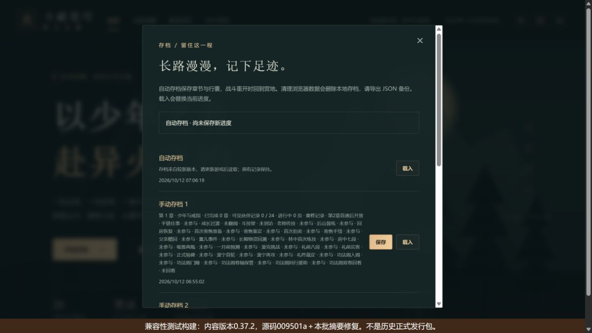
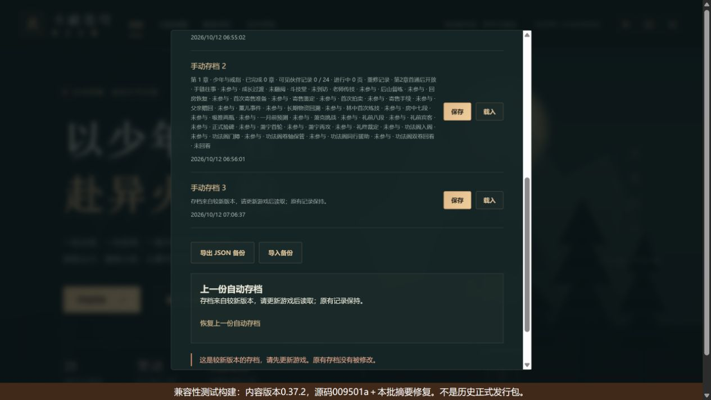
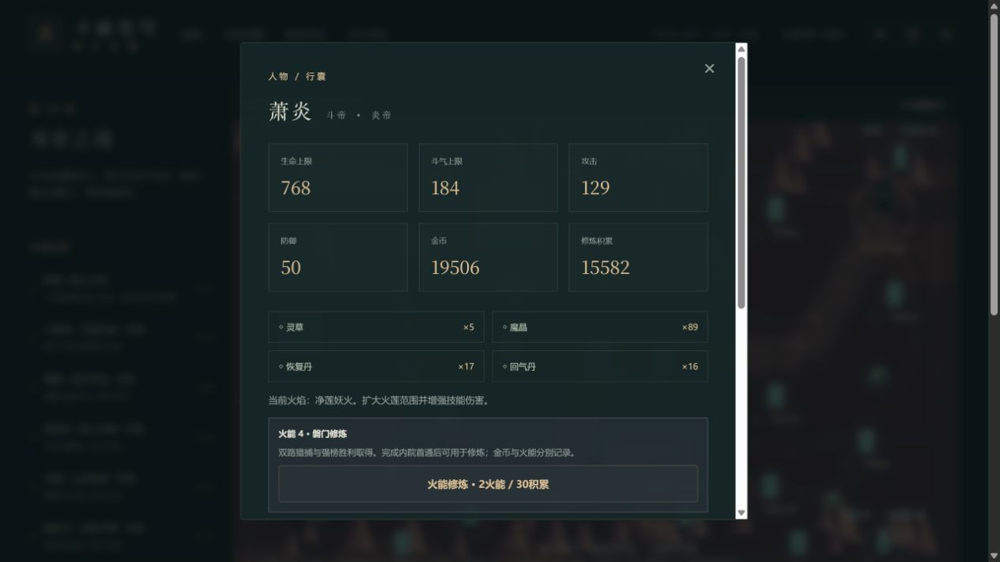

# C11f-3c 较新存档摘要与完整终局恢复

2026-10-12，0.37.3。C11f-3b实际发现有效保护的较新档在列表中仍被称为“存档异常，可尝试恢复上一份自动备份”。本批在`saveRecordSummary`按`NewerSaveVersionError`分类：较新schema/内容版本提示更新游戏、原记录保持；真实损坏继续原提示。存档格式、保护、奖励和剧情规则保持。

独立4183静态服务器只切资源目录，不读写浏览器数据库/store。原完整文件由此前正常网页旅途导出，0.37.1、28章与七线24页完成。以下均为真实正常UI和文件选择器操作：

1. 在0.37.3工作区候选通过原生选择器导入该完整文件，正常预览/确认；切换减弱动态再恢复，形成新版auto及上一份备份，保存原空manual3。再次下载完整state，与原旧文件仅contentVersion变化。manual1/2原有独立早期旅途保留。
2. 同源切到明确标示的0.37.2兼容性测试构建。auto/manual3/backup三条均显示“存档来自较新版本，请更新游戏后读取；原有记录保持。”。实际DOM无“存档异常”，无双帝之战、已完成28章或24/24泄露；manual3拒绝载入。
3. 兼容manual2可读取为早期旅途，但自动写与重试被保护拒绝，不能覆盖完整较新auto。没有修改数据库/内部角色或坐标来制造保护。
4. 切回0.37.3候选并刷新。原auto/manual3摘要时间与切换前相同，manual1/2摘要时间也保持；再次下载完整state与切换前完全相同。
5. 正常进入第28章，画布1。伙伴手札显示“可见记录 24 / 24 · 当前可做 0 页”；人物/资源与原档保持，再下载全state仍相同，console error=[]。

三个真实下载比较忽略外层导出时间，仅比较整个state对象；规范state SHA256为`96df3a177a7376a88b2a984fb34c8b3fac76734527dedccaa077020652867659`。金币19506、积累15582、草5晶89恢复17回气16火能4、净莲妖火、药老归队、双卷8/援助10及所有原设置保持。机器证据见[完整版本摘要证据](qa/c11-newer-save-summary.json)。

三图已实际查看。110文件683Vitest+11Node完整check、类型/迁移/三难度早期及28章回放/生产构建/包体/发行完整性通过，日志`.git/task-version-summary-check.log`。五槽与三种查看范围均有较新schema/内容版本、防泄露、不改原记录及真实损坏回归。初始489156/gzip158950、总JS1624732、引擎gzip173297按需，71文件1734261字节。

构建身份：验收新版是包含未提交修复的0.37.3工作区候选，清单基础SHA为009501a1a0c4436c0786145e58ec87274472da98。较低包基于该提交的0.37.2，额外复制摘要修复并添加HTML标题/醒目测试标识，目录`.git/task-compat-summary-009501a/dist`，差异另存`.git/task-compat-summary-description.json`。二者均不是“从干净正式源码冻结的历史发行包”。前批009501a远端Game checks38182717719 success、Pages38182717715 skipped。

本批签完整终局本地受保护兼容性版本切换与摘要修复，不签真实历史二进制、公网缓存/部署、真人设备或Beta。后续可从干净已推送新提交独立构建保存包，绑定其真实SHA，不能把本次基础SHA冒称新提交产物。
