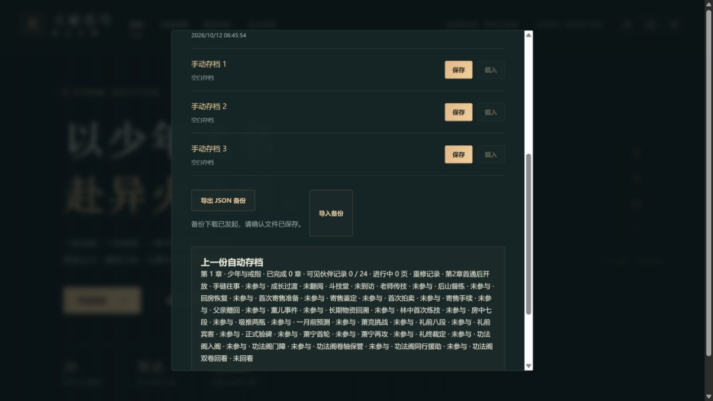

# C11f-3a 较新自动档保护

2026-10-12，0.37.2。回滚准备中发现的实际代码风险：自动档校验拒绝较新内容/schema后，初始化仍按损坏恢复旧备份，自动会话也保留写许可；一次正常持久操作可能覆盖较新原档。该风险由代码路径及隔离数据库回归识别，不称已在玩家设备发生。

新增专用`NewerSaveVersionError`。初始化遇版本不兼容只显示更新提示，不恢复旧备份。AutoSaveSession在读取任意槽时先检查自动档，较新自动档不给写令牌；即使玩家读取兼容手动档、开始新旅程、保存重试，也不能覆盖它。读取手动/备份仍可供当前内存浏览和JSON导出，但自动保存会提示保护。自动档已由兼容版本恢复后，显式再读才允许保存。

六项隔离fakeIndexedDB回归（人工构造的999.0.0/schema4为测试夹具，不是实际已发行版本）：

- 较新内容、较新schema各拒绝加载/写入/重试，自动、备份、手动全部原文与时间不变。
- GameStore初始化不恢复旧备份；intro操作、重试、新旅程同样保全原始数据库。
- 兼容手动/备份可读却不能绕过保护；外部兼容写入后显式读回，保存恢复正常。
- 普通损坏依旧恢复有效备份并继续保存，不破坏已有恢复机制。
- 较新手动档拒绝不锁兼容自动档，错误文本不误称自动档已保护。

完整`pnpm run check`通过109文件680Vitest+11Node、类型、旧档迁移、三难度早期完整链和28章回放、生产构建/包体/清单/完整性。入口489148字节/gzip158940，总JS1624615、引擎gzip173298按需，原预算保持。日志`.git/task-c11f-version-protection-check.log`。

真实4181普通旧档0.37.1→0.37.2刷新读取，存档管理正常、三个手动槽空白；实际下载JSON，正常取消/恢复减弱动态看到“已保存”，刷新后再下载。两份新版整state相同，前版对比仅contentVersion变化，36金币12积累恢复5及设置保持，当前error=[]。截图已实际查看：

这张图只证明正常兼容保存/备份，不证明较新档拒绝在网页已完成；较新保护当前证据为隔离数据库/规则。C11f-3b继续明确标记的受保护兼容性测试构建与真实本地网页版本切换。历史0.37.1二进制不会获得新保护，不直接用它代签安全回滚。公开部署、真实设备/Beta、完整来源和人物事件仍开放。
