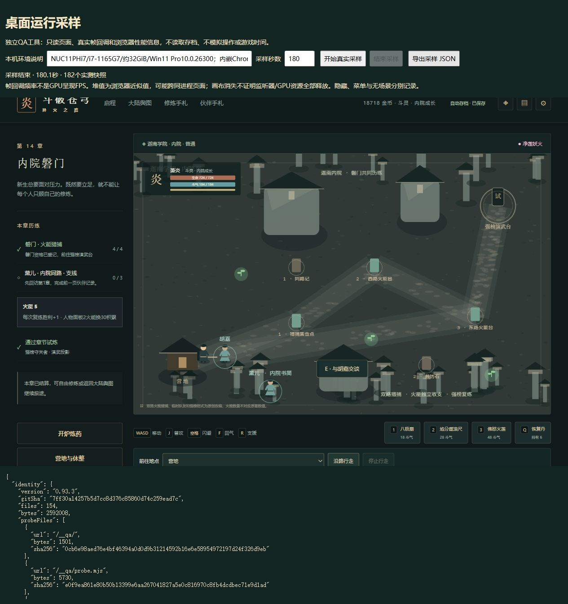

# C11采样身份固定与战斗读证验收

2026-10-15，游戏仍为0.93.3。本批修复独立QA服务的实际取证缺陷，补单敌战斗样本与场景输入清理接线证据。生产运行、剧情和存档格式不变，E03仍为部分完成。

## 采样身份与实际响应保持一致

原服务启动时验证dist，随后每次请求重新读取磁盘。若采样过程中另一次构建替换dist，返回的HTML、脚本甚至清单可能已经变化，报告仍沿用启动时的SHA；启动后新增的未验证文件也可能被读取。

新增回归在临时副本启动真正服务，再替换HTML、实际JS及清单，并放入未登记文件。旧正式实现实际返回11字节替代HTML，原668字节断言失败。修复后启动时将清单和全部登记文件固定为内存字节，逐个复核长度与SHA256；请求只从固定集合返回。运行中构建不会改变这次服务的游戏字节；需要测新构建时明确重启服务。新启动仍拒绝损坏发行。

`pnpm qa:desktop:check`现有四项：统计、原始样本篡改拒绝、实际只读发行与路径边界，以及上述构建并发回归。首次旧版证明助手把脚本放到私有目录后未调整统计模块路径，先遇到ENOENT；修正助手路径后才取得真实响应字节断言失败。没有把助手导入错误当成产品回归证据。

这次修复不表示前批样本已混入另一构建。前批154生产文件指纹与正式交付相同，已保存的原件及证明继续冻结；没有重写旧测量。

## 真实180秒混合战斗样本

同一NUC11PHi7、i7-1165G7、约32GiB、Windows11专业版10.0.26300及内嵌Chrome155，DPR2，1265×820游戏iframe；实际GPU仍未知。正常读取已通关28章旧档，重返第14章，沿路走到演武台，手动开启复练。没有注入生命、敌人或存档fixture，没有模拟游戏时间，采样时未执行构建/测试。

实际窗口04:30:26至04:33:26 UTC，180067.5毫秒，182快照。两次单敌复练均有自然受击直至生命0，首轮实际普攻/斗技，首领生命924→540；第二轮原生闪避按钮后体力79，并实际移动。第一次免费重试在窗口中恢复724；第二次免费重试紧接测后确认724。没有获胜、击杀、采集、用丹或领取新奖励。

| 分组 | 间隔数量/累计时间 | p50/p95/p99/最大 | 超50毫秒 |
|---|---|---|---|
| 场景（含战斗与行走） | 16471 / 141592.4毫秒 | 7.8/8.6/23.1/376.8毫秒 | 96 |
| 失败菜单 | 4495 / 38276.1毫秒 | 7.6/8.5/23.2/168.4毫秒 | 18 |
| 短暂失焦 | 14 / 107.3毫秒 | 独立保留原始值 | 0 |

Long Tasks实际2条，共401毫秒、最大204毫秒。采样器errors与本轮浏览器error/warn均为空。画布快照始终1；粗堆首55492806、末62304705，范围23960470–75665244字节。数据不作GPU帧率、泄漏或性能改善结论，也没有调用栈用于归因。

180秒包含行走和失败菜单，不能写成180秒连续战斗。只有单敌复练，不代签最大群战。第一次请求键盘Space时自然死亡窗口已经出现，工具输入超时；没有把该次尝试记作成功闪避。其后成功的原生按钮闪避有体力79读证。

两份同域顶层原生备份由真正parseSave解析，raw.state与结果相等，采样前后整个state相等。相较前批只章节28→14，其余金币18718、积累14560、28章结算、火能5、75击杀、草9/晶76/恢复6/回气3/灵药0及全部旧历史保持。证明的是持久档；没有冒称直接导出iframe当时内存。原始采样、指纹、实际观察时间线见`qa/c11-combat-sampling-0933.json`和`qa/c11-combat-sampling-0933-native.json`。

## 输入资源清理接线

新增三项测试调用真正AdventureScene的create、update、shutdown和destroy，保留真正CombatWorld；只替换Phaser绘图及输入接口、音频调用与DOM目标。因此它们属于源码集成证据：

- shutdown与destroy分别清掉五个window监听器、一个visibility监听器、pointerdown及两个场景清理回调；移动、排队动作、按住键与导航清空。
- 重复两个生命周期事件不会重复清理；其后的键盘、失焦、可见性事件及更新不能再驱动已释放场景。
- 致命更新异常走同一清理路径，只报告原始异常一次，后续更新停止。

这不等于在实际浏览器做了保留对象、强制GC或GPU资源分析；静态环境与Phaser自身资源销毁没有被测试替身代签。已有12次真实画布退出/重入证据继续保留。

## 检查与剩余边界

完整175文件1076项Vitest通过，类型检查通过；四项QA Node与生产构建、包体、完整场景及发行完整性通过。154生产文件指纹与上一正式交付完全相同，旧782迁移集合及旧写入器不扩大。固定预算500000/165000/1850000不变，实际474921/163259/1847247。

E03继续等待最大群战样本、浏览器精确保留资源分析及切换长任务定位。本批没有补签实体设备、真人Beta、试听、原作完整来源或公网发布；固定剩余26个工作包保持。

