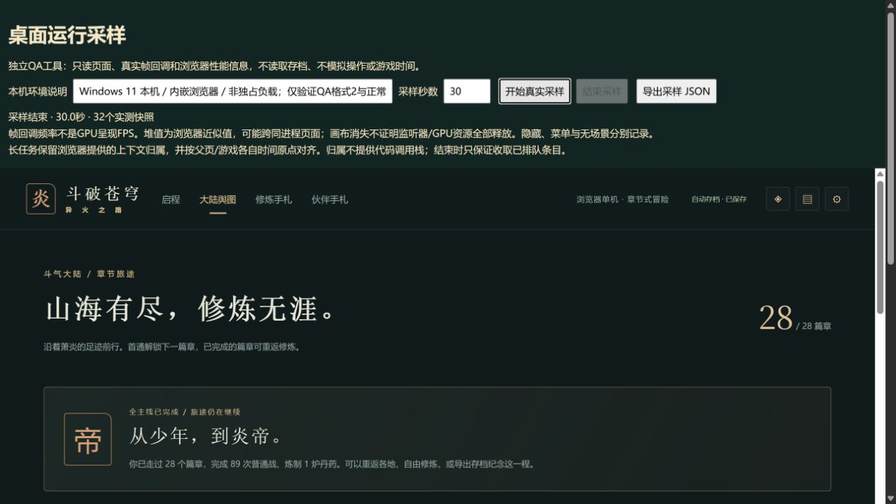

# C11 / E03 长任务时间轴与尾队列验收

2026-10-15，运行版0.94.0保持。修复独立QA工具的结束漏取队列，并交付两个真实格式2原件。E03仍部分完成，剩余25工作包，不能据此估计25轮结束。

任务范围见《C11长任务时间轴与尾队列任务卡.md》，机器证据见[汇总](qa/c11-longtask-clock-0940.json)、[45秒菜单原件](qa/c11-longtask-clock-0940-menus.json)、[30秒切换原件](qa/c11-longtask-clock-0940-switch.json)。

## 结果与回归

旧工具结束时只断开PerformanceObserver，未读取待送达队列。把本批真正QA模块接入可控观察器，排队条目在旧正式文件中被清空，停止回归实际失败，调用顺序只有`disconnect`；新实现先`takeRecords`再断开，条目保留，重复停止与下一轮清空通过。此为实际脚本接线验证，不是给真实网页注入假任务，也不把它写成历史样本已经证实漏了多少条。

新导出保留父页和游戏iframe的两个时间原点、浏览器实际长任务上下文信息、相对采样起点和窗口内交叠时长。复核器独立重算，兼容旧格式1原件且不写回；单测覆盖原点偏移、起止两端截断、窗口外任务、非法时长、伪造相对时间或归属字段。不能把`self/unknown`理解为已定位某个JavaScript函数。

`takeRecords`只收取已经排队的条目，当前执行“停止”操作的任务尚未结束，仍可能之后才被浏览器报告。该限制同时写入界面、原件和复核结果，不承诺捕获未来条目。

## 两个真实网页样本

使用未改写的0.94.0/第28章原生档正常导入独立4198域；游戏155个发行文件绑定正式`0574e14e6993d36141f8fa9c0173b53859928e0f`，QA候选的三文件指纹另列于原件，不把尚未提交的工具称作已提交SHA。两轮期间没有并行执行构建或测试，没有制造长任务或改变时间推进。

环境为本机Windows、Chrome155内嵌浏览器、8逻辑线程、像素比2，游戏iframe1265×820。GPU未确认，其他应用存在，不是独占基准或实体手机。

| 原件 | 实际时长/快照 | 场景间隔p95/p99/最大 | Long Tasks |
|---|---|---|---|
| 菜单 | 45012.7毫秒/47 | 16 / 21.7 / 84.2毫秒 | 1条，50毫秒，`self` |
| 切换 | 30004.8毫秒/32 | 16 / 16.2 / 270.6毫秒 | 1条，226毫秒，`self` |

两轮实测父页原点`1792042697530.1`、iframe原点`1792042697578.9`，相差约48.8毫秒，验证了不能直接混用两条时间轴。两条任务均原样保留`name=self`、`attribution.name=unknown`、`containerType=iframe`及`containerSrc=/`；相对采样起点分别约36375.1与9362.2毫秒。全部原始间隔可重算，窗口内交叠分别为50/226毫秒。API归属没有代码调用栈，不据其签引擎函数耗时或采样开销为零。

第一轮包含营地与人物菜单；第二轮正常舆图→终章→设置菜单→舆图，实际逐次读到进入画布1、退出0，各阶段在原件独立分组。这个切换用于验收新采样器，不能重复算成新的完整长时资源释放证明或最大群战测试。截图实际查看：

两次iframe页头鼠标定位失败，刷新DOM后改用真实键盘Enter成功。第二轮尝试手动结束时自动30秒已经到期，按钮禁用；读取结束状态并正常导出，没有冒签手动停止成功。控制台在05:38:17.659Z仍有此前同类MutationObserver参数错误，来源未确认；第一轮05:38:38.783Z才开始，两个采样器内部errors为空。这不是整个页面全程无控制台错误的证明。

## 存档、构建与范围

前后两个真实下载均由当前官方`parseSave`解析，整个state与导入前原件完全相同：28章结算、19506金币、15582积累、火能4、全部物资、伙伴与登记离阁13保持。刷新读取的是同域持久档，未称直接读取iframe私有内存。新增2原件只在本批登记，旧847集合保持原有次序/内容，累计849；既有迁移证明未重跑。

完整177文件1084项Vitest、37项Node、类型、三难度28章与早期回放、生产完整性通过。新增3项Node包含真正QA收尾接线；相同旧QA文件失败、新文件通过。155个发行文件与前正式清单逐字节指纹相等，src/tests/public/依赖/锁文件/运行版本不变，不需要凭工具更改重迁玩家档。

固定预算仍440925初始JS / 160148 gzip / 1842062总JS，原500000/165000/1850000上限保持；引擎大块提示保留。独立工具不进入生产包。

E03继续最大群战、浏览器精确保留对象/GPU资源和长任务代码调用栈分析。来源人物、死亡专属末帧、实体设备、Beta、权利与公网门槛不因本批关闭；自动续办继续。
