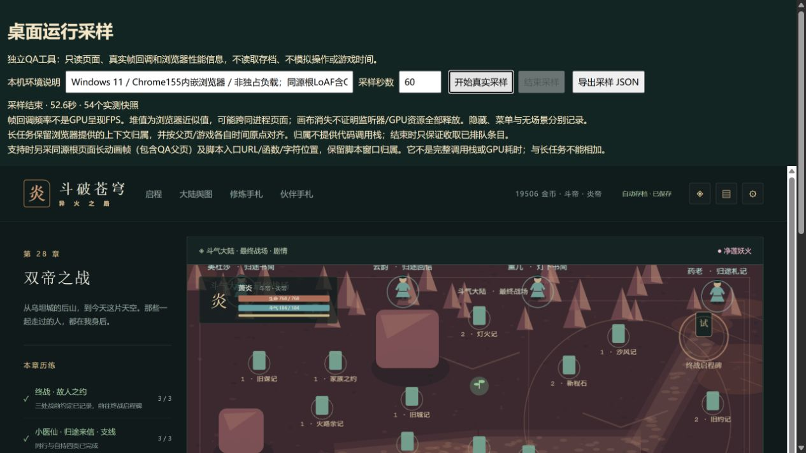

# C11 / E03 长动画帧脚本入口验收

2026-10-15，接续上一批正式`132665417558fea46a1747b272e624b9a44a326a`后完成第二批。运行版0.94.0、155个生产文件保持，独立QA格式升3。E03仍部分完成，剩余25工作包。

任务卡见《C11长动画帧脚本入口任务卡.md》。[机器汇总](qa/c11-animation-entry-0940.json)与[真正原生采样](qa/c11-animation-entry-0940-native.json)保留未修改数据、固定构建与三份工具指纹。

## 新增的证据

浏览器实际支持Long Animation Frames。本机正常打开第28章、人物菜单、退出舆图、再进入终章和打开设置，手动结束时实际52583.2毫秒、54个快照。期间没有并行构建/测试，没有人工忙循环或假事件注入。

API记录到3个长动画帧、6个脚本入口，均为`descendant`，对应游戏iframe。Long Tasks独立为3条共697毫秒；帧的原始blockingDuration合计607.2毫秒，不能和697相加，也不能据此算成GPU耗时。采样根包括QA父页，保留`windowAttribution`以区分来源；没有把缺失的脚本归属补成游戏函数。

| 浏览器脚本入口 | 实际脚本时长 | 对应生产UTF-16字符位置 |
|---|---|---|
| React根节点keydown入口`_h` | 139.1毫秒 | `index-DYMY-YfV.js:210615` |
| 同根click入口`_h` | 6.3毫秒 | 同一位置 |
| Phaser图片onload匿名入口，两次进入 | 255.9 / 295.9毫秒 | `phaser-CIO7jVcA.js:577533` |
| Phaser rAF回调`t`，两次进入 | 31.9 / 21.6毫秒 | `phaser-CIO7jVcA.js:584142` |

已只读按发行清单SHA256验证对应两个生产文件，再以浏览器提供的字符位置读取固定文本。210615处为React事件分发函数，577533处为TextureManager的`addBase64`图片onload回调（创建纹理并发出事件），584142处为rAF调度回调。公开汇总包含有限片段和文件指纹，未把UTF-16字符位置误当字节偏移，也没伪造source map或反推出完整调用栈。

这个结果把之前只有`self/unknown`的切换卡顿，收窄到了具体入口及其同步调用链。它不能证明255.9/295.9毫秒全部花在解码4×4图片、某个单独函数或某项GPU工作上；事件发出后也会同步调用后续初始化。下一步针对同一初始化链进一步读证和测量，不能凭入口直接删除纹理或声称已优化。

场景rAF间隔p95=16、p99=23.6、最大330.7毫秒，超过50毫秒2次；如实保留。它不是绘制FPS或优化前后对照。本批实际读到画布1→0→1，属于正常切换证据，不能代签全部保留对象/GPU资源释放。

## 工具与检查

格式3在支持时观察同源根文档；长任务继续来自游戏iframe，分别使用各自时间原点。保留frame/render/layout/阻塞字段，以及脚本URL、函数、字符位置、调用入口类型、窗口归属、同步layout和暂停时间。两观察器结束均先取队列再断开，不支持时明确false/空数组。停止不能保证未来尚未生成的报告。

复核器兼容格式1/2，验证格式3原点、窗口交叠、有限数值、脚本字段及归属；原始blocking/script时长属于整条记录，不伪称按窗口裁出了某函数的精确占用。真正QA模块支持/不支持两个分支验证回调、尾队列、窗口外排除、停止幂等和下一轮清空。新增2项Node，完整177文件1084Vitest、39Node、类型、三难度28章与早期回放、生产构建通过。

本轮完整check退出0、测试无失败，但13:50:44实际记录了一条并行SSR证明服务器对共享`.vite/deps`重命名的EPERM。保留该失败日志；修正三个只用于SSR导出核对的服务器，不再启动浏览器依赖预构建。随后相同14项并行SSR证明全过，且无扫描/预构建/EPERM输出。没有删除缓存来掩盖问题，没有把它误当历史玩家刷新回退根因；E01不据此关闭。

浏览器旧日志仍含05:45:04.061Z的MutationObserver参数错误，本样本稍后才开始，内部errors为空；来源未确认，不宣称整个页面从无错误。实际完成截图已查看：

## 状态与后续

同域正常刷新后的真实下载经官方`parseSave`解析，整个state与上一正式原件完全相同，含28章结算、19506金币、15582积累、物资、伙伴和登记离阁13。旧850原件不改，新增1件只在本批登记；旧迁移证明不重跑。

155生产文件逐项指纹相同，src/tests/public/依赖/锁文件/运行版本不变；预算440925/160148/1842062与原上限保持。QA工具独立，不增加玩家运行开销。

后续E03继续纹理onload后初始化同步链定位、最大群战、精确保留对象/GPU；API入口信息不代签完整调用栈。完整来源人物、死亡专属末帧、实体设备、Beta、权利与公网验收继续，自动续办保留。
