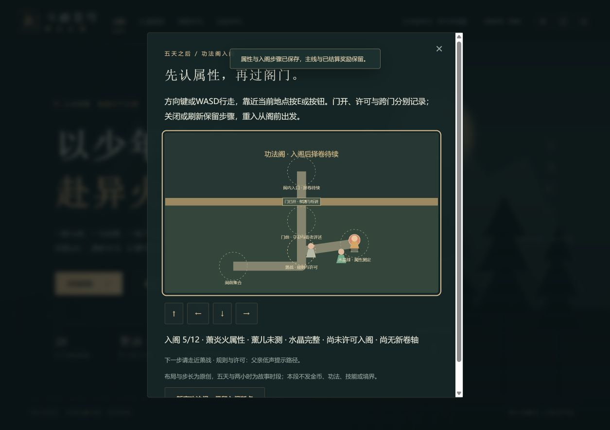
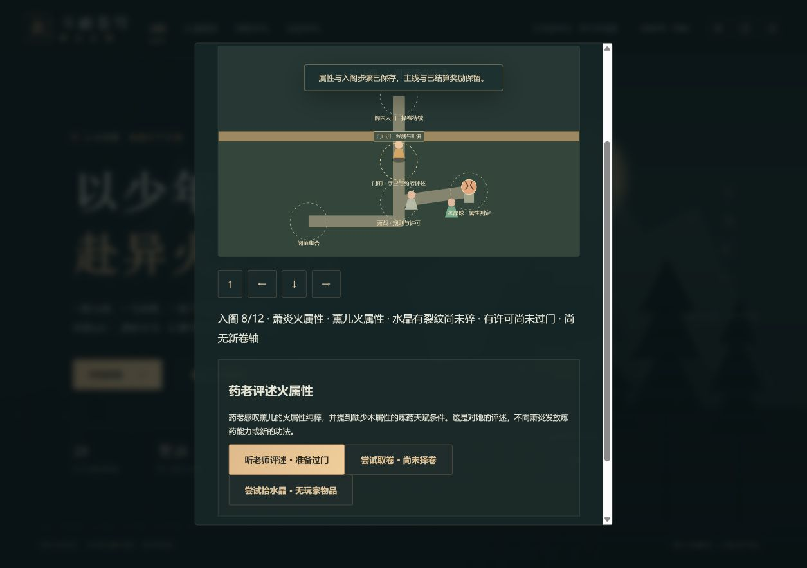
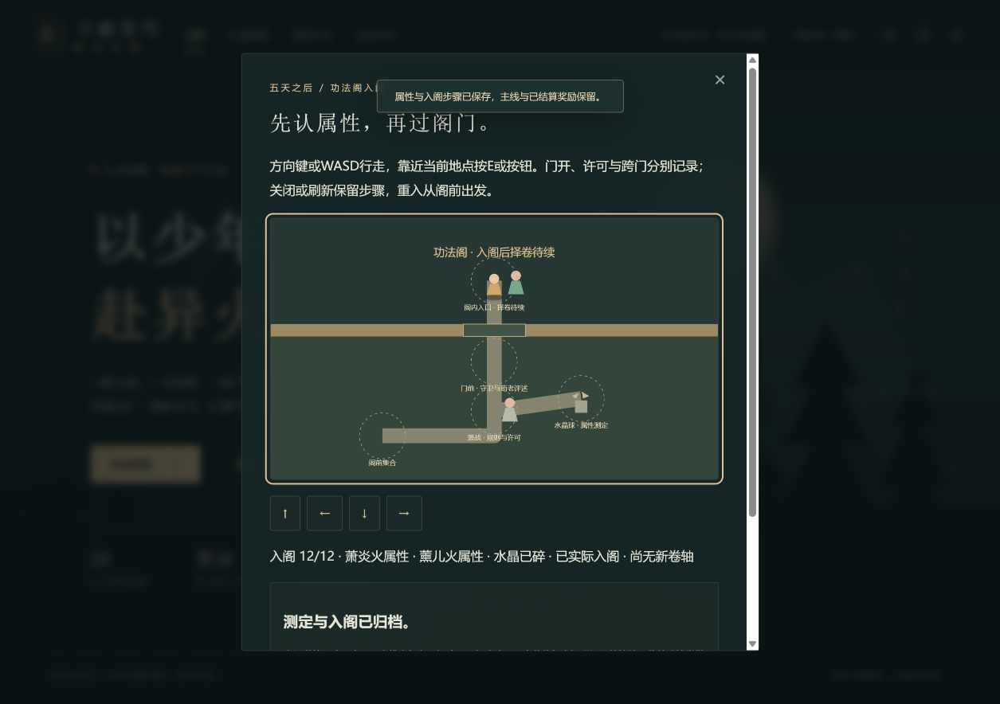

# C1f-1：功法阁测定与实际入阁

2026-10-12；运行0.34.0。依据本轮实际读取的授权英译48正文，来源与后续细单见《C1f功法阁来源与任务卡.md》。中文正版章次与动画正片定位仍未核。这里只交付入阁12步，不代签门障、择卷、修炼或完整离阁。

## 可玩交付与数据

从修炼手札→重修往事，在合法礼终16归档后出现功法阁入口。独立地图包含阁前/父亲/水晶/门前/阁内入口，方向/WASD、按钮与E可操作。墙面不可绕穿；布局、坐标和20步长为原创。

十二步为五天故事过渡集合、父亲规则、守卫开门、族人风属性、本人物测火、父亲路径线索、薰儿火属性与裂纹、许可、药老评述、实际走入、场外水晶碎裂、归档。许可8仍未过门，评述9才开通门洞，必须实际走到阁内才能10；碎裂11与归档12另签。两小时这里只记故事规则，时限机制留后续择卷；本段无卷轴、金币、材料、技能或境界奖励。

`earlyTraining.qiPavilionEntry` introducedVersion为0.34.0，稳定ID`early-qi-pavilion-entry`。旧0.33.11及更早只补未参与；新版缺字段、非法阶段组合、错人物/位置、过期快照/重复、领取未有物品拒绝。其余早期历史、原物/钱账、主线/伙伴页与战斗runtime保留。

## 同一真实旅程网页证据

4175原真实新旅程已28章/24页、早期礼终完成，由正常手札入口进入，没有导入fixture或操作内部角色/存储推进。

1. 阁前集合→实际走父亲听规则→门前开门。连续向上仍止(360,210)，3/12双方未测，不能先入阁。
2. 水晶旁观风属性→SVG按E本人物测火。5/12萧炎火/薰儿未测/球完整，刷新正常入口恢复5，从阁前重建。
3. 远阁前E不能代听父亲；实际回父亲尝试取卷被拒仍5→记第三路43房→水晶旁观薰儿到7，球仅裂/未许可；已保存刷新仍7。
4. 实际回父亲尝试拾晶被拒→许可8，连续上走仍(360,210)，有许可未过门/球裂未碎；此断点再刷新仍8。
5. 正常走门前E评述9→实际键盘沿门洞到(360,110)→E确认10入阁，球仍裂。拾物仍拒绝→独立观察碎裂11→E归档12。
6. 暂离后焦点回功法阁入口。自动已归档/择卷待续，上一份已入阁待归档，三个手动槽空白未覆盖。最终刷新仍12，当前新页error=[]，不抹除此前旧构建错误。

三图均实际查看。第二图地图上缘/第三图末尾正文部分在视口外，完整台词另由DOM核验。

## 兼容、防剧透与检查

实际下载`异火之路-第28章-1791752925756.json`，SHA256 `DCE145C3F9D0C2CA6B58F9476ACA63079DBA7DA06DA69C1410D09A5FA016DC0A`，未改或公开提交。和前批0.33.11真实下载档整state比对只新增事件/变化版本；其余资源、28章/24页、全部早期历史/设置完全一致，19506金币15582积累、草5晶89恢复17回气16火能4保持。

实际动画上限1/2，自动/备份摘要功法阁、水晶、火属性、43房、未来28章匹配为空，上限2重修入口无功法阁按钮；恢复小说/上限3/剧情/音量0.3/减弱动态开启。4174旧档只读刷新：自动功法阁未参与，0.16.7手动1未参与后续链/功法阁，2/3空，未覆盖。

104文件661Vitest+3Node、类型、每断点JSON/自动手动上一份、旧档/非法组合/防剧透/逐阶段网格与门洞可达、Store唯一成功写/runtime不变、三难度完整早期新增入阁与28章回放、生产构建全部通过。entry485950/gzip158339、engine173298按需、totalJS1581058，门槛不提高。

前批30317fae6159c726aa40f3bd3ff3710d2acf790d已推送/远端一致，Game checks38174280860 success、Pages38174280796 skipped。接C1f-2已核49火路/红幕/43房，再独立家族卷/婉拒/援助；51完整登记结果仍待正文。C10r完整材料/融合、中文/最新动画、真正后台/设备/Beta与发布门槛保持。
