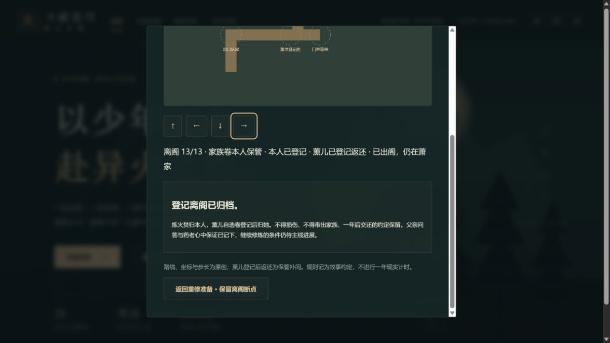

# C1f-5 登记离阁完整验收

2026-10-15，0.94.0，固定工作包G01。十三动作作为一个完整功能交付，容量、旧档、网页与生产验证合并，不再逐句扩版本。

提交后复核：首个39f446f远端检查失败，匿名日志需登录，未读取其完整错误。本机随后实际复现收尾登记JSON格式整理改变指纹、已写快照未重生的审计失败（两个摘要520e2713/22141b88不同）；重新生成并验证快照。此修正不改游戏或存档，正式验收以修正提交的远端结果为准，不把首次失败隐藏或改称通过。

## 可玩的完整流程

从修炼手札→重修往事→“接续出口登记 · 同行离阁与安心”进入。前置为既有同行援助10和原严格早期链。本人实际到队尾、观察程序、交同一卷、登记返还、听保管规则、移到门旁，薰儿交自己的自选卷并完成登记；双方登记齐全后实际跨中央门洞，阁外回应父亲，再记录本人疑问、药老心中保证和归档。

独立`earlyTraining.qiPavilionExit`保留13个断点。第3步本人卷由登记人暂持，第4步返还；第7步薰儿卷登记中，第8步返还。第9步实际出阁但仍在萧家。未登记不能绕墙提前跨门，领取支持卷、带卷离族、提前学功法均拒绝。归档不发卷轴副本、不改境界、不增金币、物品或主线奖励。原有卷轴保管与援助摘要仍描述较早的“登记待续”历史时刻，新登记摘要单独显示当前结果。

## 来源边界

本轮沿起点目录正常进入免费中文第五十一章《安心》，实际读至末段及下一章导航。作者天蚕土豆，页面标2228字、2009-05-11 00:09，链接及摘要见[完整任务卡](C1f登记离阁完整任务卡.md)。页面虽有验证码iframe，正文在普通可见区域完整提供，未与验证码交互、解题或绕过。web工具未返回正文，不称其为全文证据。

中文炼火焚、弄炎决已在本章核见。薰儿登记后继续自持的返还动作是保管补间，原文未单列返还；坐标、路线与步长为原创。只发布改写摘要和可见DOM指纹，不发布整章正文。此项不代签其他中文章次、当前年番正片边界或改编授权。

## 规则、迁移与容量

完整`pnpm check`通过：177文件1084项Vitest、34项Node、类型、三难度28章规则回放、生产包体及发行完整性。新增专项覆盖三难度每断点、自动槽/三手动槽/上一自动备份、整state保持、前置/错人/操作/远位/旧快照/坏字段、门禁与所有目标真实网格可达、防剧透UI及摘要。

806份冻结旧原生档对实际正式`8f16577ea642e8fb99d9c78041f772acc45d6872`的367份完整源码及package解析比较，仅升contentVersion并补空登记字段。旧奖励及其它整个state保持；不扩大或改写旧782迁移证明。另从真正0.37.5通关原生备份正常导入两独立网页源，旧援助10能接续而新任务保持0。

启动只读轻量地图元数据，完整几何留给延迟玩法；`point`独立导出，全部几何不变。一个专项比较全部28章、legacy及非法fallback的启动字段和store初始位置，防止两份配置漂移。原AST文本池新增完整events模块，现有Node检查比较其完整导出/分支。原预算500000/165000/1850000保持；实测初始440925、gzip160148、总JS1842062，65场景模块/68载荷/902行，155发行文件2587868字节。首次容量与版本NOTICE候选被门槛拒绝，最终候选才通过。

## 实际桌面网页

主键盘与独立方向按钮两分支各完成13动作，分属4196/4197独立源，均原生文件选择器导入同一未改写旧0.37.5原件。37份实际下载逐份由官方parseSave解析，raw.state完全相等；两分支每断点与实际advanceEarlyQiExit事务整个state相等，仅新登记历史变化。9组整state相等对照涵盖第3/8/9/13步刷新、两次拒绝、未登记门禁、归档重复与地图往返。金币19506、28章结算及所有旧历史保持。

主分支真实方向键行走、近位E；远E未推进，ctrl+方向无移动，Shift+方向按既有行为正常移动20，不声称所有修饰键均拒绝。独立按钮路线实际走至队尾、登记处、门旁、门洞及父亲处再点击推进。最初复用助手仍绑定主标签，已改独立助手后才执行按钮分支，未把超时当游戏成功。

实际第28章加载完整几何、地点选择与探索画布，舆图退出/重入画布1→0→1，无新增error/warn，原生持久档整个state保持。此项不是本版重新人工通玩28章，也不是GPU保留资源或真机验收。归档返回父入口精确回焦、Enter重开已核。两张实际截图均已查看；机器证据见[本批JSON](qa/c1f-exit-0940.json)。

G01按上述功能与证据关闭，固定剩余25个工作包，**不是25轮承诺**。S01/S02、12人物包、其余工程、设备/真人Beta/授权及最终发行门槛继续开放。正式提交、远端SHA、CI和提交后构建/原生保持写入交付记录，不把Pages skipped当部署。

