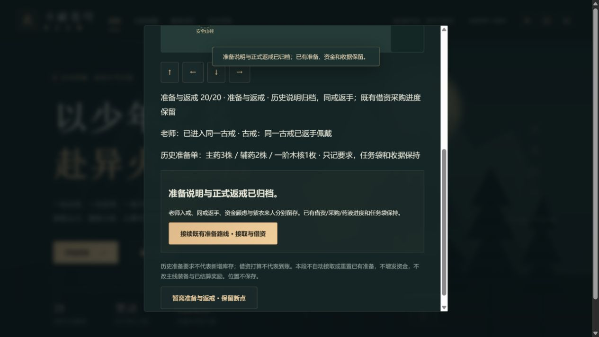

# C1g-3c2 温和方案、准备单与同戒返手

2026-10-12；0.44.0，沿本轮已完整取得的英译9；中文正版与动画精确定位继续待核，不能用本游戏章号代替。原创短摘要、程序地图与身影。

20步：回一年目标/本人再问、循序基础/本人父亲回忆/老师确认基础、本人问丹药/当时口服不适合、问温和方案/老师提议、三株主药/两株辅药/一阶木核单独记要求、来人前保密、老师入戒、同戒返手、资金顾虑/老师回应/本人借资打算、实际走山径看紫衣来人、归档。数量仅为历史准备要求，不发任务袋副本；资金顾虑不新发400或扣1000；古戒同一件，不改主线装备。

preparationBrief独立introducedVersion0.44，前置methodDiscussion28与第2章首通/可见。stage与其余派生字段精确校验，整快照/人物/操作/合法位置与38近距/重复拒绝。14老师已入戒但戒仍浮空，15返手才worn；18借资计划还未看见来人，19紫衣身影而未姓名/交谈/实际借款。旧0.43补空，不自动beginEarlyTraining，不清旧接取/收据/材料/调制链。4越界选项可见，不代签取得材料、入戒即佩戴、计划即到账或方案即成药。

共享地图仍20步与原障碍，老师入戒后人物消失、浮空戒仍显示，返手后戒只在本人右手；看到来人才出现匿名紫衣身影。后山/拜师/功法前段标明当时记录，摘要随后续显示同戒返手，原历史状态不重写。终页按钮只导航到已有街巷准备路线，不接取、不借款或清任务。

117文件723Vitest+11Node、类型/生产/清单/三难度早期全链与28章规则回放通过。20断点JSON/自动/手动/备份、旧迁移/新版缺字段、全部派生组合/非法阶段/前置、全部整快照字段/人物/错序/远位/四拒绝/重复、防剧透/三种戒图/紫衣/旧历史摘要/store零写与单次/runtime保持。另有合法已接取、借资和主药购买档回补20步，全部其他state保持，无法重复接取或再借资。80文件1841213字节，初始495446/gzip161176，总JS1726924，enginegzip173298按需，固定预算未提高。

真实4185普通28副本由手札0→20。初始远处E不能推进，实际走青石完成前18步；12三类要求齐备、14老师入戒仍浮空、15正式返手、18借资计划、19紫衣、20归档六处真下载刷新，从正常入口再实际走回。18在青石不能看山径来人，实际到山径才交互。三组错误材料12/提前佩戴14/计划领钱18的前后整state下载完全相同；19假调制也实际拒绝，未用缺少前文件代称其整state双文件已核。

完成20真下载后刷新，经终页正常“接续既有准备路线”导航进入街巷，页面仍“尚未接取”。导航后与再次刷新两份下载均与20整state全同。十二真文件含旧0.43基线，官方SSR parseSave在浏览器外核，原下载未改，SHA256见qa/c1g-preparation-brief.json，脚本与副本.git/task-brief-*。

主线18718金币/14470积累/28章/伙伴0与24、17/15/33/21/25/28旧事件、全部准备/主线其他state保持；三个手动槽空，备份19待归档，新页面error=[]。尚未在这份普通28副本实际接取或借款，避免把导航称已到账；既有连续新档采购调制证据保留而不重复代签新原著细节。

图已实际查看，可见返手、三类要求、归档和衔接按钮，地图上部在视窗外；行走/戒图变化由原生操作、DOM和断点文件另核。

0.43提交501c446aa06dca2358de53d78afddd2e362f7e80远端完整SHA一致，Game checks38209748458 success、Pages38209748416 skipped。C1g-3a/3b/3c1/3c2分批可玩交付，完整薰儿来访/借资原著问答尚未细化，不用既有折算160到账逻辑代签正文10。下一批先核合法10章及既有借资边界，独立补问答/本人请求/回应与账本衔接；来源未取得时继续不依赖来源的原创机制。51/1277、其他完整人物、历史回退、死亡末帧、真机/后台/Beta/授权/公开发行全部仍开放；自动续办继续有效。
