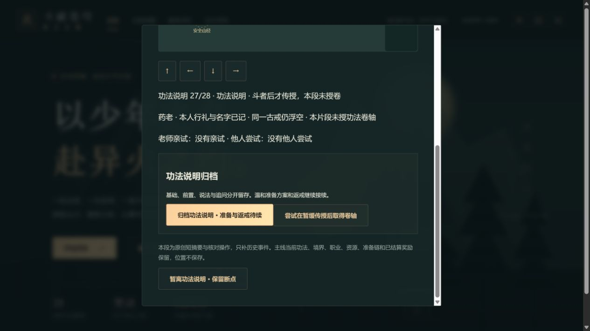

# C1g-3c1 功法前置与暂缓传授

2026-10-12；0.43.0。本次web工具取得Wuxiaworld英译9完整正文至NEXT，沿先前后山细单，把功法说明与之后准备/返戒拆为两批，后者仍待实施。中文正版与动画定位仍待核。原创短摘要，不复制长对白、图片或音轨。

28步包含一年目标办法、基础、炼药时机、斗者/火属性前置、天阶请求与否定、家族功法顾虑、未来功法提议/询阶/黄阶低级、本人疑问/问特征/老师称可进化/本人质疑/回应、同类询问/独特说法、再次确认、老师亲试询问/未试、他人尝试询问/未试、依据询问/文字依据、请求查看、斗者之后才授、归档。所有说法与实际结果分开，未来功法未获得或进化，主线已学功法与家族卷保管不回滚。古戒仍浮空。

methodDiscussion独立introducedVersion0.43，前置apprentice25/第2章首通与可见。stage和13个派生字段严格组合，所有整快照字段/人物/操作/合法位置与青石38接近距离/重复校验；拒绝前置授职业、口述直接进化、文字冒充实验证成、暂缓后领卷。只有新记录变化，runtime保持。0.42只补空字段，上限1封存。

共享原后山地图20步/障碍不改，药老已听名字与坐青石、同戒浮空、本人已行礼保持；位置不保存，刷新从山径走回青石。前段归档摘要随说明进度更新，退出回焦入口。

116文件718Vitest+11Node、类型/生产/发布清单通过。28断点JSON/自动/手动/备份、迁移与新缺字段、全部派生组合互换/非法阶段/前置、全快照/人物/错序/远位/四拒绝/重复、UI/封存/store零写/一次及runtime、三难度完整早期链与28章回放通过。79文件1828032字节，初始494573/gzip160863，总JS1714282，引擎gzip173297按需；固定预算不提高。

真实4185原普通28副本，从正常手札入口0→28，开始远处按钮禁用且E不推进，实际方向行走青石才回应。4前置、13可进化仅说法、20只问老师亲试、25文字依据、26请求查看未给、27暂缓、28归档均真下载刷新，从原入口再实际走回。四越界选项真实拒绝；13冒签进化和27冒领卷各有前后整state相同下载。26/27分开保存，未把请求当授卷。

退出28焦点回“接续功法说明”，再回拜师25摘要真实显示“功法仅说明归档/未授卷/准备返戒待续”。最终自动28、三个手动空槽/备份27保持，新页面error=[]。十一真实文件含旧0.42基线，官方SSR parseSave在浏览器外验证，SHA256见qa/c1g-method-discussion.json，原JSON未改，脚本与副本.git/task-method-*。仅版本和新字段变化，所有其他state保持：18718金币/14470积累/28章/伙伴0与24/17/15/33/21/25/旧准备未接取。最终刷新两份整state相同。

截图实际查看，断点、未授说明和错误按钮可见，地图上部在视窗外，不以图代签未显示区域。

0.42提交8a0ca1be03997785696060b695e51d828fe345dc远端一致，Game checks38208938353 success、Pages38208938389 skipped。下一批C1g-3c2：回到一年目标/循序基础/本人问外力/老师拒口服过猛与温和方案、三类准备单、来人保密/老师入戒、同一戒飞回手指、资金顾虑/本人决定借资、紫衣来人。只写历史准备说明，不调用旧beginEarlyTraining、不新发400或扣1000、不清旧准备或材料；正常入口衔接既有借资。全周期其他未验门槛继续开放。
