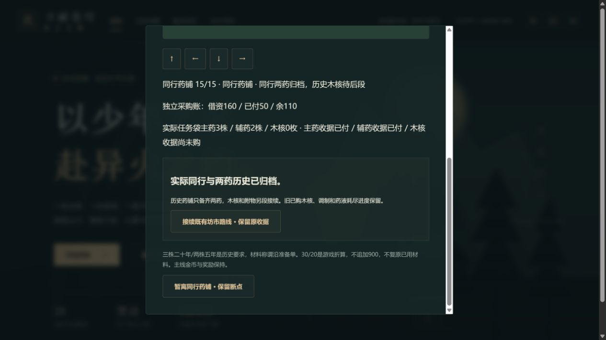

# C1g-4b2 同行入城、两药年份与原订单

2026-10-12；0.47.0。沿本轮已完整复读至NEXT11的英译10，中文正版与动画精确映射仍待核。只用准备单的主药/辅药称谓，不把待核材料中文译名写成来源已证实；两药年份三株二十年/两株五年分别留存。程序城中示意图、碰撞路径和短对白为原创。

15步可玩：族内本人开始同行、族人反应、继续走族门、实际离族、街道入城、薰儿逛摊、逛摊结束、本人实际入药铺、两药各数量年份、主药原30订单/辅药原20订单、花费回顾、历史木核仍待、归档。老师留戒中，薰儿浅绿衣同行。逛摊和看年份不发药；原著900不再扣账，药铺不代签木核、黑铁片、调制或胜利。

独立cityPharmacy introducedVersion0.47，前置晨卡14与第2章首通/可见。旧0.46补空；全快照、人物/操作/合法坐标/38近距/started/借资/已付/三份收据/调制阶段都核。11主药订单后须有效已付主药收据，12之后辅药亦须已付；pending不能冒签已成交。未买则在原advanceEarlyTraining唯一订单里扣30/20、交3/2、记收据与历史同步存档；已有订单则只补existing历史，即使已经消耗也不恢复库存。

120文件740Vitest+11Node、类型/三难度早期全链/28章回放/生产完整性通过；文字调整后新增六项专项和最终类型生产构建再通过。83文件1887273字节，初始498416/gzip162076，总JS1771422，enginegzip173298按需，固定预算未提高。15断点JSON/自动/手动/上一份备份、未购/任一药已购/两药已购/木核已购与药液耗尽迁移和回补、派生变造/成交漏收据/快照/错序/位置/四拒绝/重复、store同次记历史与30交三株/双击零写/runtime保持、防剧透1全入口和摘要封存均通过。

真实4185主档此前晨卡14、借160、两药未买，从手札完整0→15。4实际离族、6逛摊、9主药年份、11主药唯一30/三株、12辅药唯一20/两株、14木核历史待后段、15归档七处正常入口刷新；远处E不推进。实际走族门/街道/摊位/药铺，房屋不可穿行：从200,170向右八次在280,170停住（可见DOM自身位置），正常返回柜前继续。地图位置只由方向输入，不注入坐标。

四越界选项均实际拒绝；逛摊领药6、额外扣900的13、药铺代交木核14、复原药液14各有前后真实下载整state全同。15最后刷新和终页正常导航回既有坊市路线下载均全state相同，返回入口焦点正确，晨间与之前历史摘要随新进度更新。

真实4187沿此前旧主药30已付档，从0完成同一同行路线。10主药已付未核历史和11核历史两下载比较，除cityPharmacy外整state全同，未再扣30或交三株；之后未买辅药才唯一扣20交两株，15归档/刷新保持。当前借资160/已付50/余110，木核收据false/库存0。药液耗尽和两药都已购是合法规则回补覆盖，本轮不称已另行实玩这些网页分支。

21份真实下载含两个旧0.46基线，官方SSR parseSave浏览器外核；允许唯一原订单的已付/收据/任务袋变化，其他state全同，未改原下载或注入存储/位置/时钟。SHA256见qa/c1g-city-pharmacy.json，脚本/原副本.git/task-city-*。18718金币/14470积累/28章/伙伴0与24/此前全部事件/三空手动槽保持，主档上一自动14、两页面error=[]。

此图及qa/c1g-city-pharmacy-map.png都实际查看：15归档、160/50/110、主药3/辅药2/木核0、两药已付/木核未购。一次合并浏览器操作超过30秒重置，按可见地图位置和原下载恢复继续，记录不重复写入。

0.46完整SHA6c26ef21add6ca99249911eb0b7e4604ae378dc6远端一致，Game checks38214745469 success、Pages38214745472 skipped。C1g-4a/4b1/4b2英译10分批可玩已交付；自动接4c坊市起始与护卫/人物/木核交易/附物，先合法核11后段正文，沿原唯一木核60与黑铁片收据，不制造二次结算。中文/动画、51/1277、其他人物全包、历史回退、死亡末帧、真机/后台/Beta/授权/公网全周期门槛仍开放。
