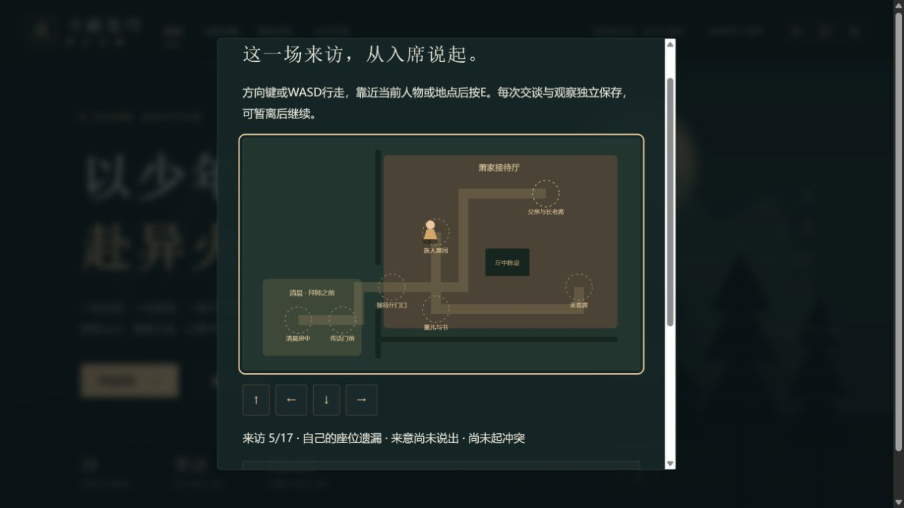
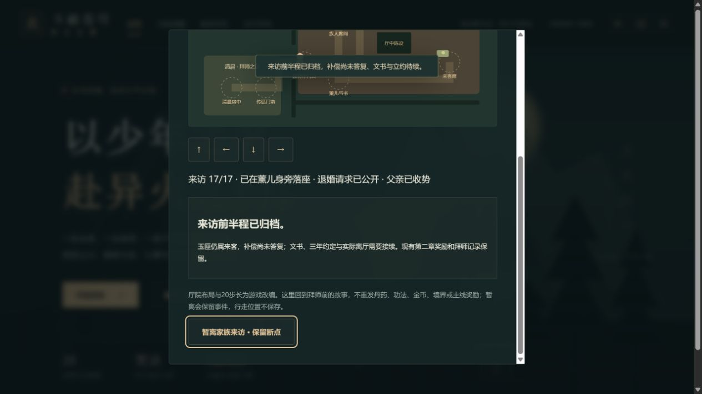

# C1g-1 家族来访前半程验收

日期：2026-10-12；运行版0.38.0。任务与来源边界见《C1g家族来访与立约任务卡.md》。本批只到前半程归档，完整文书、约定、离厅、后山过程接续；旧第2章概要/首通不被倒退或重奖。

独立状态保存17步，全部派生字段严格组合校验，完整快照防重复/过期；站位38范围、当前人物/操作强校。墙面、门洞和陈设限制移动，所有当前目标经行走网格可达。来访不需拜师后重修started，旧档只补未参与；新版缺字段与有记录但缺第2章首通拒绝。上限1隐藏入口、场景人物/标题/摘要。

完整检查为111文件691项Vitest+11项Node，含17个合法断点JSON/自动/手动/上一份备份往返、错地点/人/操作、两种拒绝、非法阶段/字段/前置/旧迁移、防剧透与store仅写一次且runtime不变。三难度早期全规则链纳入来访并继续28章。类型与生产构建/预算/完整清单通过：72文件1750091字节、初始489861/gzip159270、总JS1639732、引擎gzip173298按需；固定门槛保持。

真实网页使用4185/tab18此前通过正常导入创建的普通28章副本，原0.37.6完整下载在改版刷新前保留。修炼手札→重修往事→新来访入口0/17，重修仍未接。清晨E后沿原生方向键走传话处、门洞入厅；台前行礼再找座，5/17遗漏已保存/下载/刷新后入口恢复。

实际x220/y170向右被墙挡在原位，远处E不推进且行礼按钮禁用。走父亲处问座→族人席听薰儿邀请7/17仍missing，再走薰儿处落座8才shared；回顾/观察来客衣袖/回薰儿认身份再回客席。12尝试代父应允被拒，仍12且请求未公开；正常E公开请求→父亲处观察戒备14，已保存/下载/刷新，仍raised且无战斗或箱物。

重返父亲处制止15才withdrawn，实际走客席尝试直接收匣被拒且15保持；正常观察16才画玉匣。下载与刷新16保持，玉匣仍在客席，不加行囊。随后原生方向按钮经门洞返门，E归档17。退出时焦点回原来访入口；完成与刷新后两个真实下载由官方parseSave在浏览器外核验，整个state全同。

全部六下载文件不经编辑，副本保留`.git/task-family-*-export.json`，输入SHA256与官方比较结果见`qa/c1g-family-visit.json`。原0.37.6迁移只有contentVersion更新及空familyVisit，所有后续文件只改这一新记录；18718金币/14470积累、主线28章、库存与全部其他扩展/偏好保持。三个手动槽仍空，未写手动槽；上一份自动备份为16展示未归档。该原旅途伙伴0/24和重修未接取也保持，不拿别的终局24页档代签。

两图已实际查看：第一张显示厅中位置/缺座状态，下一场父亲回应位于下方，不以图代签其内容；第二张显示17/17、玉匣仍属来客与待续文书，地图上半部在滚动区外。完整场景和刷新另外由DOM与下载证明。该标签本轮控制台error=[]。

未注入存储/运行态/坐标/时钟，未覆盖旧手动档，未宣称实体设备、中文正版/动画精确定位或公开部署。下一批按完整可用6–7正文做补偿答复、条件和独立文书，之后8–9后山拜师；来源受限则保持缺口并推进不依赖它的其他任务。全周期仍开放，续办保持有效。
