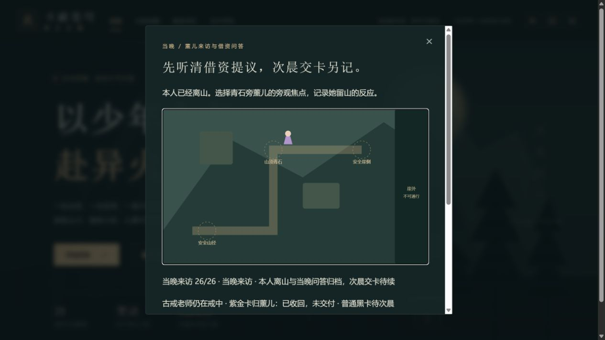

# C1g-4a 当晚来访与借资问答

2026-10-12；0.45.0。沿已实际完整读取至NEXT11的合法英译10；中文正版/动画精确映射仍待核。程序地图、短对白与方向操作为改编。

26步可玩：确认薰儿/观察信心/问候与本人回应/当时评价、本人实际近身/童年回顾/歉意与回应、资金问答/短缺与提议、薰儿展示自己五纹紫金卡/说明、足够/日后归还与不必还回应/收卡、次日邀请/挥手/实际走山径下山/离山、薰儿留山旁观与归档。当晚不交普通黑卡、不发资金/境界/关系/胜利、不清旧独立账本。

独立mountainVisitor introducedVersion0.45，前置preparationBrief20和第2章首通/可见。旧0.44补空，新增版缺字段拒绝；整快照、所有派生字段、人物/操作/距离/位置/视角/重复均校验。本人离山后仅旁观焦点可继续，不让本人返回代签；刷新清空位置和焦点。老师不再出戒，同戒佩戴与旧准备链保持。

完整check：118文件728Vitest+11Node、类型、三难度早期全链/28章回放、生产构建/完整性通过。81文件1856820字节，初始496472/gzip161513，总JS1741997，enginegzip173298按需；固定预算不提高。26断点JSON/自动/手动/备份、旧迁移、新版缺字段、防剧透1、所有错序/快照/位置/视角、五种越界拒绝、store零写/单次写/runtime保持已核。已接取/借资/主药购买旧账回补全26步，其他state全同。

真实4185普通28副本从手札完成0→26。8本人致歉未回应、13提议未到账、14紫金卡展示、19收卡、22下山未离、23本人已离/旁观未选焦点、26归档七处正常入口刷新。远处E不推进；崖侧问候后走青石，最后走山径；离山后地图无本人和方向按钮，未选旁观焦点E及目送按钮均不能推进，显式选焦点才记录。返回焦点正确，准备20历史摘要跟随归档更新。

实际尝试五种越界选项均拒绝；当晚领款13、取紫金卡14、清旧账18三组前后真实下载整state相同。13份含旧0.44基线的原下载由官方SSR parseSave在浏览器外核：除mountainVisitor与版本外所有state不变，最终刷新整state全同。SHA256和路径见qa/c1g-mountain-visitor.json，本地脚本/原文件副本.git/task-visitor-*，没有改下载或注入存储/位置/时钟。18718金币/14470积累/28章/原全部事件和准备started=false保持，三个手动槽空，上一份自动25仍待归档，页面error=[]。

截图实际查看，显示26归档、普通黑卡待次晨与仅薰儿留山地图。另存14持卡图qa/c1g-visitor-purple.png，实际查看时地图顶部受模态滚动裁切；持卡原属另由DOM、SSR和原下载核，不冒称全图完整可见。

前批c846e3f1df88ab5bc8c4056b2a93e8df9fafa4a4远端一致，Game checks38210949670 success、Pages38210949617 skipped。自动接4b晨间普通黑卡和唯一160旧折算账本事务，再接药铺两药/木核仍缺；本批不签晨间已完成。中文/动画、51/1277、其他人物全包、历史回退、死亡末帧、真机/后台/Beta/授权/公网全周期门槛继续开放。
