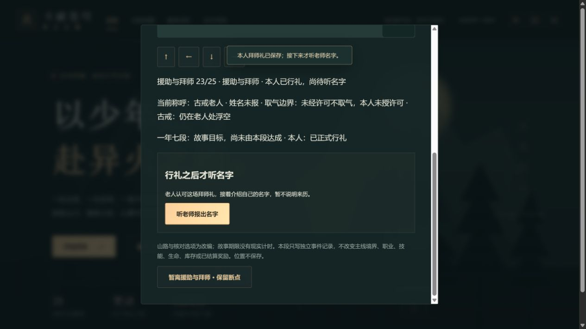
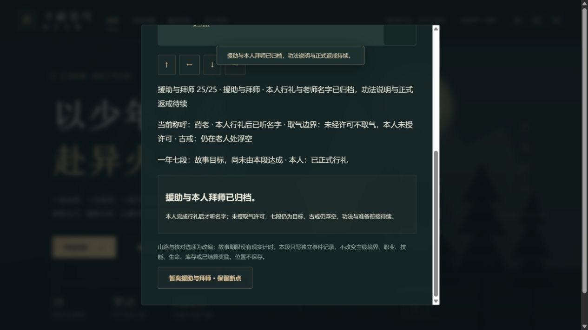

# C1g-3b 援助谈判与本人拜师

2026-10-12；0.42.0。沿已核英译8/9过程，新增原创短摘要和25个可操作断点。中文正版/动画集数时间点继续待核，本批不新增已核来源声明。

许可边界承诺、变强询问/本人自主回应、一年七段目标、面对差距/请求方案/暂不明确答复、本人条件/老人回应/诚意/援助答复、炼药提议/资质询问与回应、老师资格询问与确认/品阶询问与未说明、本人愿学、青石前要求/本人疑问/坚持、本人实际行礼、其后听名字、归档分别保存。一年故事目标独立于已保存三年赴约，不现实计时；资质不授职业，愿学不代行礼，行礼23仍unknown、24才yaolao，古戒仍浮空。五错误选择可见且拒绝，不授取气许可、七段结果、职业、免行礼或提前佩戴。

apprentice introducedVersion0.42，mountainRing21/第2章首通与可见前置；stage与12个派生字段逐项校验，人物/整快照/有效位置与38接近距离/顺序/重复强校。旧0.41仅补空，不清准备、主线技能或结算。只改新记录，runtime保留。

共享MountainWalkMap从3a提取：20步/原障碍/方向或WASD/E和按钮操作保持；从安全崖侧实际走青石，要求时老人坐在青石旁，礼成独立标记，名字听到后才显示药老。旧3a标明“本段当时记录”，摘要随后续进度更新，避免把当前承诺误显示为仍未答复。

115文件713Vitest+11Node、类型、生产构建和清单完整性通过。覆盖25断点JSON/自动/手动/上一份备份、旧迁移/新缺字段、全部派生值互换/非法阶段/前置、所有快照字段/人物/错序/远处/五拒绝/重复、匿名与具名UI、上限1封存、共享地图回归、三难度完整早期链与28章回放。首次全检有两条新增摘要断言失败，修正摘要使归档明确返戒待续，完整重跑通过。78文件1814327字节，初始493462/gzip160569，总JS1701117，enginegzip173298按需；固定预算未提高。

真实4185/tab18沿原普通28副本，从手札入口0→25。初始按钮禁用且E不能远处推进；方向走崖侧才听承诺。1/4/14/19/23/24/25均真下载刷新由普通入口重入，再实际行走恢复。愿学19在崖侧不能听青石要求；22实际走回崖侧本人礼成按钮禁用/E不推进，走回青石才可本人行礼。23仍显示古戒老人/姓名未报，之后实际听名字24才药老；完成仍古戒浮空。

误授许可1和跳礼22各有拒绝前后真下载，整个state完全相同。提前七段4、资质变职业14、提前佩戴24均真实拒绝；不以缺少对应拒绝前文件声称三者整state双文件已核。最终25两份刷新前后整个state相同。十二文件含旧0.41基线，官方SSR parseSave在浏览器外核迁移与所有其他字段保持，原下载未改，SHA256见`qa/c1g-apprentice.json`；脚本与副本在.git/task-apprentice-*。

金币18718、积累14470、28章、伙伴0/24、17/15/33/21旧记录、重修未接取和所有其他state保持；三个手动槽仍空，上一份自动24待归档；新页面控制台error=[]。

两图实际查看，显示断点/当前称呼/边界/归档与待续说明，地图上部在视窗外，地图行走由原生操作和DOM另核，不以图代签未显示区域。

前批87b8acde8682e81785dfd58eed04fcbf7affe4bf远端完整SHA一致，Game checks38207356825 success、Pages38207356789 skipped。自动接C1g-3c基础/火属性与斗者前置、未来功法进化说明/本人追问但未授、三类准备单、老师返戒、紫衣来人/借资入口；不调用旧准备接取重发，不清旧准备链，不新增400/扣1000。中文/动画、51/1277、完整人物、历史回退、死亡末帧、真实设备/后台/Beta/授权与公网发行继续开放。
