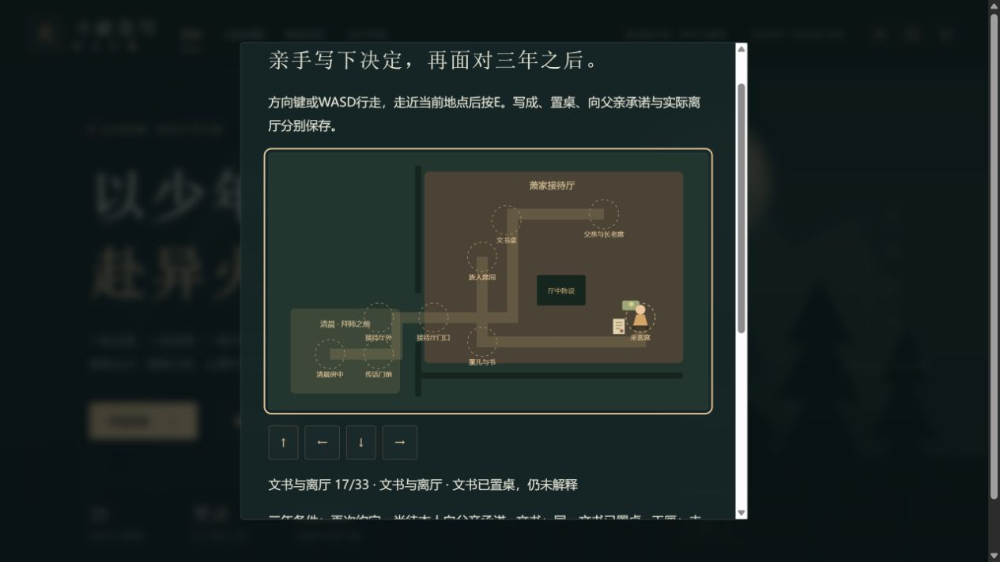
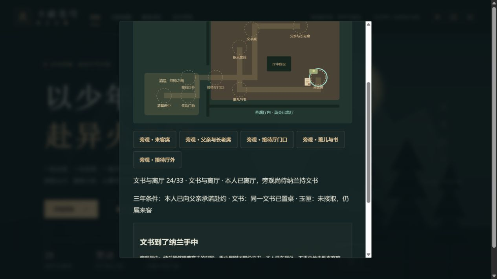
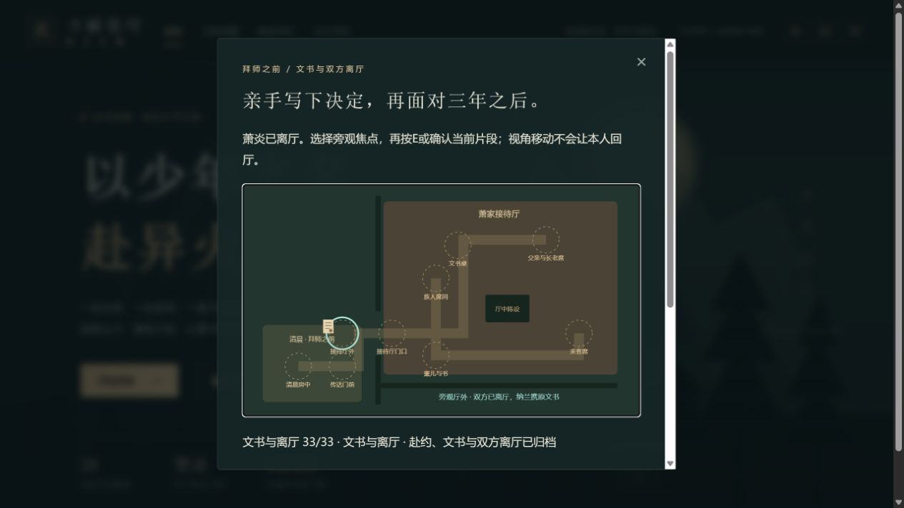

# C1g-2b 文书、本人承诺与双方离厅

2026-10-12；运行0.40.0。依据前批已完整核读的授权英译7，完成33步可玩会谈后段；中文正版章次和动画定位继续待核。短摘要、地图布局、核对选项均为游戏改编，不复制长对白或使用来源图片。

独立familyContract记录情绪、青年拔剑/父亲喝止、三年提议/再次约定/本人向父亲承诺、拒绝婚约、同一文书准备/写成/抽象印记/置桌/纳兰持有、本人离厅、父亲退匣/葛叶收回纳戒、薰儿提醒/短暂迹象与来客离厅。文书没有交父亲；父亲接的是本人致意与承诺。未来条件不提前启动决斗或登记胜负；同一玉匣没有加入行囊。印记不提供伤害输入或扣生命。

前24步由本人实际行走；离厅步骤须越过原门洞到厅外，门内270/270不能签离厅。24之后隐藏本人标记和方向按钮，只能选旁观焦点确认他人事件，焦点切换不变更存档。文书置桌后先仍在桌上，25才由纳兰持有；28退匣未入戒，29才回纳戒；31短暂迹象仍未离厅，32才来客离厅，33归档。来客离厅后文书图标在厅外，不残留客席；备纸尚无成文时不绘字迹。原来访/交涉是历史记录，字段保留，归档文字和摘要随新记录更新，避免继续称当前本人在厅或文书待续。

introducedVersion0.40.0，不增schema。0.39旧档只增加空familyContract并更新版本；新版缺字段拒绝。stage与全部派生组合、交涉15前置、整快照/人物/位置/视角/次序及重复强校。上限1封存入口、标题、人物和整个摘要；旧主线、库存、生命、技能、奖励与其他早期记录不变。

113文件702Vitest+11Node全检通过，33合法断点JSON/自动/手动/备份往返、派生值互换、旧迁移、缺字段/前置、四种越界选项、错视角/焦点、重复、墙/陈设及全地点可达、store零写/合法单写/runtime保持通过。三难度完整早期规则链含新33步，再完整28章回放。最后地图物品表现修正后3文件16项和类型/生产完整性再次通过；最终75文件1782718字节、entry491597/gzip159940、总JS1670894、enginegzip173298按需，固定预算未提高。

真实4185/tab18沿此前普通28章、来访17和交涉15副本正常入口0→33，没有先接重修。方向键/E与按钮实际行走，7提议、15写成、17置桌未解释、22亲口承诺未离厅、24本人离厅、28退匣未入戒、33归档均真正下载并刷新从正常入口恢复。7提前决斗/胜利两误选下载与拒绝前整个state全同；19错误交父文书、27错误收匣各见拒绝且阶段不变。23本人270/270门内按钮禁用且E无推进；四次左行至190/270后才离厅并自动切旁观。24刷新后错误焦点E和方向不推进；转客席后才确认同一文书由纳兰持有。

本人22承诺后仍在厅、24离厅但文书仍桌上、28退匣但未入戒、29不再画客席玉匣、32来客离厅但未归档均实际页面核对。完成退出焦点返回原入口；回看来访17和交涉15显示当时与后续归档，原物不会重新出现在客席。三个手动槽仍空；备份32来客离厅待归档。未覆盖任何手动档。

十二份真实文件含旧0.39基线、0.40初始和各断点/拒绝/两刷新；官方SSR parseSave在浏览器外核全state，公开摘要qa/c1g-family-contract.json保留原SHA256，副本及脚本在.git/task-contract-*。除新记录和版本外全部state相同，18718金币/14470积累、28章/伙伴0/24/重修未接、原17/15和全部库存不变。归档、刷新及最后表现修正后的第三次下载整个state完全相同；本批新控制台error=[]。

三图均实际查看。24图地图上部/说明按钮位于滚动区外，不能只用截图代签全部地图；实际行走、拒绝与断点由DOM、UI输入与真正下载核验。最终图显示33归档、厅外文书和无客席玉匣；归属完整文字由DOM核对。

098bb9e4d6864079211ba038b203dbf613161838已推送，Game checks38204580936 success、Pages38204580876 skipped。本批交付之后立即接C1g-3a独立后山/声音/戒指归属与承认，不将这里或现有第2章概要签为完整拜师。中文/动画、51/1277、完整人物、死亡末帧/历史回退、真机/后台/Beta与授权/公网门槛保持开放，自动续办继续有效。
