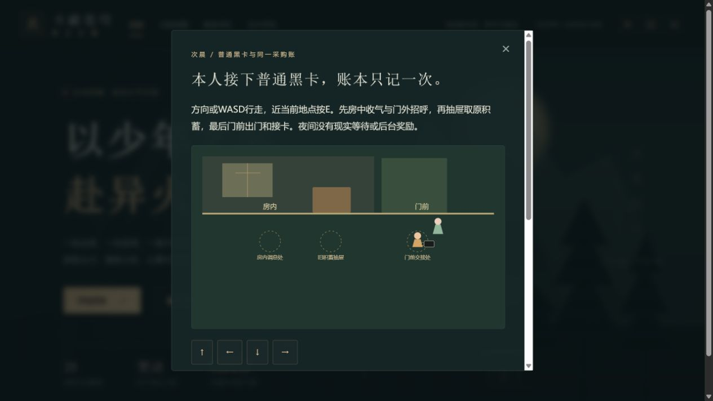

# C1g-4b1 晨间普通黑卡与唯一采购账

2026-10-12；0.46.0。本轮再次完整读取浏览器tab20英译10正文至NEXT11。房中收气/感受/起身、门外招呼、取原积蓄、实际出门、薰儿递卡和本人接卡依正文顺序；中文正版与动画精确映射待核。青年外貌及身体描写省略，采用原创短对白/房门图/方向操作。

14步可玩，三个地点本人实际行走：房内调息处、积蓄抽屉、门前交接。旧积蓄只记历史，不派400；老师仍在戒中，薰儿晨间浅绿衣。普通黑卡与当晚紫金卡分开：8递出尚由薰儿持有，9本人接同一卡才变归属；普通卡容量不派5000，也不授境界。接卡后双方对同行邀请的回应和出门准备各自存，14归档仍“实际入城/采购待续”。

独立morningCard introducedVersion0.46，前置当晚26与第2章首通/可见，旧0.45补空；所有派生字段/整快照/人物/操作/有效坐标/38近距/started/borrowed/spent快照校验。资金衔接字段pending只可在9以前；9以后必须credited或existing且started=true/borrowed160，漏记资金的已接卡存档拒绝。若未接取准备单，8接卡拒绝，页面需本人明确“记下重修准备”再接卡；接取沿原唯一入口，不自动回滚或重发章节奖励。

9本人接卡与借资在同一个store.update存档事务处理：旧borrowed0才唯一折算160；旧borrowed160/已经花款/材料和药液耗尽只补existing历史。四个错误选项拒绝原积蓄派钱、普通卡冒充紫金卡、按容量领5000和复原已用材料；旧简略接取/借资路线保持可达，不强制旧玩家重修全部前段。

119文件734Vitest+11Node完整check、类型/三难度早期全链/28章回放/生产完整性通过；82文件1872166字节，初始497349/gzip161761，总JS1756832，enginegzip173298按需，固定预算未提高。14断点JSON/自动/手动/上一份备份、未领取/已领取/主药已付/药液耗尽迁移与回补、全部派生变造/账本快照/重复/远位/防剧透1、store一次同时写接卡与160/重复零写/runtime保持均通过。首次类型检查时集成脚本因系统Python不可用未执行，补齐集成后完整check重新通过，没有把失败当通过。

真实4185普通28副本从0到14，5门外招呼/6取积蓄/7出门/8递卡和准备单/9本人接卡唯一160/10容量说明/12回应/14归档均由正常入口刷新恢复；远处E不推进。8未接取时接卡按钮disabled，正常明确接取后仍8与0款，独立接卡才9与160。四错误选项均实际拒绝，每组真实前后下载整state全同。最终刷新和终页“查看既有准备路线”导航两份下载均与14整state全同，返回入口焦点正确、旧晚摘要随晨间记录更新。

真实4187独立分支原生导入4185的8接取后下载（原文件未改），通过旧合法按钮借160/买主药30，形成旧已领且已付档。回晨卡本人接卡9→14→刷新全过程只改晨间历史，借资160/已付30/余130/主药收据与三株库存保持，不再发160。耗尽药液属于合法规则回补测试，本轮没有将它声称为新真实网页耗尽分支。

20份真实下载含旧0.45基线，官方SSR parseSave浏览器外核，原文件未改、无内部存储/位置/时钟注入。唯一允许的其他变更是明确接取started=true及本人接卡时borrowed160；独立旧账分支另有原借资与主药30实际订单。原全部事件、18718金币/14470积累/28章/伙伴0与24均保持；三个手动槽空，主档上一份自动13保留，新页面两分支error=[]。SHA256见qa/c1g-morning-card.json，脚本/原副本.git/task-morning-*。

图已实际查看：门前两个人、浅绿衣和本人持普通黑卡；归档与账本在模态下方，另由DOM和原下载核。某次多段浏览器操作超过工具30秒而重置会话，按实际页面/已下载文件恢复继续，未重复写档或制造完成证据。

0.45完整SHA d8b19a38cf7ac3000912e6777b55646d89f4d9ac远端一致，Game checks38212890173 success、Pages38212890134 skipped。自动接C1g-4b2实际同行离族/入城/两种药草年份历史与唯一原30/20收据衔接、木核仍缺，不能在此归档代签药铺完成。中文/动画、51/1277、其他人物、历史回退、死亡末帧、真机/后台/Beta/授权/公开发行全周期门槛继续开放。
