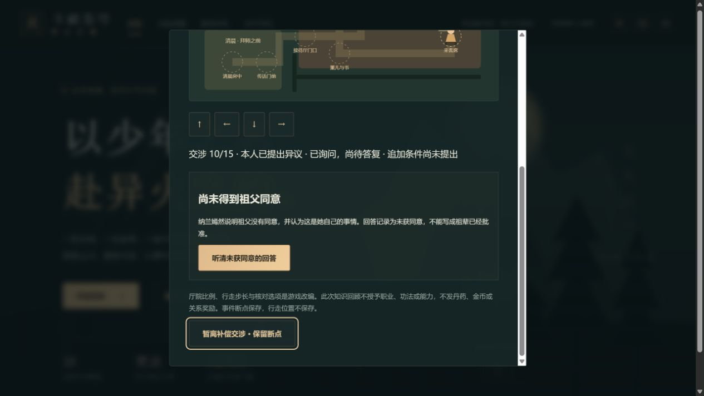
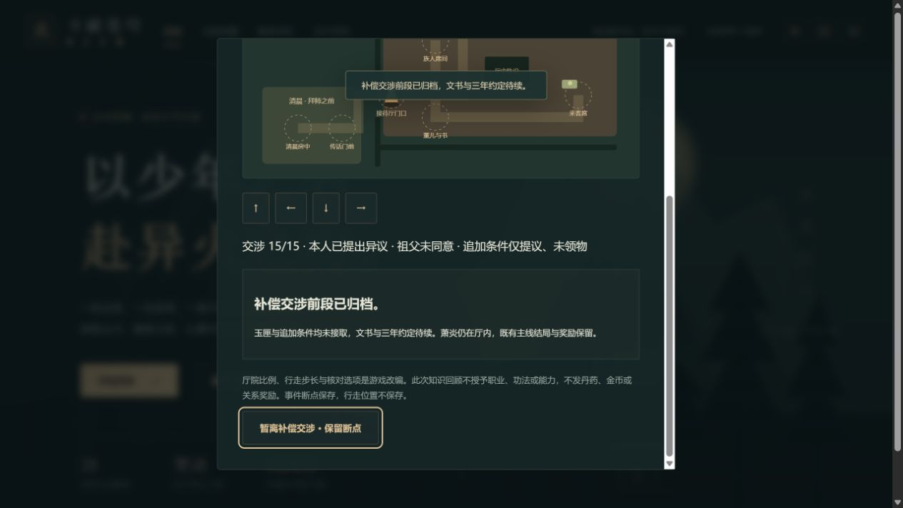

# C1g-2a 补偿交涉前段验收

日期：2026-10-12；运行0.39.0。继来访17步后，补15步交涉；来源见任务卡，本轮英译6、7均返回完整正文至 NEXT CHAPTER。本批只实施6章范围；7章文书、三年条件与离厅/退匣实际过程继续开发，中文正版/动画对应独立待核。

独立familyCompensation记录丹药说明、知识、古河、本人异议、长老状态、祖辈同意问答、追加提议与边界核对。未接拜师后重修也可做；必须已有来访17归档。旧0.38只补空字段，新版缺字段/任意非法阶段/派生字段组合/缺前半程拒绝。全快照、地点/当前角色/操作防过期与重复；提前领取三枚、入宗学功法、读说明获得职业各有拒绝反馈，不发奖/物、不改库存或主线。

厅院SVG、方向/E/四方向按钮复用同一地图组件，保留墙/门洞/陈设、20步长与38接近距离。旧来访记录字段不变，归档画面和存档摘要随着后续交涉更新，避免后续已发言仍称当前尚未答复。上限1隐藏标题、人物与全部交涉入口/摘要。

112文件696Vitest+11Node、15合法断点JSON/自动/手动/备份往返、旧迁移/缺字段/非法组合/前置/错人错序远位/三拒绝/重复/剧透与store零写或一次写/runtime保持通过。三难度完整早期规则链包含新交涉，再完整28章规则回放。类型、生产构建/预算/完整清单通过：74文件1762582字节、初始490644/gzip159595、总JS1651355、引擎gzip173298按需；门槛未提高。

真实网页沿4185/tab18上一批正常来访17且普通28首通副本接续，0.38完整下载留存。加载0.39先回旧来访地图按方向，实际位置100/330→120/330、E不重登，17/17和玉匣/归档保持，再从正常入口进交涉0/15。远处E不推进，走近客席后观察丹药；1/15把读知识算已获职业被拒，随后正确记知识/古河，再实际走父亲处看长老，回薰儿处提出异议。

实际走到父亲处听阻拦、回薰儿处本人回应7，保存/下载/刷新仍blocking，未由刷新提前使长老落座。靠近薰儿才8支持/长老坐回，再走父亲处9行礼，最后走客席10本人询问。10询问但未答复保存/下载/刷新保持asked；纳兰下一步回答11才not-given，之后本人祖辈立场及追加条件13各自推进。

13追加三枚/入宗提议保存/下载/刷新保持offered且未领取。真实误选领三枚、入宗学功法各被拒，13不变；拒绝后的下载经官方parseSave与拒绝前整个state全同。重新从正常入口实际走客席，正确核对14，再方向键返门E归档15；退出焦点回交涉入口。

回看原来访17归档画面，明确“当时玉匣仅展示；后续交涉已归档”，不是倒退旧记录。完成/刷新两次真下载整个state全同；三个手动槽仍空，未写任何手动槽，上一份自动档是14核提议未领取待归档。旧28章首通、来访17、18718金币/14470积累、库存/技能/伙伴0/24/重修未接与全部其他状态保持。

七文件含一份旧0.38真下载与六份0.39新下载，未经编辑；副本`.git/task-compensation-*-export.json`、官方SSR校验脚本与公开摘要`qa/c1g-family-compensation.json`保存原文件SHA256。迁移只增加空familyCompensation并更新contentVersion，后续只改新交涉；新控制台error=[]。

两图均实际查看：前图显示10只问未答及下一场回答按钮，不能以该段未确认叙述代签11；后图显示15归档、玉匣与追加条件未接取及文书待续，地图上半部在滚动区外，完整行走由DOM和实际输入另核。

没有浏览器存储/位置/时钟注入或fixture跳章，没有旧手动档覆盖、真实设备/正片精确定位/公开部署声称。399f190b1a1aa5e7a9e12e3750cb8b2105f71212远端ref一致，Game checks38203391492 success，Pages38203391475 skipped。下一批C1g-2b细单已写，继续本人发怒/制止、三年条件、独立文书、赴约承诺及离厅/退匣；全部完整人物和来源/设备/Beta/公网门槛保持开放。
