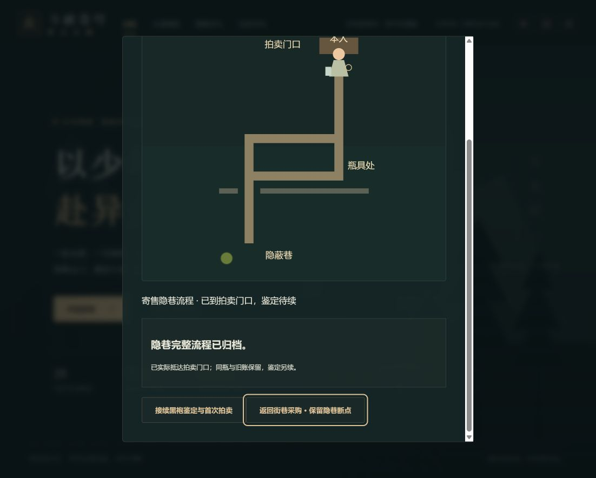
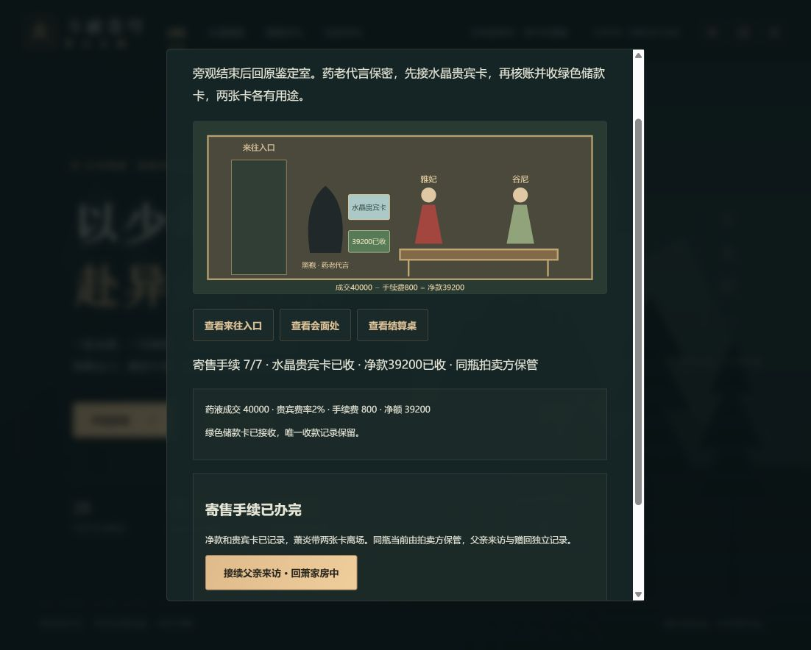
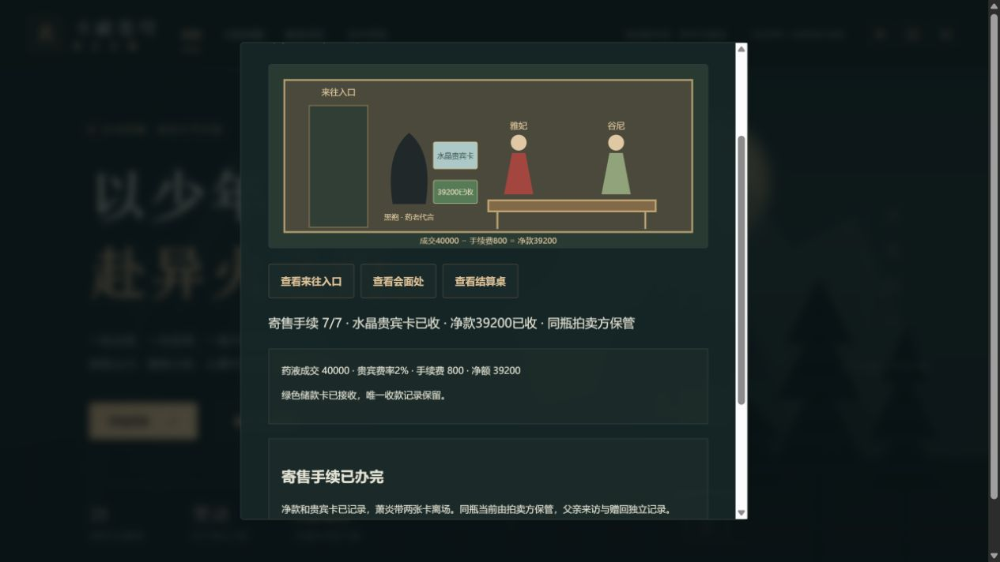

# C1h寄售完整衔接验收 / 0.93.1

2026-10-15。实际缺口：0.93.0隐巷归档后只有返回采购，玩家需退出多层窗口到院落重新选择已有鉴定。现在归档页可直接接续黑袍鉴定，沿原鉴定8步→首拍7步→寄售手续7步连续完成。回调由原路线负责前置校验、转场与返回焦点，未复制机制、存档历史、玉瓶或奖励。

本轮重新实际读取Wuxiaworld英文21–24正文及章末导航，详《C1h鉴定与首拍完整流程任务卡.md》分章表。更正此前宽泛表述：21只到黑卡与离开鉴定室，竞价在22，功法卷成交在23，贵宾卡与收款在24；39200是按正文40000与2%计算。没有据此填写中文章号或当前年番集数。此前21读取记录缺少可复核输出，本轮重新核实，私有材料是事实摘记，不能称作正文原件。

两个既有合法隐巷档分别通过键盘Enter和鼠标按钮执行全部22步，没有导入人工构造状态。25份本轮原生下载由官方解析器核验，并与实际鉴定/拍卖/手续API完整回放相等。独立允许变化校验仅准许三个原记录及同瓶owner变化；主线28章、金币、行囊、备料90减50、原自用药液耗尽与细分历史全部保持。40000报价时尚未成交，落槌时尚未收款；核账与接卡分开，只有接绿色卡后为39200。完成后重开及回看隐巷再按E，整个持久状态仍与完成时相等。

23个完整dialog刷新对照相等、正常检查点控制台error为空；两个分支退出手续后均准确回焦“回鉴定室 · 贵宾卡与寄售收款”，键盘Enter或按钮重开保持完成记录。另保留1个助手选错路由的失败：新增alley复验传给旧助手，被旧助手的“非鉴定即拍卖”分支打开拍卖窗口，不能计作窗口相等；直接重开隐巷后完整窗口一致，失败原记录未删除或冒签成功。生产路由与原生状态没有在此失败中改变。首次新增集成测试的备份envelope遗漏game标识被官方解析拒绝，改用官方serializeSave后通过，没有放宽生产解析。

类型、173文件1067项Vitest、20项Node、三难度早期与28章、四槽及上一档、生产构建和发行完整性全部通过。142份core源码与实际0.93.0逐字相等（统一换行后），用该提交全部旧core/版本源码与749份不可改写原生旧档比较，新解析整state只变版本至0.93.1。未增加迁移旗标或改变schema。

固定预算500000 / 165000 gzip / 1850000不变；最终474921 / 163256 / 1848372，余25079 / 1744 / 1628。64场景模块、67载荷、889行完整，3个自有文本模块保持；153发行文件2019239字节。没有因本批再做容量版本或删剧情。提交后正式SHA绑定、远端与CI另行核对，不用提交前清单冒称最终发行包。

机器证据：[qa/c1h-sale-chain-0931.json](qa/c1h-sale-chain-0931.json)。25原件追加元数据749→774；本批迁移/证明写入器随交付冻结，不重跑到扩大的原件列表。提交后另取原生备份，单独追加，不覆盖旧证明。

正式交付补证（2026-10-15）：完整提交58c685950242cf4fbdf6f5c5070f35b157186a72与远端一致；逐项查询Game checks38666929939为success、Pages38666929819为skipped。提交后生产清单绑定该SHA；正常刷新后的隐巷整dialog相同、error=[]，第26份原生导出由官方parseSave核对原文及此前最终整state全同。只追加该份元数据774→775，私有交付回执`.git/task-sale-chain-0931-delivery.json`；本批全部写入器冻结。

以下三图均已实际查看，是桌面浏览器证据：

首次寄售从方案到离房、采购、隐巷、鉴定、首拍与收款的当前链已形成连续玩法；不继续为原来正确的八步/七步另造历史。后续直接进入固定28章覆盖与C0/C11收尾清单，不将父亲赠回、全部早期逐句演出或其他支线再次无限切批。正文/动画剩余核验、51/1277资料、已知运行问题、设备/Beta/许可/公开发行与回滚仍分别追踪；本批不关闭这些门槛。
